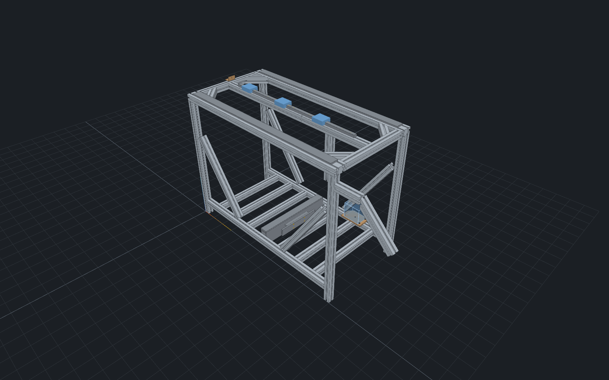

# AluKit

Plan builds made from catalog parts, starting with aluminium T-slot extrusion, in the browser.

You lay out a frame in 3D and AluKit derives what you need to build it: the **cut list**, a
priced **bill of materials**, the machining on each bar, an **order list** per supplier that tells
you when it is not ready to send, and a **GLB** of the model. Everything comes from one JSON
document, so the same project can be edited by hand, in the browser, or by an agent through the
CLI.



*The synthetic cart project in [`tests/fixtures/cart`](tests/fixtures/cart), rendered by
`alukit snapshot`.*

AluKit runs locally: a small Node server with the app in your browser, and no hosting. Your
projects live in folders you choose and are never part of this repository.

## Quickstart

You need Node 26 (see `.nvmrc`) and pnpm 12. Node 26 does not ship Corepack, so install pnpm
yourself.

```sh
git clone https://github.com/marciogranzotto/alukit.git && cd alukit
nvm install && nvm use                     # Node from .nvmrc
npm install -g pnpm@12.23.0                # the version in package.json's packageManager
pnpm install --frozen-lockfile
pnpm build                                 # the app, once; `alukit serve` and `snapshot` need it
alias alukit="node $PWD/src/cli/main.ts"   # the CLI runs from the sources, with no build step
```

Make a project in a folder of your own, using the built-in Forseti catalog, and open it:

```sh
alukit new ~/frames/my-frame --name "My frame" --catalog forseti --currency BRL
alukit serve ~/frames/my-frame             # prints http://127.0.0.1:<port>/#t=<token> and opens it
```

(`ALUKIT_PROJECT=~/frames/my-frame pnpm dev` does the same inside Vite's dev server, with hot
reload, and prints the address with its token.)

The empty project opens with a start card over the 3D view and three ways in:

- **A box frame**: type its width, depth and height and press **Make the frame**: four posts, a
  base and a top ring, every corner butted, in one step. The form shows the cut lengths first.
- **Draw the first bar**: pick a size (40 × 40), the profile and its finish, and press **Start
  drawing**. That profile becomes the project's default bar and the draw tool is on. Click a
  start point, type a length and press Enter (or click the end). Draw a leg, then a rail onto its
  top: before you click, the preview by the end says what the joint will do ("will butt on b1 ·
  cut 580 · b1 800 → 820"), and `Tab` flips which bar runs through.
- **Load the example**: the skill's work table, as one step.

If the catalogs you named sell no profile, the card says so, and **Add one in Project settings**
lists the built-in catalogs with an **Add** button each. Press `?` for every key; see the
[guide](docs/guide.md) for the layout and the tools.

Everything you make stays editable in the 3D view, each change one step that `Ctrl/Cmd+Z` takes
back and that the CLI would make with the same commands:

- **Select** by click, a box (left to right: what is inside; right to left: what it touches), a
  tag's heading in the outline, `Ctrl/Cmd+A`, or the menu's similar, tagged and connected; **hide**
  (`H`), **isolate** (`Shift+H`) and **show all** (`Alt+H`); the selection's size in the status bar.
- **Right-click** anything (or `Shift+F10`) for a menu of what you can do to it, with the keys.
- **Move** (`D`) and **Rotate** (`Q`) by dragging or by typed values, joined ends following;
  **Duplicate** (`Ctrl/Cmd+D`, with `4x` or `/4` for more), **Copy** and **Paste**, **Mirror** and
  **Align to a face** from the menu.
- **Bars**: drag an end, or type a length (`=W` binds a param, from either end or the middle); set
  each end's cut, extension and where it stops; offset, anchor and roll; **split**, **reverse**,
  and **holes** on a face; fields shared by several bars at once.
- **Joints, patterns and parts**: every connection's fields, a face joint's bolts and stations, a
  corner's butt, mitre or splice; a live pattern's pitch and count, or explode it; replace a part,
  move it along its bar or into a groove.

Read what you drew from a terminal, while the server runs or not:

```sh
alukit check  ~/frames/my-frame            # errors and warnings; exit 1 on an error
alukit cutlist ~/frames/my-frame           # every piece, its length and its end cuts
alukit bom    ~/frames/my-frame            # items, quantities and mass
alukit order  ~/frames/my-frame            # per supplier: READY or BLOCKED, and why
alukit export glb ~/frames/my-frame -o my-frame.glb
```

`alukit order` exits 1 while any supplier is blocked (a missing price, an open item, a
placeholder, an estimated price), so an unfinished order cannot slip through a script. Every
output takes `--format md|csv|json`. A project to try all of this on is
[`tests/fixtures/cart`](tests/fixtures/cart): `alukit order tests/fixtures/cart`.

## The CLI at a glance

Every command takes the project folder first. `--json` gives machine output on the commands that
support it; `alukit --help` and `alukit <command> --help` list the options.

| Command | Does |
|---|---|
| `new <dir>` | create a project: the document, its lock and a `.gitignore` line for `.alukit/` |
| `serve <dir>` | run the project's server and open the app; edits from tabs and the CLI go through it |
| `do <dir> '<json>'` | apply a batch of commands atomically (also `-f file` or `-` for stdin); `--dry-run` says what the step would do and writes nothing |
| `add bar\|point\|connection\|part\|frame <dir>` | one entity, or a box frame in one step, as sugar over `do` |
| `query <dir> <selector>` | read entities back: `b7`, `tag:leg`, `item:forseti:PF40-01`, `connections of b2` |
| `check <dir>` | validate, derive and run the checks; exit 1 on an error |
| `problems <dir>` | the checks and the order's reasons as one list in words, each with its fixes; exit 1 when one blocks the order |
| `arrangements <dir> --at x,y,z` | at a corner, each corner rule's arrangement: which bar runs through, the cut lengths, the batch; writes nothing |
| `derive <dir> --json` | the full derived model, for report builders; `--select bars.*.cut_mm,params` keeps only what you name |
| `cutlist` `bom` `order` `costs <dir>` | the outputs; `order` exits 1 when blocked |
| `machining <dir>` | the machining sheet for the project's own plates and bent angles |
| `undo` `redo` `log <dir>` | the running server's history, across the app and the CLI |
| `fmt <dir>` | rewrite the files into canonical form (`--check` only reports) |
| `lock update <dir>` | refresh the lock from the live catalogs and show what moved |
| `diff <a> [<b>]` | compare folders, revisions, git refs or variants |
| `revision save\|list\|show\|verify` | named snapshots of the document, lock and every output |
| `snapshot <dir> -o x.png` | render a view to PNG in headless Chromium |
| `export glb <dir> -o x.glb` | the model as binary glTF |
| `catalog search <query>` | find items across the catalogs, ranked, 20 at a time (`--kind`, `--catalog`, `--limit`) |
| `catalog check\|show\|schema` | work on catalogs |
| `catalog import forseti` | rebuild `catalogs/forseti` with the importer, or say which of its inputs is missing |
| `skill install` | link the agent skill into `~/.claude/skills/alukit` |

`--variant <name>` selects a variant on every output; `--frozen` makes an item the lock does not
pin an error instead of reading it from the live catalog.

## Catalogs

A catalog is a folder of JSON: items (profiles, tubes, rails, connectors, fasteners, materials),
the sections they extrude, and the offers that say who sells them, in what lengths and for how
much. Built in:

- `forseti`: every orderable SKU of the Forseti shop, with a section for every profile stem; built
  by the importer in [`importers/forseti`](importers/forseti/README.md).
- `std`: standard steel shapes, fasteners and materials.
- `ref-hiwin`: the HIWIN HG rails and blocks that linear-rail items clone.

How `std` and `ref-hiwin` were checked is in
[`docs/notes/std-hiwin-verification.md`](docs/notes/std-hiwin-verification.md).

**Your own catalog** is a folder you name by path. Start from the synthetic one in
[`tests/fixtures/catalogs/test`](tests/fixtures/catalogs/test) (`catalog.json`, `offers.json`,
`sections/`, optional `families/` and `overrides.json`), with
[`ref-test`](tests/fixtures/catalogs/ref-test) beside it, since its carriage clones a rail block
from there, and ask the CLI for the exact shape:

```sh
mkdir -p ~/parts && cp -R tests/fixtures/catalogs/test ~/parts/my-parts
cp -R tests/fixtures/catalogs/ref-test ~/parts/ref-test && cd ~/parts
alukit catalog schema                                 # the JSON Schema of every catalog file
alukit catalog check ./my-parts --catalog ./ref-test  # computed against published values, references, offers
alukit new my-project --catalog ./my-parts --catalog ./ref-test --catalog forseti
```

Catalogs merge in layers (vendor data, your overrides, then the project), and every number keeps
its source and read date. The design has the rules, in
[§3](docs/design.md). A project that needs a part no catalog has (a plate, a bent angle, a
placeholder for something not chosen yet) declares it as a project item instead; see the
[guide](docs/guide.md#items).

## Working with agents

AluKit is built to be driven by an agent: the project is plain JSON, `alukit do` applies
validated, atomic commands, and every number the CLI prints is derived, never computed by the
agent. The skill in [`skills/alukit/SKILL.md`](skills/alukit/SKILL.md) teaches the format, the
commands and the workflow, with a worked example that a test runs.

```sh
alukit skill install      # links the skill into ~/.claude/skills/alukit
```

It refuses to replace a link that points somewhere else; `--dir <folder>` links into another
skills folder. An agent can look at what it built with `alukit snapshot <dir> --view iso -o
shot.png` (headless Chromium through Playwright; `pnpm exec playwright install chromium` once).

## Documentation

| Document | What |
|---|---|
| [`docs/guide.md`](docs/guide.md) | the user guide: the project folder, the document, drawing and editing in 3D, reading the outputs, locks, revisions |
| [`docs/design.md`](docs/design.md) | the v1 design: catalogs, the project format, the solver, the agent interface, the viewer |
| [`docs/notes/`](docs/notes/README.md) | the decisions made while building each milestone, and [where the build differs from the design](docs/notes/design-vs-built.md) |
| [`BRAINSTORM.md`](BRAINSTORM.md) | the early decisions, the ideas, the roadmap |
| [`docs/research/forseti-inventory.md`](docs/research/forseti-inventory.md) | a survey of the first vendor catalog |

## Development

```sh
nvm use && pnpm install --frozen-lockfile
pnpm exec playwright install chromium    # once, for the end-to-end tests and snapshots
```

| Script | Does |
|---|---|
| `pnpm dev` | Vite dev server with hot reload; `ALUKIT_PROJECT=<dir> pnpm dev` mounts that project's server in it |
| `pnpm build` | builds the app into `dist/` |
| `pnpm serve <dir>` | serves a project and the built app on 127.0.0.1 (a free port) |
| `pnpm test` | unit tests (Vitest) |
| `pnpm test:e2e` | end-to-end tests (Playwright, Chromium, one worker); run `pnpm build` first |
| `pnpm lint` / `pnpm format` | Biome check / format |
| `pnpm typecheck` | TypeScript, no emit |
| `pnpm skill` | regenerates the skill's command reference from the code (a test fails while it is behind) |

The gate before a change lands is: install, lint, typecheck, test, build, `test:e2e`, and
`alukit catalog check` on `forseti`, `std` and `ref-hiwin`. CI
([`.github/workflows/ci.yml`](.github/workflows/ci.yml)) runs the same steps on every push and pull
request. Internal imports use `package.json` subpath imports (`#core/*`, `#catalog/*`), which
Node, TypeScript, Vite and Vitest all resolve.

## License

[MIT](LICENSE). Use anything here as you like; keeping the copyright notice (attribution) is the
only condition.

The app bundles the IBM Plex Sans and IBM Plex Mono fonts, © IBM Corp., under the
[SIL Open Font License 1.1](src/ui/fonts/OFL.txt).
