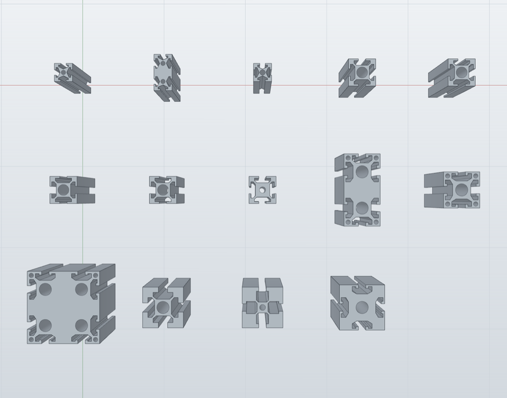
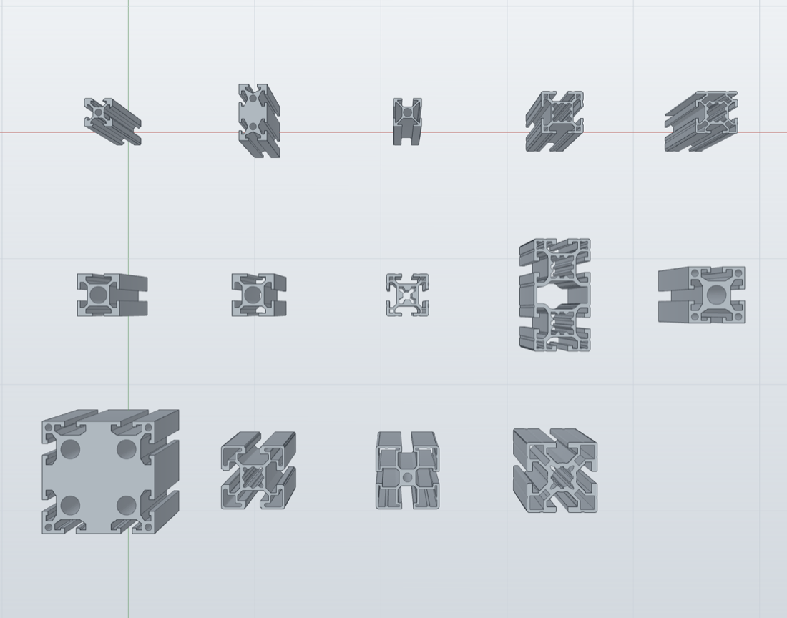

# Forseti's traced sections: real outlines from the catalogue's raster drawings

*2026-11-27. Before this change 19 of Forseti's 27 profile sections were `parametric` T-slot
envelopes: the box less its slots, with no cavities, `props_ok: false`. They now have their real
cross-sections wherever the catalogue draws one that passes a check against the published values:
**one** more vector outline, which the build had read as a raster (PF20-11, `exact`), and **eight**
traced from raster images (`traced`). Five traces fail the check and stay envelopes, with the
reason in their note; five stems have no drawing that can be traced. The design text follows
(marked *2.3*, listed in its changelog under "Forseti traced sections"; calls 63–65). Labels:
**verified** (run, with how), **read** (from the code or a document), **inferred**.*

## The method

`importers/forseti/forseti_importer/trace.py` (standard library and PyMuPDF), run by the build for
each profile in `TRACES` (`tables.py`, the reviewed table). The steps, each a standard technique:

1. **The layer.** The image's soft mask where it has one (its alpha is the drawing's coverage),
   else its grey levels, scaled so the section's fill reads 1 and the paper 0. Images with
   dimensions drawn into them (PF30-01R, PF40-03B, PF50-01) are opened by one pixel (a
   morphological opening, erosion then dilation, which removes features thinner than the
   structuring element and keeps the rest: Serra, *Image Analysis and Mathematical Morphology*,
   1982; Gonzalez & Woods, *Digital Image Processing*, ch. 9), so a dimension line touching the
   outline does not join it; the last two are cropped to the section first.
2. **The edge.** The 50 % coverage contour by marching squares with linear interpolation along each
   cell edge (the 2-D case of Lorensen & Cline's marching cubes, SIGGRAPH 1987, as
   [scikit-image's `find_contours`](https://scikit-image.org/docs/stable/api/skimage.measure.html#skimage.measure.find_contours)
   does it). Segments are oriented topologically, from the edge where the contour leaves a cell to
   the one where it enters the next, so rings close without a geometric test; a saddle cell is
   decided by its mean, as `find_contours` decides it. The largest ring is the outline; the rings
   one level inside it, larger than 4 px², its holes.
3. **Simplification.** Douglas–Peucker (Ramer, *Computer Graphics and Image Processing* 1, 1972;
   Douglas & Peucker, *Cartographica* 10, 1973) at 0.1 px, which changed no traced area by more
   than 0.06 % (**verified**), then at 0.01 mm after scaling.
4. **The stroke's margin.** A drawing outlines its material with a line, so the dark region is
   the section grown by a margin δ (half the line's weight, and the antialiasing). δ and the scale
   (x and y apart) are fitted per image by least squares to every printed dimension: an overall
   size reads its true value plus 2δ, an empty width (an opening, an undercut) minus 2δ, a lip plus
   2δ, a depth (face to floor, both edges moving the same way) unchanged. This is the distinction
   ISO 10360-7 (CMMs with imaging probing systems) draws between bidirectional and unidirectional
   lengths, for the same reason: an edge-detection bias doubles in the one and cancels in the
   other. Bores are not fitted: on the images checked against vector outlines they read 0.1 to
   0.2 mm under their printed diameters, more than δ explains.
5. **Taking it off.** The margin is removed by an exact inner offset: the outline's signed distance
   on a 0.04 mm grid in a narrow band about the edge, contoured at δ by the same marching squares
   (the offset curve as a level set of the signed distance: Osher & Fedkiw, *Level Set Methods and
   Dynamic Implicit Surfaces*, 2003). **Verified** against a polygon buffer (GEOS, through
   Shapely) on traced outlines: area within 0.001 %.
6. **Snapping.** The box is snapped to the printed overall size (it was at most 0.04 mm off), and
   each core's hole, where the page prints its bore and the trace's is within 0.5 mm of it, to the
   printed diameter (the hole's edges inside the printed circle are replaced by its arc, at 0.5°
   steps, as the generators flatten arcs). A core whose traced bore is farther off fails the trace.
7. **The section's own groove** is measured on the traced outline by `measure_groove`, as on an
   exact one (the median over its grooves), except the dimensions the page prints, which are taken
   as printed (`src`). Each measured one is an estimate with a range: the trace's uncertainty and
   the grooves' spread.

**Checked against ground truth** (**verified**). Four pages draw a raster image under the vector
outline the build already reads (PF40-00, PF40-01, PF40-03, PF45-12). Traced as above and compared
with their own vector outlines, δ came out within 0.005, 0.004, 0.011 and 0.005 mm, the areas
+0.89, −0.76, −0.24 and −1.04 % off, the inertias within 1.81 %, an inertia's error at most 2.1
times its area's (an edge's error weighs by its distance from the axis squared). Two earlier
versions failed this and were dropped: one scale for both axes, with the bores fitted (δ off by
0.015 to 0.025 mm), and calibration on the vector extension lines (the rasters sit up to half a
pixel off their own vector overlay, locally).

**Uncertainty**, stated in each section's `from.note`: ±(the margin's standard error ⊕ 0.011 mm,
the method's largest error above) overall, 0.011 to 0.013 mm; ±half a pixel locally, 0.07 to
0.15 mm.

## The check, and the tolerance

A trace becomes the section only within **2 % of the published area** (design §3.5 already said so)
and **4 % of the published inertias**, where published (call 63). 4 % because a trace's inertia
error was up to 2.1 times its area error on the ground truth, so 2 % of area allows about 4 % of
inertia; the brief's suggested 3 % and 5 % would have let through traces the design's 2 % refuses.
The published values are the catalogue's table (area, IX, IY), else the area the published mass
gives at the alloy's density, after overrides. A trace within both is `traced` with
`props_ok: true`; otherwise the section stays the envelope and its note gives the trace's errors.
The importer refuses in the build, so a wrong outline never reaches the catalog.

`alukit catalog check` judges a traced section by the same tolerance (call 63): a published area or
mass beyond 2 %, or an inertia or modulus beyond 4 %, is a mismatch and a `traced-area` or
`traced-inertia` error that no override can accept. An exact outline keeps the 1 % rule. The
computed values of a trace carry its uncertainty, so holding them to 1 % would flag every trace.

The catalogue prints IX as the inertia about the axis along the profile's long side, the weak
axis. A square profile that prints two different values (the face-plate 30x30: IX 2,58, IY 2,82)
had them in the drawing's order; with an outline, the smaller goes to the axis the outline is
weaker about (call 64). The face-plate 30x30's plate stiffens it about x, so Ix is 28 200 mm⁴ and
Iy 25 800, the reverse of before.

## Per profile

Points are the outline's and the holes' vertices. Errors against the published values; the
uncertainty overall / locally. All **verified** by the build and `alukit catalog check forseti`.

| Profile | Source | Points | Holes | Area | Ix, Iy | Uncertainty (mm) | Fidelity |
|---|---|---|---|---|---|---|---|
| PF20-11, 20x20 V-slot | vector, p. 10 | 104 | 1 | +0.60 % | +1.42 %, +1.41 % (accepted) | – | exact |
| PF20-21, 20x20 | raster, p. 10 (image 88) | 585 | 1 | −1.34 % | −0.24 %, −0.62 % | ±0.012 / ±0.13 | traced |
| PF30-01, 30x30 básico | raster, p. 13 (137) | 636 | 5 | −1.20 % | −1.27 %, −0.79 % | ±0.012 / ±0.09 | traced |
| PF30-01F, 30x30 de face | raster, p. 13 (135) | 628 | 4 | −1.11 % | −0.59 %, −0.87 % | ±0.013 / ±0.13 | traced |
| PF30-11, 30x30 centro M8 | raster, p. 12 (117) | 694 | 5 | −1.29 % | −1.11 %, −1.27 % | ±0.011 / ±0.09 | traced |
| PF40-02, 40x80 | raster, p. 17 (189) | 2037 | 7 | −0.11 % | −1.09 %, −0.58 % | ±0.012 / ±0.14 | traced |
| PF45-01, 45x45 básico | raster, p. 18 (211) | 1022 | 5 | +0.77 % | +1.47 %, +1.48 % | ±0.012 / ±0.07 | traced |
| PF45-11, 45x45 parafuso | raster, p. 19 (225) | 948 | 5 | −0.77 % | −0.71 %, −0.88 % | ±0.011 / ±0.13 | traced |
| PF50-01, 50x50 | raster, p. 20 (240) | 798 | 5 | +0.44 % (from the shop's 2,448 kg/m) | none published | ±0.012 / ±0.15 | traced |
| PF20-12, 20x40 | raster, p. 11 (109) | – | – | +3.05 % | +2.08 %, +2.16 % | – | parametric |
| PF30-01C, 30x30 de canto | raster, p. 14 (151) | – | – | −6.57 % | −7.31 %, −5.46 % | – | parametric |
| PF30-01R, 30x30 abaulado | raster, p. 15 (163) | – | – | +3.26 % | +3.23 %, +3.10 % | – | parametric |
| PF40-03B, 80x80 básico | raster, p. 20 (238) | – | – | −3.95 % | +1.90 %, +1.98 % | – | parametric |
| PF40-04, 40x40 fechado | raster, p. 17 (191) | – | – | −2.59 % | −2.43 %, −2.46 % | – | parametric |

**Worst accepted**: area −1.34 % (PF20-21), inertia +1.48 % (PF45-01). Every traced section's
mass is its published one, unchanged (the authority rule, §3.5).

**PF20-11** was read as a raster by M2b, but p. 10 draws the 20x20 V-slot as a vector path (104
segments, the page's lower half). Its outline is exact: area 164.98 mm² against the printed 1,64
cm², its core's inscribed circle Ø4.89 against the printed Ø5 (within the core rule's 0.1 mm on
the radius, §3.5), its own groove measured (opening 6.03, lip 1.79, depth 6.29, undercut 11.01,
within 0.02 of the c6-20 type's, which is measured on the 20x60 V-slot). Its
inertias are 1.4 % over the printed 0,67 cm⁴, beyond the 1 % rule, and are accepted in
`overrides.json`, with the reason; its printed mass (0,425 kg/m, where 1,64 cm² gives 0.443) stays
the accepted authority, now with the outline confirming the printed area rather than the mass.

**The five refused** stay `parametric`, each section's note ending with the trace's errors:

- **PF20-12**: its traced bores are Ø3.80 and Ø3.89 where p. 11 prints Ø5, and its area 3.05 %
  over. The image draws bores a millimetre small, or the page prints the wrong one; the trace
  cannot settle which (the shop's description says M5, the drawing M6).
- **PF30-01C** (two plates): 6.6 % short of the printed area, and the inertias 5.5 and 7.3 %. No
  margin error of the size the ground truth showed comes near that: the image and its table
  disagree.
- **PF30-01R** (rounded corners; its image a JPEG with its dimensions in it): 3.3 % over.
- **PF40-03B**: the area 3.95 % under but the inertias 1.9 % over. A margin or scale error moves
  both the same way, so the image and the table differ in shape. The page's own table is
  inconsistent too: its mass, 4,547 kg/m, is 2.3 % under its area's (an override already says so);
  the trace is 1.7 % under the mass's area and 3.95 % under the printed area, and the build checks
  against the printed area.
- **PF40-04** (closed, drawn with its covers in): 2.6 % under, just beyond.

**Not traced.** PF20-13 (the C-beam, p. 12) is a raster line drawing: its outline a thin line
with centre lines and dimension lines crossing the section, its material not filled, so there is
no coverage to contour; separating the outline from the lines that cross it is other work.
PF20-11C, PF20-11F, PF20-15 and PF40-11 have no drawing in the catalogue. All five stay
envelopes.

## Grooves against their traced outlines

Every traced section's grooves are its listed faces' (three for the face-plate 30x30, all four
otherwise) with its own `groove_dims`: printed where the page prints them, the rest measured on the
trace. Where the trace and the groove data disagree by more than the trace's uncertainty:

- **PF20-21, the bottom chamber.** p. 10 prints 14,1; the trace's widest width is 14.66 (range
  14.47–14.85). Rendered at 900 dpi, the dimension's vector extension lines end on the lip at
  image x 19.90 and 75.00 px, while the image's chamber walls at the lip are at about 19.2 and
  76.2 px, after taking off the margin; the overall size's lines land within 0.1 px of the image's
  true edges. So the image and the dimension laid over it disagree at the chamber, not the trace:
  the printed 14,1 is the section's undercut (a new table field, `printed_only`: printed, but not
  calibrated on, since fitting δ to it would bias every edge), and its note gives the trace's
  14.66 (call 65). **Which is right**: the printed value, as the authority for a dimension the
  vendor states; the trace is faithful to the image.
- **PF20-21 against its groove type.** The shop sells it as canal 6 (system `s20-c6`, type c6-20,
  the V-slot's groove: opening 6.01, lip 1.81, depth 6.31, undercut 11.01), but p. 10's drawing
  prints an 8 mm opening and the trace gives lip 1.33, depth 6.00. The drawing is consistent with
  itself (its image's opening is 8.2 mm at the scale its overall size gives, the margin taken
  off, and the trace's area passes), and the table is the shop's anodised variant's (both say
  0,344 kg/m); the shop's black variant says 0,403 kg/m, which no drawing explains, and both
  share the one item. So the profile's own groove is the drawing's and replaces the type's in
  every judgement, while the type stays the interface for fit (call 61): canal-6 hardware is what
  the shop sells for it.
- **PF50-01** printed depth 14,5 and lip 4 where the assumed type c8-40 has 9.99 and 3.79; its own
  groove holds the printed values (system `s50-c8` keeps base 40's groove as its interface, named
  as assumed).
- **PF30-01F** (canal especial): undercut 15.07 and depth 6.69 against c8-30's 18.01 and 7.11; its
  own measured values replace them.
- **PF40-02** (F9 read its image by hand): the trace gives taper from 7.15 (6.93–7.37) where F9 read
  6.8 (6.5–7.1), the bottom 13.34 (12.63–14.05) against 13.6 (13.0–14.2), the hooks 14.33 against
  14.3, the wall 1.85 against 1.9. The ranges overlap; the trace's values are used, its method
  having been checked against ground truth where F9's readings were calibrated on the printed
  values alone. F9's readings stay in `OWN_GROOVES` for the envelope, should the trace be left out.

## What moved

**Catalog** (**verified**: the importer rerun on the cached snapshot, twice, byte-identical; the
committed files were byte-identical to a rerun before the change). `catalog.json`: only the
face-plate 30x30's Ix and Iy (swapped, call 64); no mass. Sections: PF20-11 and the eight traced
replaced; the five refused changed only in their note. `overrides.json` (hand-written): PF20-11's
inertias accepted, and its mass's reason updated. `alukit catalog check forseti`: OK, with the three
rail warnings it had.

**Tests.** `builtin.test.ts`: the exact outlines are nine with PF20-11, whose inertias join the
accepted mismatches; the fidelity counts are 9 exact, 8 traced, 10 parametric; a new test holds
the traced sections to 2 % and 4 %; PF30-01F's inertias. `x9-f8-f9.test.ts`: the 40x80's own hook
and wall are measured on its trace (14.33 and 1.85, from F9's 14.3 and 1.9). `catalog.test.ts`: a
new test of the traced tolerance in `catalog check`. No golden case or fixture moves: none uses
the Forseti catalog (**verified**: no fixture outside the test catalogs names it), the test
catalogs are untouched, and the full suite passes.

**The two acceptance frames** (**verified**: both projects' checks run with their locks updated
to the catalog before and after, and every diagnostic compared). The errors are unchanged (the
decided frame 28, the alternative 25), and no check moved. The decided frame's warnings go from
66 to 68 only because two of them (c43, c44) now print one line per pair of stations, their heads
bearing differently by side; the alternative's stay 44. What moved is the 40x80's, now drawn as
its outline:

- a quick connector's head (CN40-01) under the 40x80's lips: 41.7 % of its seat to 40.8 % and
  42.3 %, by side (16 heads in the decided frame, 16 in the alternative): the two lips of a groove
  differ by a pixel in the trace;
- a T-nut screw's head (PCI8-30) on the 40x80's face, 46.8 % to 45.0 % and 46.5 % (the decided
  frame's c42–c45);
- a 40x80's end face overhanging what it butts on: its area 3200.00 mm² to 3197.86 (c32, c33) and
  3227.82 to 3225.66 (c68, c69), the trace's rounded corners, and c69's overhang 9.88 mm to 9.79.

All of them are warnings before and after.

*`alukit snapshot --view top` of a stub of each profile, before and after, left to right and top
to bottom: PF20-11, PF20-12, PF20-21, PF30-01, PF30-01F; PF30-01C, PF30-01R, PF30-11, PF40-02,
PF40-04; PF40-03B, PF45-01, PF45-11, PF50-01. The five refused stay envelopes.*

## Not done here

- Design §3.5 says a traced section's computed properties stand in tagged `est`; `barMass`
  (`src/core/items.ts`) tags a mass from a computed area `calc` whatever the fidelity. No traced
  Forseti profile reaches it, since all eight have a published mass; the core change is left to the
  core's owners.
- The five refused traces need a person to settle each page's image against its table, or vendor
  CAD.
