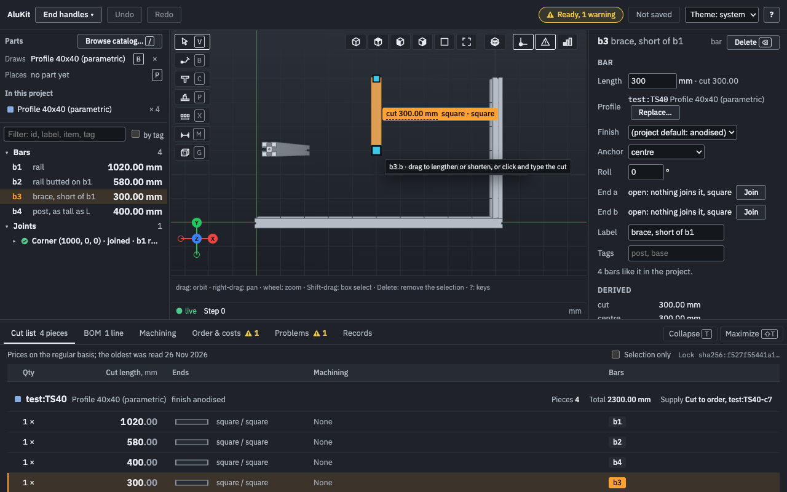
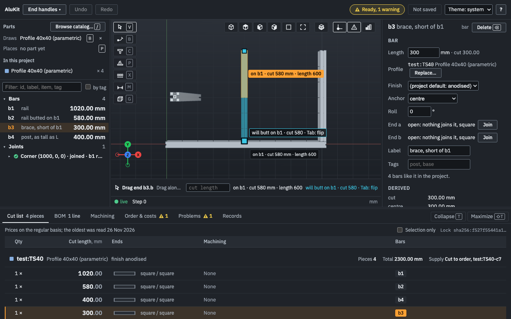
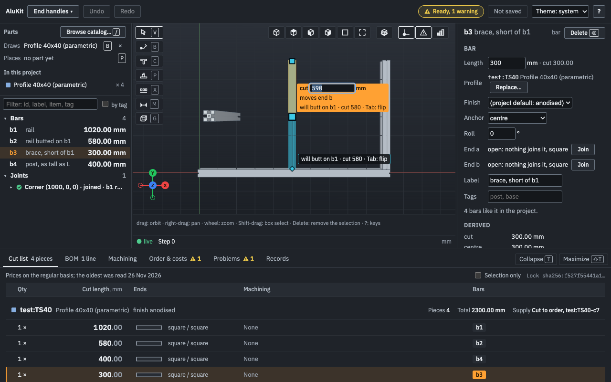
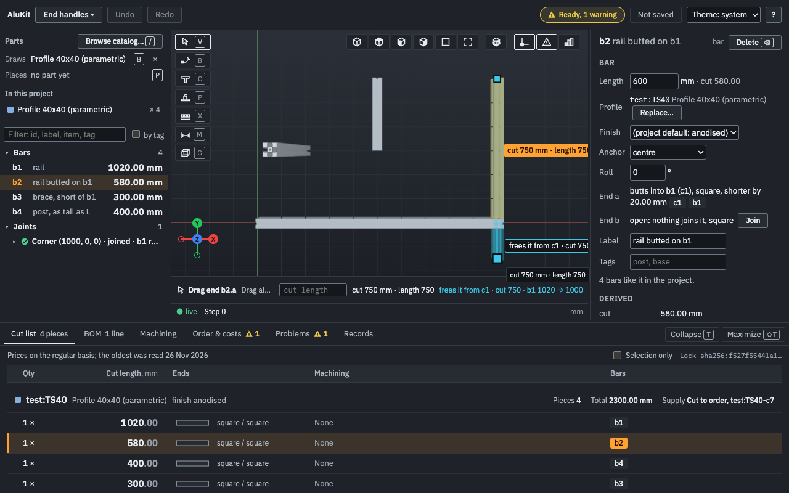

# AluKit UX: dragging bar ends, typing a length on the label, and moving

*After the UX redesign. The owner asked, while using the app: "I need a way to able to grab one
end of a profile and extend it. It should then auto attach to colliding profiles. Also if I click
on the size number on the center I should be able to type a new number". This note records the
research, the decisions and the measurements for the end handles and the length label; the Move
tool, which builds on the same drag, follows under its own heading. Design §6 and §8 state the
result (*2.3*). Labels as in the plan: **measured** (a test or a run says so), **read** (from the
code or the page cited), **inferred**.*

## Research

| Source | What it does | What AluKit takes |
|---|---|---|
| SketchUp's Move ([Moving entities around](https://help.sketchup.com/en/sketchup/moving-entities-around)) | Click, move, click, or drag; the arrow keys lock the red, green and blue axes; the distance shows in the Measurements box while moving, and a typed distance (or `[x, y, z]`, `<dx, dy, dz>`) sets it exactly | Both ways of dragging (press, drag, release; or click, move, click); the value typed into the command bar while the gesture is on (D-UX-17), Enter commits it (**read**) |
| Fusion's manipulators (the API's [`DistanceValueCommandInput`](https://help.autodesk.com/cloudhelp/ENU/Fusion-360-API/files/DistanceValueCommandInput.htm)) and [editing a sketch dimension](https://www.autodesk.com/products/fusion-360/blog/how-to-edit-a-sketch-dimension-in-fusion-360/) | One value, set two ways: an arrow dragged in the view, or the number typed in its box; a dimension edited by clicking its number | The handle drags the end, and the label's number is the same value, typed (**read**) |
| Onshape's dimensions ([Dimension](https://cad.onshape.com/help/Content/sketch-tools-dimension.htm)) | Double-click a dimension's value to type a new one, Enter to accept; a *driven* dimension is grey and cannot be edited until made driving | A length a param drives is locked, grey, and says what drives it ("driven by L: edit L"), as the inspector already does (**read**) |
| three.js [`TransformControls`](https://threejs.org/docs/pages/TransformControls.html); Unity's [`HandleUtility.CalcLineTranslation`](https://docs.unity3d.com/462/Documentation/ScriptReference/HandleUtility.CalcLineTranslation.html) | An axis-constrained drag: the pointer's ray against the axis, the object moved along it | The same projection, done analytically: the point of the bar's axis nearest the pointer's ray (`rayLineParams`, already the draw tool's). `TransformControls` itself is not used: it moves three.js objects with its own pointer listeners and its own gizmo materials, while AluKit's scene is drawn from the derived model, every edit is a command, the drag must snap to what derive knows, and a revision must link no shader program (s3 27–29) (**read**) |

## The end handles

| # | Decision | Why |
|---|---|---|
| 1 | **One bar selected in Select shows a handle at each end**, a 17 px square at the end's face (where it is cut, on the design line), 23 px when hovered or held, in the tool's colour, grey when locked. Drawn with no depth test, so a handle inside another bar shows, as the selection does. No handles on a pattern copy (its template's), in a tool, or while the project is read-only | The visible end is what a person grabs. Three `Points` with lasting materials in the overlay: a state changes positions and a colour (`setHex`), never a material, so `view.spec`'s zero links per revision holds (**measured**) |
| 2 | **The end moves along the bar's own axis only**: the pointer's ray is projected onto the axis (nearest points of two lines). The other end stays | §4.4: a bar is two design points; a length change that turned the bar would be another edit |
| 3 | **Where it stops**: on another bar's design line between its ends (`line`), at another bar's end (`corner`), or touching a bar whose line the axis misses (`face`, the near face as it comes, the far one as it backs out); otherwise the cut in whole millimetres. A `line` or `corner` stop catches the end anywhere the axis is inside that bar's box, so the end falls into the joint as a body meets another, plus 10 px either side | `autoConnect` joins where design points meet design lines or ends (§4.5), which is where the draw tool joins: a stop there joins. The project has no grid of its own (the draw tool's 10 mm grid is a view setting), so open space rounds the cut, the number a saw is set to |
| 4 | **The release is one step**: `moveEnd` (new, §6), then `autoConnect { end, optional: true }`, as drawing a bar sends one per end. The corner rule is Tab's, else the command bar's Corners select, else the project's. Always on: the draw tool's "Join ends" box is drawing's | The owner asked for the attach; one undo takes the drag back (**measured**, `ends.spec`) |
| 5 | **The preview is the draw tool's**, moved into `tools/preview.ts` and shared: a dry run 60 ms after a stop or 250 ms after the gesture rests, stale answers dropped, Tab to flip; asked only where the end lands on a stop, frees something, or has a typed value. "will butt on b1 · cut 580", "frees it from c1", "touches b7: no joint, its line misses b7's" | One preview, not two (D-UX-11). In open space the cut is the drag's own arithmetic, so no dry run is asked |
| 6 | **Live feedback**: the end's handle, a ghost of the bar at its new length, the snap marker (a diamond on a line, a square at an end, a ring in open space), "on b1 · cut 580 mm · length 600" in the selected bar's label, by the pointer and in the command bar, which shows whatever the tool while a drag is on | The brief: length and cut in the label and the command bar |
| 7 | **Typing during a drag sets the cut**: `600`, `0.6m`, `=L - 40` (D-UX-17's grammar; a leading `=` as E-UX-16 writes it), and `+50` or `-20` from the cut now. A value that reads no param is written as the number it comes to; **one that reads a param keeps it**: `moveEnd` writes the design length as the typed cut plus what the ends add or take (`L - 40 + 20` on a bar butted at one end; `600 - (L - 40)` as b3's coordinate), so the param keeps driving the cut. Where the document cannot hold it (a bar off the world axes, an end whose other end is a reference), `moveEnd` refuses and says to give a number | D-UX-17's rule, a param keeps driving what reads it, and E-UX-4's (`W` moved by 100 is `W + 100`). A cut is derived, so no field holds one; the design length a constant away from it does, exactly, while the ends stay as they are. Silently writing the number was the alternative, and the rule exists against it |
| 8 | **A typed cut that puts the end inside a bar it can join joins it**, and the cut is that bar's face's: typing 590 on a brace 10 short of b1's line reads "will butt on b1 · cut 580" before Enter | "Auto attach to colliding profiles": a cut that collides is the case it names. Exactly on the face (580) joins too |
| 9 | **What holds an end** (core `hold.ts`, read by the handles and applied by `moveEnd`): a free end drags. One a node, another bar's end or a station holds, or one a butt lists among its butting ends, is **freed by the drag**: written as coordinates, dropped from its butt (the butt goes with its last end), and the hint and the preview say so before the release ("b2.a butts on b1 (c1): dragging frees it", "frees it from c1"). The through bar's own end at a corner drags; leaving the corner ends that claim and the butting ends still bear on its side. An end a pivot, miter, splice, a named `through_end` or its own plane sets is **locked**, and pressing it says what sets it and how to free it ("b14.a is at pivot c13, which sets it") | The least surprising for a frame where most ends are joined: a person who grabs a joined end means to move it, and the words say what lets go before anything does; the step is one undo. A pivot or miter fixes the end's place or plane, so moving the design point would not move the cut, or would break the joint without a word |
| 10 | **A length a param drives is locked**: an end whose moving coordinate (or free length) reads a param or another entity draws grey, and pressing it, or its label, says "driven by L: edit L", whose button opens the param | Never overwrite a link the person made (s5 25; Onshape's driven dimensions). Replacing the expression with a number was not offered: editing L is one click away, and a silent unlink is the surprise the rule exists to avoid |
| 11 | **Pattern copies and runs**: no handles on a copy; a run's spliced ends are locked by the splice | A copy's geometry is its template's; a splice holds its ends (decision 9) |

## The length label

| # | Decision | Why |
|---|---|---|
| 12 | **The label says "cut 569.88 mm"**, and a click on that number opens a field in its place with the number selected; Enter commits, Esc or a click elsewhere leaves it. It takes the same values as a drag (decision 7) | What a click edits is what the label shows. The inspector's Length field keeps the design length with "· cut" beside it: two numbers, each named and each edited where it is shown |
| 13 | **Which end moves**: end b when it is free, as the inspector's Length field moves end b; when end b is held, end a when that is free; a coordinate a param drives says "driven by L: edit L"; when both ends are held, why, and that dragging an end frees it. The moving end's handle is drawn large while the field is open, and the field says "moves end b" | The inspector's rule, one step further only where it refuses (end b held, end a free). A refusal names both holds, so the next move is clear |
| 14 | **The same auto-attach and preview** as a drag (decisions 4, 5, 8): the step is `moveEnd { cut_mm }` (or `{ to }` when the cut lands in a bar), then `autoConnect`, one undo | One rule for one edit, however it is asked |

## The command (CLI parity)

| # | Decision | Why |
|---|---|---|
| 15 | **`moveEnd`** (§6, Structure): `end`, and one of `len_mm` or `cut_mm` (an expression over params is kept, decision 7), `by_mm` or `to` (a bar or a bar's end: where the axis meets its line or that end), with `detach` to free a held end. It refuses a locked end, a driven coordinate, an expression it cannot keep, a bar it cannot meet ("the axis misses b7's line by 3.2 mm"), and a length of nothing. `cut_mm` takes the end's own default plane after the move, with one correction from a derive, for an end whose other cut depends on its angle. The CLI form is `alukit do <dir> '{"cmd":"moveEnd","args":{…}}'`; `--dry-run` says what it would do | Composing `setBar` would put the holds, the detaching and the meeting point in the app, and an agent would compute coordinates by hand, which §6 exists to avoid. The skill's reference is generated from its schema (`pnpm skill`) |

## Measured

A scratch Playwright script (not committed), headless Chromium on SwiftShader at 1280 × 720, the
built app. Each drag presses a handle, makes 61 pointer moves 16 ms apart along the bar, rests
400 ms, and cancels with Esc; three rounds per case. Frame time is the interval between
`requestAnimationFrame` callbacks; CPU is `renderer.render`'s, from `__alukit.frames()`; dry runs
are the `dryRun: true` posts seen. The machine's load average was 37 to 47 throughout (other
agents' runs), so wall-clock figures are high and noisy; the CPU and the counts are not.

| Case | Dry runs per drag | Frames drawn | `renderer.render`, ms a frame | Frame interval, ms (mean; p90) |
|---|---|---|---|---|
| The cart, b13's free end b, down (open space) | 0, 0, 0 | 61 for 61 moves | 16.47, then 0.34, 0.34 | 24.6; 16.7 · 16.9; 16.7 · 35.4; 66.6 |
| ux/ends, b3's end b onto b1 and past it | 1, 1, 1 | 61 for 61 moves | 0.24, 0.21, 0.18 | 23.0; 16.8 · 22.0; 33.4 · 19.9; 33.2 |

- **Dry runs per drag**: none in open space, where the cut is the drag's own arithmetic; one when
  the end falls onto a bar (60 ms after the snap), whatever the number of moves, since the batch
  asked is the same until the stop changes (decision 5). Each Tab costs one per rule it tries.
- **Frame time on the cart**: one frame per pointer move, drawn on demand, 0.34 ms of CPU in
  `renderer.render`. The first drag of a session spends about a second on its first frame
  (16.47 ms a frame averaged over the round): the overlay's preview mesh, shared with the draw
  tool, compiles its program the first time it is drawn, as the draw tool's first preview already
  did. No program is linked per revision: `view.spec` passes (**measured**).

## Screenshots

1280 × 800, dark, tests/fixtures/ux/ends from the top.

| | |
|---|---|
|  |  |
| The handles | A drag onto b1, before the release |
|  |  |
| The length label, typed into | A held end freed by the drag |

## Tests

- `src/core/commands/move.test.ts`: onto another bar's line and joined in one batch (cut 580),
  cut, design and relative lengths, an expression length that keeps its param, a cut over a
  param written as the cut plus the ends' allowance (`C + 20`) and still driven by it, an
  expression refused on a bar off the world axes rather than written as a number, a driven
  coordinate refused (and an undriven axis beside it kept), a butted end refused then detached
  (its butt removed with its last end), an end freed from a node keeping the node's other axes,
  the through bar's end moving off its corner, a pivot's end refused, the base frame's `H`
  refused, a bar it cannot meet, end a of a bar with a free end b, and `endHold`'s words.
- `src/core/commands/commands.test.ts`: `moveEnd` then `autoConnect` gives G01 back.
  `src/cli/edit.test.ts`: `alukit do` with `--dry-run`, then the step, canonical, and a refusal.
- `src/ui/tools/ends.test.ts`: the axis, the holds, the stops (b1's line at 600, its span 580–620),
  landing in a body and in open space, a corner stop, the label's end, a typed cut (units, `+50`,
  `=L - 40` kept, `+L` from the cut now), the batch it sends, and the drag's dry run.
- `tests/e2e/ends.spec.ts` on `tests/fixtures/ux/ends`: a drag onto b1 butts in one step and the
  cut list is the CLI's, one undo takes it back; Esc cancels with nothing written; a click on the
  handle, `0.45m`, Enter; the label typed 450, then 590 into b1 (previewed, joined, cut 580); a
  butted end dragged away frees it from c1, said before the release; `=L - 40` on the label keeps
  `L` driving the cut (a `setParam` on the CLI moves it); a length `L` drives is locked and says
  so, on the handle and on the label.
- `view.spec` and `words.test.ts`: the label now says "cut". `draw.spec` passes byte for byte, and
  `view.spec`'s zero shader links per revision holds (**measured**).

## Against the editing audit

The [editing audit](editing-audit.md) (§5.1) lists what (a) the end handles and (b) the length
label would leave uncovered. Where this batch stands on each:

| Audit item | Here |
|---|---|
| (a) an end at a reference should say what sets it and offer to detach | Done: the hint names it, the drag frees it and the preview says so first; a pivot, miter, splice or plane locks it, saying why (decision 9) |
| (a) re-aiming an end off its axis; stopping at a face *as a provider* | Not here: the end moves along its axis, and a face stop is a length, not `plane.face` (E4.1) |
| (a) an auto-attach at an angle makes an `angled-end` error | Unchanged: `autoConnect` declares no cut yet (E-UX-11) |
| (b) binding to a param with `=W` | Done for the cut: `=L - 40` keeps `L` driving it (decision 7) |
| (b) which end moves | End b, else end a when b is held (decision 13); the menu for end a or both ends from the middle is E4.6 |
| (b) a param-driven length opens the param | Done: "driven by L: edit L" opens it (decision 10) |

`tests/e2e/ends.spec.ts` is the spec the audit assigns to E4; its cases extend this file.
