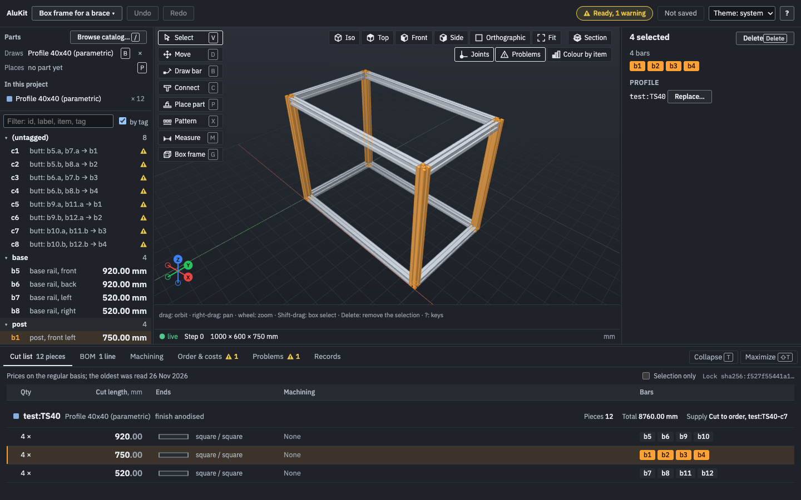
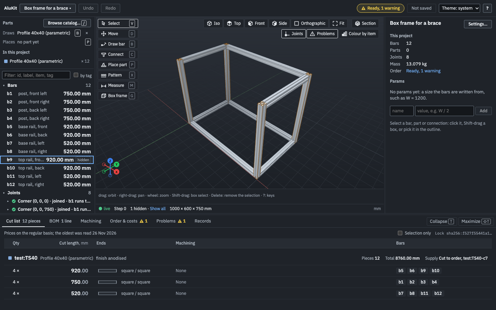
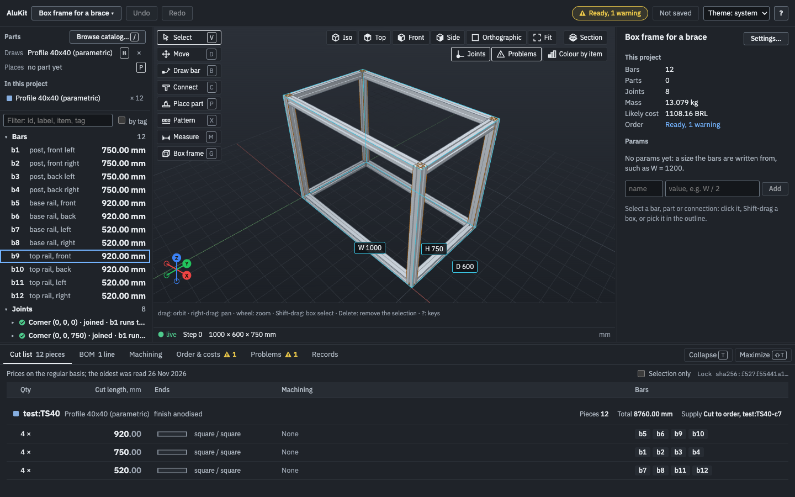
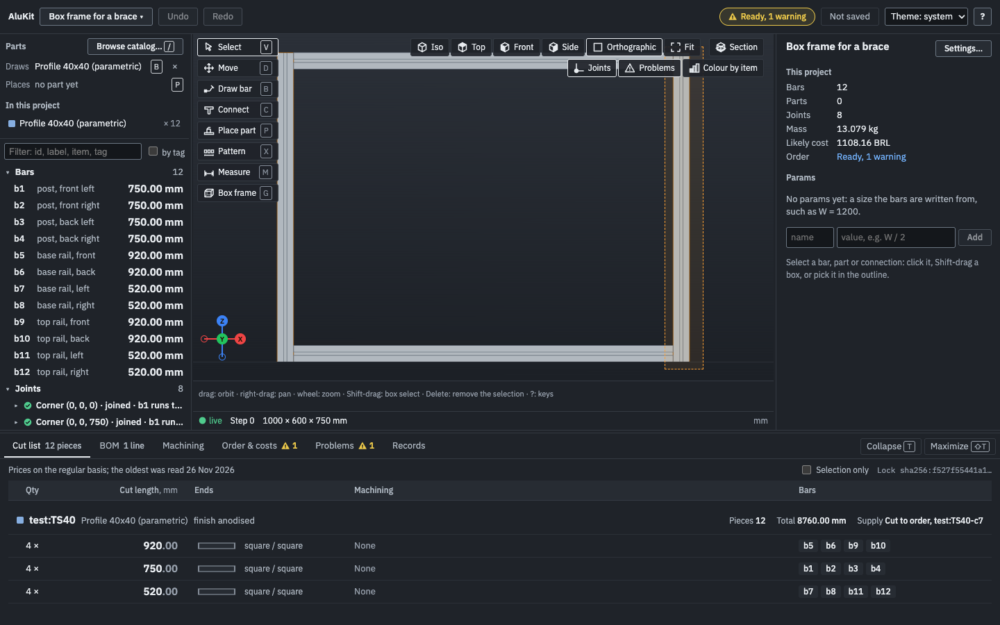
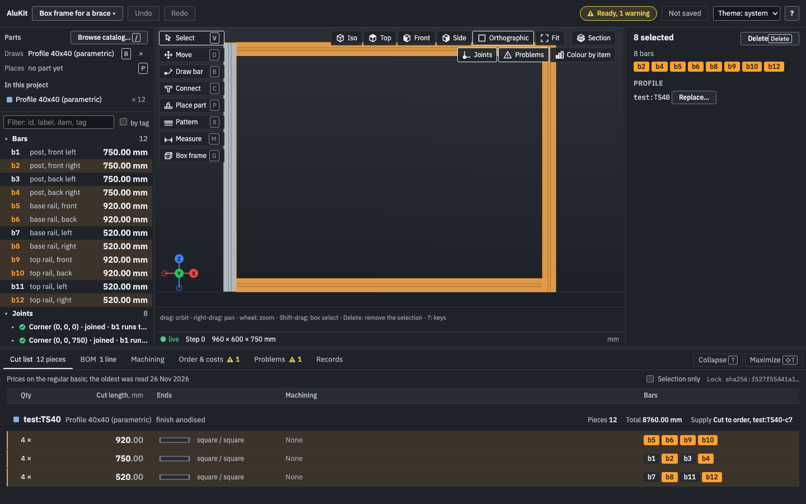
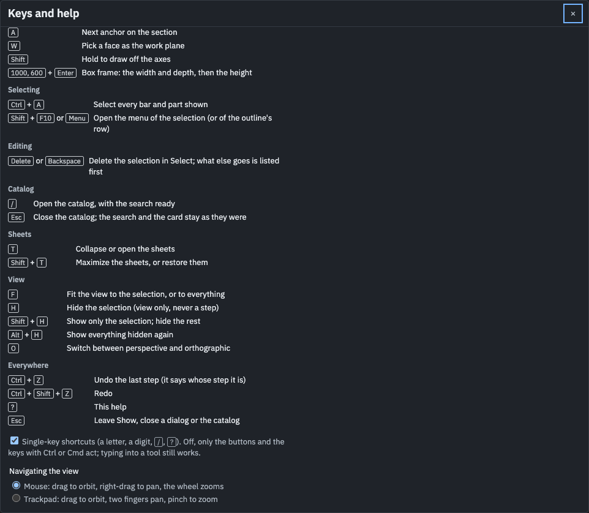

# AluKit editing round, E2: selection, visibility, menus and navigation

*Stream E2 of the [editing audit](editing-audit.md) (§7.6): the context menu everywhere it is
asked for, the selection verbs, the crossing box, hide and isolate, the size readout, trackpad
navigation, and the audit's defect D1. It builds on E0's contracts ([e0-decisions.md](e0-decisions.md))
and E1's selectors ([e1-decisions.md](e1-decisions.md)); the interfaces it adds are in
[contracts.md](contracts.md), "Editing round: E2 changes". Labels as in the audit: **measured**,
**read**, **inferred**. Decisions are numbered for the design's citations ("e2 6").*

## Done

Each e2e test below fails against the app built at E2's base (the E0 merge) and passes after
(**measured**: all twelve of E2's e2e tests run against that build, the server from E2's
sources); `first-run.spec`'s, `labels.test.ts`, `pick.test.ts`, `query.test.ts`, `edit.test.ts`,
`server.test.ts` and `navigation.spec` were also seen failing before their code was written.

| Id | What | Test |
|---|---|---|
| E2.1 | The menu on outline rows and heads; Shift+F10 and the Menu key; right-drag still pans; the selection header's buttons from the registry | `menu.spec`: four tests; `registry.test.ts` |
| E2.2 | Select all (Ctrl/Cmd+A), similar, the same tags, connected, the whole assembly; a group head selects its members; `like:<id> by tag`; `GET /api/query` | `select.spec` "on the frame…"; `rows.test.ts`; `query.test.ts`, `edit.test.ts` (CLI), `server.test.ts` |
| E2.3 | The crossing box | `select.spec` "a box right to left…"; `pick.test.ts` |
| E2.4 | Hide, isolate, show all, the strip, hidden rows | `visibility.spec` (shader links counted); `registry.test.ts` |
| E2.5 | The size readout, and the size box while Alt is held | `select.spec` "the size readout…" (shader links counted); `size.test.ts` |
| E2.6 | Mouse or Trackpad navigation; a pinch dollies | `navigation.spec` |
| E2.7 | D1: the palette follows `defaults.bar` | `first-run.spec` "after the start card's frame…" |
| E2.8 | Ctrl+A, H, Shift+H, Alt+H as actions, in the help | `keys.spec` "Ctrl+A selects all…"; `registry.test.ts` |
| — | The selected bar's label (and every label over the view) kept inside it | `select.spec` "the selected bar's label…"; `labels.test.ts` |
| — | `camera().moving` false after a move made at once | `select.spec` (it waited forever before) |

D6 (design §8 says Select works "or by tag") is true now: a click on a tag's head, or "Select
tagged …" in the menu. §8's text is left to the coordinator's fold, as the round's rules say.

## Screenshots

On the audit's frame (`tests/fixtures/brace`), 1440 × 900, dark theme.

| | |
|---|---|
|  |  |
|  |  |
|  |  |
|  | |

## The menu and the header (E2.1)

| # | Decision | Why |
|---|---|---|
| 1 | **Shift+F10 and the Menu key are an action**, `menu` (group `select`, never an entry of a menu: `applies` is false). It opens the menu about the selection: by the outline's row when the focus is on one, else at the selection's middle in the view, else in the middle of the view. While the menu is open, the browser's own `contextmenu` is prevented | E-UX-2; WAI-ARIA's menu pattern opens a menu where the keyboard is. The Menu key and Shift+F10 also send `contextmenu`, after the key, and the browser's menu would open over this one |
| 2 | **A right-click on an outline row opens the menu about that row**, selected first unless it is already in the selection, as in the view; **on a group's head, about its members** (a corner's head, about the corner). It opens in any tool, where the view's opens in Select only | The same rule as the view's (E-UX-2). In the view a tool owns the pointer; the outline has no gesture to interrupt, and a greyed entry says why it cannot run now |
| 3 | **The selection header's buttons are the registry's `edit` and `transform` groups**: each its title and first key, greyed (`aria-disabled`) with its `when` as the title, run through `runAction`. They are disabled while the project is read-only or a step is on its way, as Delete's button was. The bar, joint and part groups are the inspector's action row (E4); the select and view verbs live in the menu and the keys. A kind that had no Delete button (an end, a corner, an item) still has no buttons | E-UX-1. A group says what an action does to the document, so no new member is needed to say which actions are buttons. `DeleteButton` had no other use and is gone from `Delete.tsx`; its `⌫` cap reads `Delete`, the key's name in the help |
| 4 | **The buttons follow what an action's `when` reads**: the model, the selection, the tool and its gesture, read by the component | `when` reads with `peek` (it also runs from key handlers), so a component that only called it would not re-render when the tool changed (**inferred** from `peek`; `menu.spec` checks the header's Delete greyed in Draw) |

## Selecting (E2.2, E2.3)

| # | Decision | Why |
|---|---|---|
| 5 | **Similar, the same tags, connected and the whole assembly ask the server**, `GET /api/query?select=<selector>` in the tab's variant, which answers the ids `alukit query` selects, over the document and the derived model the server holds. An answer that comes back after the person changed the selection is dropped | E1's `similarTo` by item reads the core's derived model, which only the server has; `src/core/query.ts` also brings the project schema (Zod) into the page, which the app keeps in a lazy chunk (`chunks.spec`). One grammar for the CLI, the server and the app is CLI parity for a verb that is not a step |
| 6 | **`like:<id> by tag`** joins the grammar (`like:<id> by item` is `like:<id>`): the entities of its kind that carry every tag it carries | `similarTo(…, "tag")` (e1 10) could not be reached from the CLI, so "the same tags" had no CLI form. One additive line in E1's `select`, with a core test, a CLI test and the skill regenerated |
| 7 | **Select all (Ctrl/Cmd+A) takes the document's bars and placed parts that the view draws and does not hide**: not pattern copies (their template is the entity, and Delete leaves a copy out), nor connections, nodes or runs (no body of their own to select in the view). **The key is taken anywhere but in a text field** (keys.ts's guard), not only while the focus is on the view or the outline | The audit's frame reads 12 (E2.2's test). The audit (§9) asked for the view or the outline only; selecting the page's text is never useful in this app, and the guard already gives fields their own Ctrl+A |
| 8 | **A group's head selects its members**: every row under it, its subgroups' too, which is what its count counts; Ctrl or Cmd adds them, or takes them out when every one is selected; the twisty opens and closes; Enter or Space on a head selects its members, the arrow keys open and close. A corner's head selects the corner, as before | E2.2 and D6. Keyboard parity with the click |
| 9 | **The verbs name what they will take**: "Select tagged post" (the entity's tags), greyed "b5 has no tag" when it has none; "Select the whole assembly" is `connected*:` | The menu says what happens before it happens (the plan's principle 5) |
| 10 | **A box drawn right to left is a crossing, drawn dashed; left to right a window, now drawn solid** (it was dashed). A body is the convex hull of its eight projected corners, the box's exact silhouette in either projection; a crossing takes it when the hull touches the box (a corner inside the box, a corner of the box inside the hull, or two edges crossing). A body with a corner behind the camera is never wholly inside; a crossing reads the corners in front of it (**inferred**: rare in a frame's views). What is hidden is passed over | E-UX-10; AutoCAD's convention (inferred in the audit). Pure (`boxTakes`, `convexHull` in `src/viewer/pick.ts`), so the unit tests need no renderer |

## Hide and isolate (E2.4)

| # | Decision | Why |
|---|---|---|
| 11 | **Hiding is visibility, never a material**: a hidden instance's matrix is zeroed and put back from a copy of where it was placed; a body of its own and its edges are made invisible; a bar's edges in the merged buffers take no alpha. The x-ray, the badges, and the joint markers whose bars are all hidden leave it out; the click, the hover, the right-click and the box pass over it; Fit and the standard views frame what is shown | E-UX-9, E-UX-19; the coordinator's note for E2.4. **Measured**: zero shader links across hide, isolate and show all (`visibility.spec`), and across the size box (`select.spec`) |
| 12 | **Isolate hides the rest**: it writes every other drawn body into `hidden` and keeps the isolated set in `isolated`; Alt+H clears both. Something a step adds while isolated is shown | **A deviation from E-UX-9's "Isolate uses the existing ghost path"**: the same decision says "Shift+H isolates (hides the rest)", and E0's `isolated` contract says "the rest hidden". A ghost stays pickable and snappable, so a click would land on what was put out of the way, and Show's ghost, which Esc clears, would fight it. Writing into `hidden` means every reader of `hidden` (the tools' snaps, the viewer) needs no change |
| 13 | **What hides is what draws the selection**, as the view lights it on a hover (`resolveTargets(…).bodies`): a bar or a part itself, a corner its bars, a joint its fasteners and bars, a pattern its template and copies. **Hide takes what it hid out of the selection** | One meaning of "what draws this" across hover, Show and hide. A hidden thing left selected would be edited unseen (Blender deselects too, inferred) |
| 14 | **While anything is hidden, the status bar says "n hidden · Show all"** ("isolated · " first while isolating), counting the model's bodies; the outline strikes a hidden row's id and says "hidden" | E-UX-9's strip. The status bar is where persistent state lives (D-UX-3); status is a word and a shape, not colour alone |
| 15 | **An Alt key matches by the key's position when Alt composes a character**: Option+H types ˙ on a Mac, so `alt+h` reads `code` (`KeyH`). Where Alt leaves the letter as it is (Windows, Linux), the letter is read. The limit: on a Mac whose layout moves a letter, an Alt key is the letter at QWERTY's position; H is in the same place on QWERTY, QWERTZ and AZERTY (**read**: the `code` values) | **Read**: `KeyboardEvent.key` on macOS with Option is the composed character. Without this, Alt+H (Show all) did nothing on a Mac |

## The size readout (E2.5)

| # | Decision | Why |
|---|---|---|
| 16 | **The readout is the bounding box of what draws the selection, or of every body when nothing is selected**, in world axes, W × D × H in millimetres, to 0.01 mm with no trailing `.00`, in the status bar. It reuses `targets.ts`'s `boxOf`: bars by their sections' corners, parts by their placed boxes, fasteners | One box for Show's framing and the readout. The audit's frame reads 1000 × 600 × 750 mm (**measured**) |
| 17 | **While Alt is held, the size box shows in the view**: the box's twelve edges over every body in the tool's colour, with W, D and H by its edges. Alt's press is taken (its default can move the focus to the browser's menu); letting it go, or the window losing the focus, takes the box away. The edges are one lasting line object built with the viewer | E2.5; E-UX-19 (**measured**: no shader link) |

## Navigation (E2.6)

| # | Decision | Why |
|---|---|---|
| 18 | **Mouse or Trackpad is a preference in the help, per browser**, Mouse by default. Trackpad turns camera-controls' wheel action to `TRUCK`, so a two-finger scroll pans by its two deltas | E-UX-17. camera-controls 3.1.2 pans on a wheel with `TRUCK` (**read**: its wheel handler passes `deltaX` and `deltaY` to its truck) |
| 19 | **A pinch (a wheel with Ctrl) dollies in perspective, in both modes**; in orthographic it zooms, as before. camera-controls zooms the lens on any wheel with Ctrl, in perspective too (**read**: `controlMode = event.ctrlKey ? ZOOM : …`), which left the field of view that the fits, the gizmo's size and the projection switch read behind. The viewer takes that event first and dollies by camera-controls' own step and scale (`_dollyInternal`), so a pinch and a wheel move alike | This also changes a mouse's Ctrl+wheel in Mouse mode, which zoomed the lens before (**inferred**: a latent defect, since the fits and the projection switch compute from the field of view and the distance). `navigation.spec` reads the camera's distance; before the change a pinch left it as it was (**measured**) |

## The audit's D1 (E2.7), labels, and the camera

| # | Decision | Why |
|---|---|---|
| 20 | **The palette follows the document's default bar while it has none**: `keepPalette` owns the palette's life in a tab, kept for the session, started from what the tab had or from the default, and armed with the default whenever the palette has no bar and the default changes, whoever changed it (the start card's frame, settings, an agent). A bar the person armed is never replaced | D1's cause (**read**): `startPalette` ran once, on the first model (`App.tsx`). The fix is where the palette lives, not in the start card's frame form, so a default set by settings or an agent arms too |
| 21 | **Every label over the view stays inside it**: placed at its point, measured with its margins and CSS translate, and moved back by its overflow, 4 px from the edges (`placeInside`): the selected bar's label, Show's callout, the tools' labels, the size box's | The coordinator's note (**measured**: the label's right edge at 1132 px against the view's 954). One placement for every label |
| 22 | **`camera().moving` turns false at the first frame that changes nothing**, besides camera-controls' rest. camera-controls marks itself rested only when an eased move settles, so after a fit made at once (the first model, a projection switch) `moving` stayed true for ever | **Measured** while writing E2's tests: a script waiting for rest after switching to orthographic timed out. The fix reads camera-controls' `sleep`, `wake` and `transitionstart` events (**read**: camera-controls 3.1.2 leaves `active` true after a move made at once, and sends `sleep` when its moves settle) |

## Files outside E2's ownership

- `src/core/query.ts`, its test, `src/cli/project-usage.ts`, `src/cli/edit.test.ts`,
  `skills/alukit/SKILL.md` (E1): `like:<id> by tag` (decision 6).
- `src/server/server.ts` and its test (E1): `GET /api/query` (decision 5).
- `src/ui/inspector/Inspector.tsx` (E4): the header's `DeleteButton` became `ActionButtons`, two
  lines; `src/ui/inspector/Delete.tsx`: `DeleteButton` removed (decision 3).
- `src/ui/App.tsx`: the one-shot `startPalette` call removed (decision 20).
- `src/ui/viewport/Viewport.tsx`, `Overlays.tsx` (S3's, no editing owner): the viewer follows
  `hidden`; the anchored labels place inside the view.
- `src/viewer/labels.ts` (S3's): `placeInside`, `nudgeInside`.
- `src/ui/styles/shell.css`, `viewport.css`: the strip, the readout, hidden rows, the help's
  navigation choice, the crossing box.
- `tests/e2e/keys.spec.ts`, `first-run.spec.ts`: E2.8's and E2.7's tests, as their tasks say.

## Against E-UX decisions

| Decision | Built | Why |
|---|---|---|
| E-UX-9: "Isolate uses the existing ghost path" | Isolate hides the rest | Decision 12 |
| §9: Ctrl/Cmd+A only while the focus is on the view or the outline | Anywhere but a text field | Decision 7 |
| E-UX-17: "pinch (a wheel with `ctrlKey`) to zoom" | A pinch dollies in perspective, zooms in orthographic | Decision 19: in perspective the view's zoom is a dolly |
