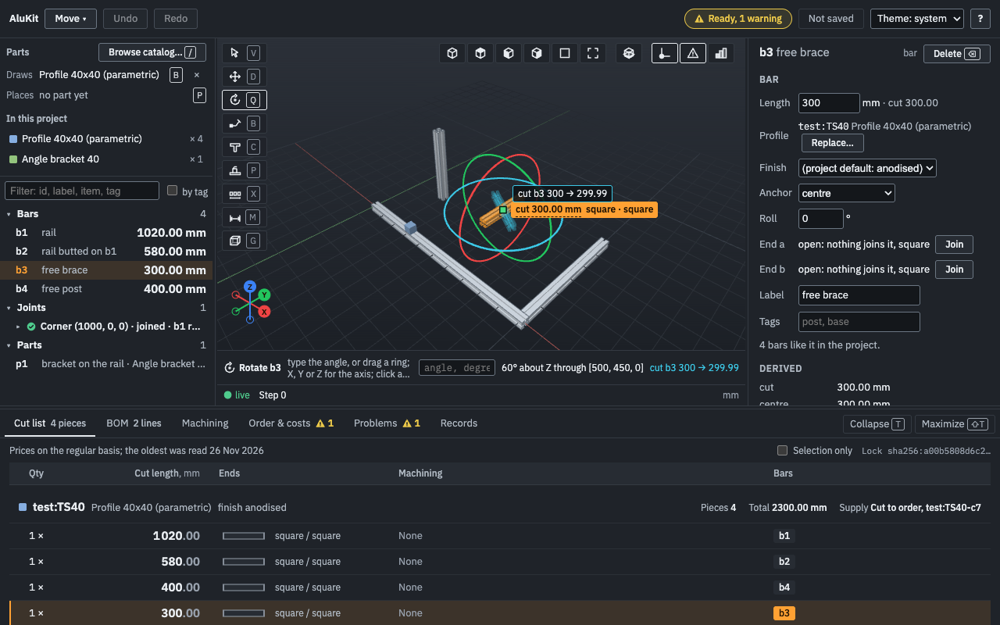
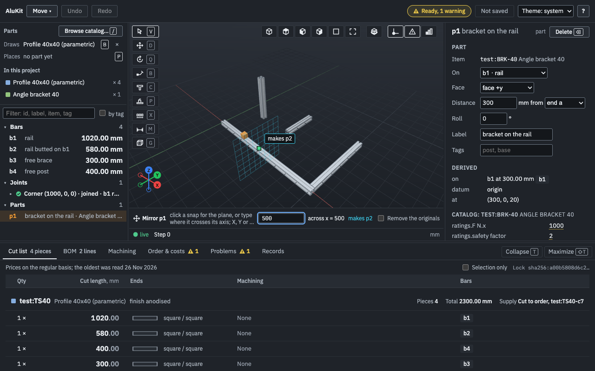
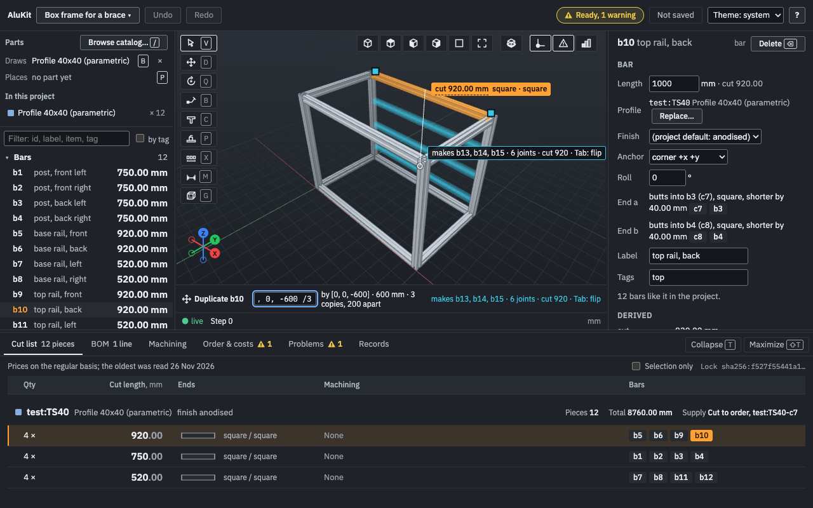
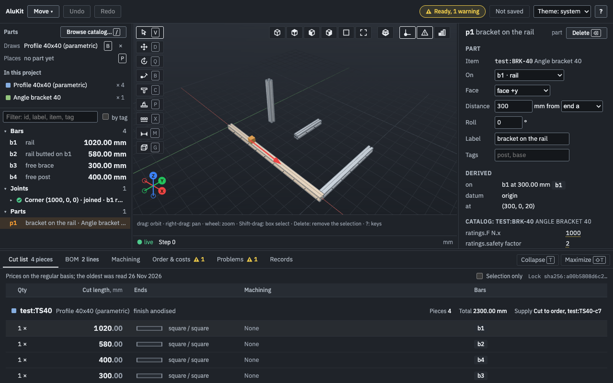

# AluKit editing round, E3: transform and copy tools

*Stream E3 of the [editing audit](editing-audit.md) (§7.7): Rotate, Mirror, Duplicate, Copy and
Paste, point to point, Align, a part slid along its bar, and the cost of the previews. It builds
on E0's contracts ([e0-decisions.md](e0-decisions.md)), E1's core ([e1-decisions.md](e1-decisions.md))
and the Move tool with `transform` ([drag-ends-decisions.md](drag-ends-decisions.md), "The Move
tool", cited as "move n"). Every edit is a command the core already had (`transform`, `mirror`,
`array`, `removeEntity`, `autoConnect`): nothing new in the core or the CLI, so CLI parity is the
existing commands' (§7.5's rule). Decisions are cited as "e3 n". Labels: **measured** (a test or
a run says so), **read** (from the code or the page cited), **inferred**.*

## Done

| Id | What | Where | Test | Failed first |
|---|---|---|---|---|
| E3.1 | Rotate, `Q`: the gizmo's rings at the selection's centre, a click on a snap for the centre (Enter for the selection's), X, Y or Z, a typed angle or a ring's drag; one `transform` turn | `src/ui/tools/wire/rotate.ts`; `rotateBatch` | `transform.spec`: b1 and b2 (and b1's bracket p1) turned 90° about Z through b1's end equal `alukit rotate` on a scratch copy (`alukit diff`: the same project) | yes |
| E3.2 | Mirror, from the menu: a plane square to X, Y or Z through the selection's centre, a snap or a typed coordinate; "Remove the originals"; one `mirror` step | `wire/mirror.ts`; `mirrorBatch` | `transform.spec`: the bracket across x = 500 equals `alukit do mirror`; `batches.test.ts` | yes |
| E3.3 | Duplicate, Ctrl/Cmd+D: a Move session on a copy; a typed offset; `4x`, `/4`; one `array` step with a join at each new bar's ends | `wire/move.ts` (`startCopy`), `wire/duplicate.ts`; `duplicateBatch`, `arrayBatch` | `copy.spec`: the top front rail 300 down, butted at both ends, then `/3` on the back rail: the cut list is the CLI batches', byte for byte | yes |
| E3.4 | Copy and Paste, Ctrl/Cmd+C and V, in the tab's project | `wire/duplicate.ts` | `copy.spec`: Ctrl+C on b9, Ctrl+V, a click on a snap: one step, one new bar | yes |
| E3.5 | Point to point: the first click on a snap is the base point in Move, Duplicate and Rotate (its centre) | `wire/move.ts`, `wire/rotate.ts`, `drag.ts` (`GestureSpec.press`) | `transform.spec`: b3 moved from its end to b4's end lands on it exactly; Rotate's test picks its centre so | Move's half no: it already snapped both points (move 13); Duplicate's and Rotate's yes |
| E3.6 | Align to a face, from the menu: one `transform` | `wire/align.ts`; `alignBatch` | `transform.spec`: the top front rail 7 mm below the posts' tops is flush after one Align; `batches.test.ts` | yes |
| E3.7 | A part selected alone, in Select, shows the gizmo's arrow along its bar; a drag slides it, one step | `wire/move.ts` | `transform.spec`: the bracket dragged by its arrow from 300 to 450 reads `at_mm: 450` | yes |
| E3.8 | Move and Rotate send `transform`; previews are local; few dry runs | `wire/move.ts`, `wire/rotate.ts`, `edit/geometry.ts` (`ghostsOf`) | `transform.spec`: a ring's drag of 60 moves asks ≤ 8 dry runs and links no shader program across the rings, the ghosts and the revision; Move's drag ≤ 8 | Rotate's yes; Move's no (move 17 already met it) |

## Research

| Source | What it does | What AluKit takes |
|---|---|---|
| SketchUp's Rotate and its Measurements box (the audit's §4.2, [Measurements box][su-vcb]) | Click a centre, then turn; a typed angle sets it exactly; the protractor snaps to angle increments (15° in a new model's Units, **inferred**) | A centre picked on a snap, a typed angle, 15° steps for a ring's drag (e3 1, 3) |
| Blender's transform keys ([axis locking][bl-axis]) | R then X, Y or Z turns about that axis; typed numbers at once | X, Y and Z in Rotate choose the axis, as the arrows lock Move (e3 2) |
| SketchUp's Move with copy ([Measurements box][su-vcb]) | After a copy, `5x` makes five at that spacing, `/5` divides the distance into five | `4x` and `/4` in the same session, typed after the offset (e3 6) |
| AutoCAD's paste (**inferred**, not checked) | A plain paste inserts at the copied objects' lower-left corner | Paste hangs the copy from the pointer by its lowest corner (e3 8) |
| three.js 0.187 `WebGLRenderer` (`src/renderers/WebGLRenderer.js`, line 1204) | A mesh whose world matrix has a negative determinant is drawn with its front face clockwise (`frontFaceCW`), a GL state, not another program | A mirror's ghost is the body's image with a left-handed frame, drawn on the ghosts' one material (e3 11) (**read**) |

## Rotate (E3.1)

| # | Decision | Why |
|---|---|---|
| 1 | **Rotate is a tool on the rail, `Q`**, after Move. With a selection, the gizmo's three rings stand at its centre; a click on a snap (or a body) is the centre instead and starts the turn there, Enter takes the selection's centre, and a digit starts a turn about the selection's centre with the angle typed, as Move starts from the keyboard. With nothing selected, a click selects | E-UX-24's key; E3.1's flow; the rings make the turn findable by the pointer alone (A14) |
| 2 | **The axis is Z at first; X, Y or Z, or → ← ↑ as Move locks, choose another**, and a ring's drag takes its own axis. The letters are Rotate's while a turn is on or a selection waits (its keys come before the tool letters): with a selection, X starts a turn about X from the selection's centre, so Q, X, 90, Enter turns 90° about X, and X does not pick the Pattern tool | Frames turn mostly in plan (E-UX-5); Blender's R then X; the arrows are what a person already knows from Move and Draw |
| 3 | **A ring's drag turns in 15° steps and its release commits**; a typed angle is any number, Enter commits. A ring clicked without a turn leaves the turn on, to type the angle | SketchUp's angle snapping; `transform` writes numbers except at quarter turns, so the drag lands on angles that keep a frame's expressions where they can be kept; the release commits as Move's drag does |
| 4 | **The step is Move's: `transform { rotate }`, then an `autoConnect` at each turned bar's end** (`rotateBatch`), Alt detaching | An end that lands on a bar joins it, as after a move (move 18); with nothing there, the joins do nothing (**measured**: E3.1's test, `alukit diff` the same as `alukit rotate`) |
| 5 | **The preview is local**: the selection's bars drawn turned (`ghostsOf` with a turn), the centre's marker and the axis guide; a dry run only after a typed angle (60 ms) or a rest (250 ms), as Move's | E-UX-20; one previewer for every gesture |

## Mirror (E3.2)

| # | Decision | Why |
|---|---|---|
| 6 | **Mirror is in the menu ("Mirror…"), no key**, for bars, parts and points. The plane is square to X at first (X, Y or Z, or → ← ↑, turn it), through the selection's centre; it follows the snap under the pointer; a typed value is where it crosses its axis (`500`, `=W / 2`). A click or Enter commits one `mirror` step. The images are drawn mirrored, with the plane's grid, and a dry run says what it makes, or the core's refusal (a part named by what is not mirrored, an item with no other hand) | E-UX-8 and E-UX-24; the core refuses what it cannot mirror, in its own words, so the app has no rule of its own to disagree with (e1 14's principle) |
| 7 | **"Remove the originals" is a box in the command bar**; checked, the step removes what was mirrored after making the images, each with what refers to it (`removeEntity { cascade }`, referrers first, Delete's order). The images are selected after the step | E-UX-8: one step; the cascade is Delete's, whose dialog lists what goes; the images are what a person works on next |

## Duplicate, Copy and Paste (E3.3, E3.4)

| # | Decision | Why |
|---|---|---|
| 8 | **Duplicate (Ctrl/Cmd+D, the menu) is the Move tool's session on a copy**, from the original's place: the copy follows the pointer, the first click on a snap is the base point and the next where it goes (point to point), or a typed offset. **Paste (Ctrl/Cmd+V)** is the same session with the base set: the copied entities hang from the pointer by their lowest corner (least x, y, z of what they place: a bar's end a for a rail along an axis), and the first click places them. **Copy (Ctrl/Cmd+C)** remembers the selection in the tab, for its project only | E-UX-6, E-UX-7; one session, so the snaps, locks and typed values are Move's, as a person already knows them |
| 9 | **`4x` (or `x4`) after the offset makes four copies at that spacing, `/4` four copies dividing it**; the count is the typed text's last token, after a space or a comma, written with nothing inside it, so `W /2` asks for two while `W / 2` and `300/2` stay divisions, and a token that is a param's name stays a value. `4*` and `*4` count only typed alone. At most 100 copies a step | SketchUp's grammar, without taking an expression's `/` or `*`; typed before the commit, since amending a step is out (plan §7) |
| 10 | **The step is one `array` along the offset's direction at its length, then an `autoConnect` at each new bar's end points** (the first 48), as drawing a bar sends one per end; the copies are selected after it. The copies' coordinates are numbers, as the core's `array` writes every step | A7: a rail duplicated 300 down butts on the legs at both ends (**measured**, `copy.spec` and `batches.test.ts`); the log words are `array`'s ("copy b9, making b13, joined at 2 ends") |

## Previews, keys and the gizmo

| # | Decision | Why |
|---|---|---|
| 11 | **Every preview is local geometry on the overlay's one ghost material**, drawn by one function (`ghostsOf`) for a move, a turn and a mirror: a mirror's frame is left-handed, which three draws turned the right way out; a copy session draws its copies (at most 96 ghosts). A dry run comes only after a snap, a typed value or a rest | E-UX-19, E-UX-20. No material per drag or per revision (**measured**: the ring test counts no program linked across the rings, the turned ghost and the step's revision) |
| 12 | **A press during a gesture is asked of the gesture first** (`GestureSpec.press`): a Duplicate's first click picks its base point (`"drag"`: a drag from there commits on release, a click keeps following), Rotate's moves its centre (`"taken"`); otherwise the press commits there, as before | E3.5's point to point for the sessions that start without a base; one drag machinery for every gesture |
| 13 | **While a gesture is on, its keys are its own wherever the focus is**, except in a text field, a dialog or a menu: `drag.ts` asks the gesture in the keys' capture phase when the focus is on an element. A Duplicate started from an outline row (Ctrl+D), or from the menu, which gives the focus back to the row, otherwise lost its arrows and Enter to the row, which takes them before the window hears them | **Measured**: `copy.spec`'s Duplicate, its axis lock pressed with the focus on the row, failed before; keys.ts routes only what reaches the window |
| 14 | **The gizmo is shared by identity**: each user (Rotate's rings, a part's arrow, the end handles) takes it away only when the view still shows what it set. The end handles kept a flag, and cleared Rotate's rings when the tool changed with one bar selected | **Measured**: Rotate with one bar selected showed no rings before the end handles' change (`wire/ends.ts`, E4's file, the smallest change: the flag became the spec it set) |
| 15 | **The rings and arrows E0 built are used as they are**: no new part, material or geometry. Rotate shows the three rings; a part alone shows the arrow of the world axis its bar runs along | Built and precompiled once already (e0 16); nothing to add |

## Align and the part's slide (E3.6, E3.7)

| # | Decision | Why |
|---|---|---|
| 16 | **Align (the menu's "Align to a face…") moves the selection along the picked face's outward normal until its own face that looks the same way is flush with it**: the face's plane against how far the selection's bodies reach along that normal (each bar's box between its two end planes, as the pick reads a body; parts and points by their point). The face under the pointer is named ("flush with b1's top · by [0, 0, 7]") and the selection drawn there before the click. The step is Move's batch (`transform`, then joins). A face of the selection itself is refused, as is a selection already flush | E-UX-23; "flush" read as faces facing the same way, as the done-when's tops are. The offset is computed from the derived model in the app, as E3.6's note allows (`transform` is enough); an agent sends the same `transform`, with the offset it reads from `alukit derive` |
| 17 | **A part selected alone, or parts all on one bar, in Select, show the gizmo's arrow along that bar** when it runs along a world axis; a drag on the arrow slides them along the bar in whole millimetres and commits on release; a click on it leaves the slide on, to type the distance. The step is `transform`, which changes `at_mm` (move 6), not `setPart` | E3.7 names `setPart`; `transform` writes the same document (**measured**: `at_mm: 450`), keeps one edit path for every move and its words ("move p1 by [150, 0, 0]"), and keeps a typed `D` as `D`. A bar off the world axes shows no arrow: the gizmo's arrows are world axes (e0 16); the Move tool still slides such a part |

## Measured

The scratch script (not committed) on tests/fixtures/ux/move, headless Chromium on SwiftShader,
1280 × 800: three rounds each of 60 pointer moves 16 ms apart, then a 400 ms rest; dry runs are
the `dryRun: true` posts seen. The machine's load average was 31 to 41 (other streams' runs):
each move also waited on a page round trip, so a 15° step was held about half a second. The
counts do not depend on the load; the audit's bound (E3.8) is 8.

| Gesture | Dry runs per 60 moves |
|---|---|
| A ring's drag, a 60° sweep in 15° steps (b3) | 4, 4, 4: one per step held past the 250 ms rest, none while the angle keeps changing |
| Move's drag along −Y (b1, joined to b2) | 1, 1, 1: at the rest only, as move 17 measured for the end handles |

## Screenshots

1280 × 800, dark.

| | |
|---|---|
| ![b1 and b2 turned 90° about Z through b1's end: the rings at the centre, the turned ghosts, "90° about Z through [0, 0, 0]" in the command bar](img/e3/rotate-typed.png) |  |
| Rotate, a typed angle | Rotate, a ring dragged |
|  |  |
| Mirror | Duplicate, `/3` |
| ![The top front rail aligned to the post's top: "flush with b1's top · by [0, 0, 7]"](img/e3/align.png) |  |
| Align | A part's arrow |

## Tests

- `src/ui/edit/batches.test.ts`: `mirrorBatch` (the core's p2 at 700; the originals removed in the
  same step; refusals), `duplicateBatch` (a rail 300 down butted on the posts, cut 920; `4x` and
  `/3`; parts; refusals), `arrayBatch`, `rotateBatch`, `alignBatch` (7 mm up to the posts' tops;
  flush already; its own face), and the previews' words (`copyWords`, `mirrorWords`).
- `src/ui/edit/geometry.test.ts`: the copy grammar, typed angles and 15° steps, turns and mirrors,
  centres, corners and reach, a bar's body and faces, ghosts.
- `tests/e2e/transform.spec.ts`: Rotate against `alukit rotate`; a ring's drag (dry runs, no
  program linked); Move's dry runs; Mirror against `alukit do mirror`; point to point; Align; the
  part's arrow.
- `tests/e2e/copy.spec.ts`: Duplicate and `/3` against the CLI's cut list; Copy and Paste.
- `tests/e2e/menu.spec.ts` (E2's): the menu on b1 now lists Duplicate, Copy, Mirror… and Align to a
  face… between Delete and Join; the list and the type-ahead's index follow, nothing else changed.
- `src/ui/tools/wiring.test.ts`: its stand-in viewer returns an undo from `on…`, as the viewer does.

[su-vcb]: https://help.sketchup.com/en/sketchup/using-measurements-box
[bl-axis]: https://docs.blender.org/manual/en/latest/scene_layout/object/editing/transform/control/axis_locking.html
