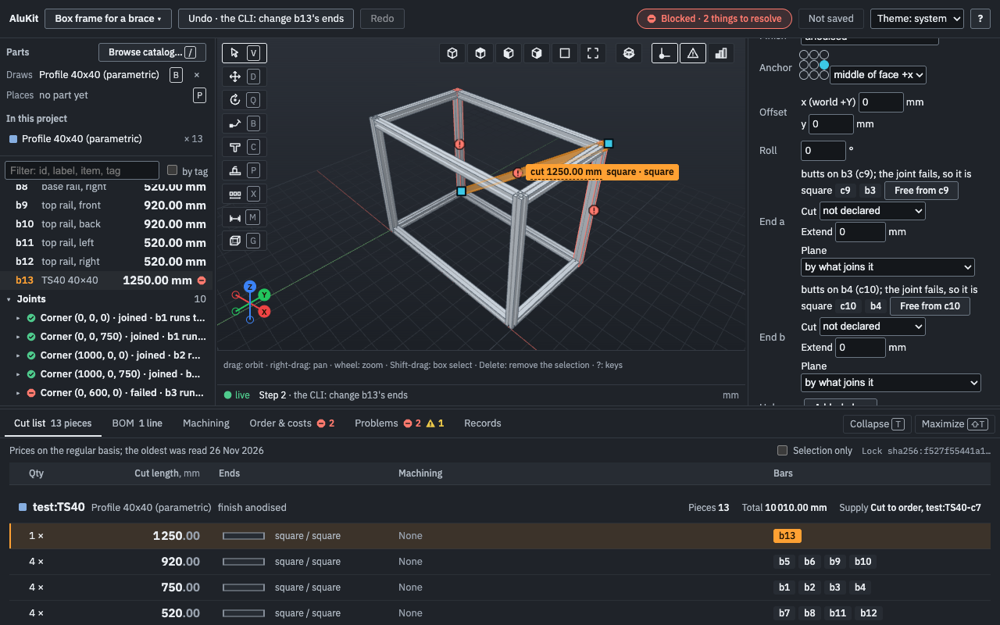
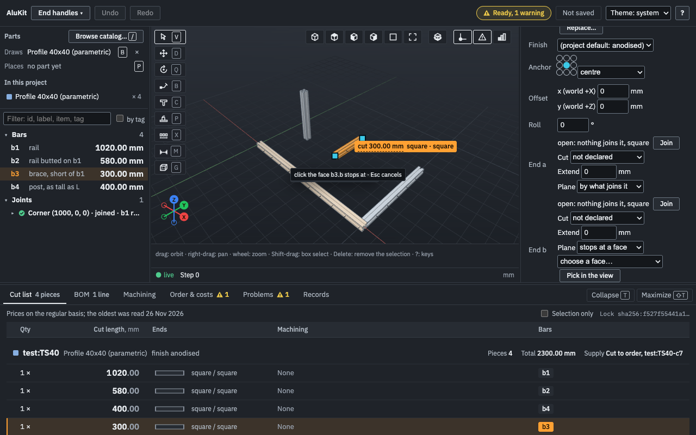
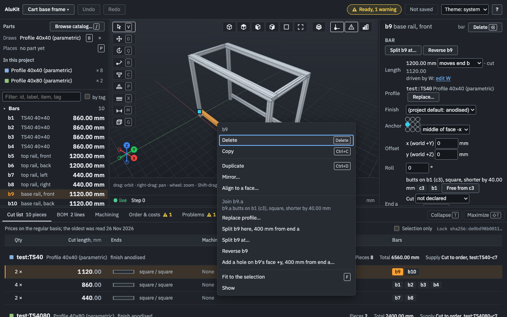
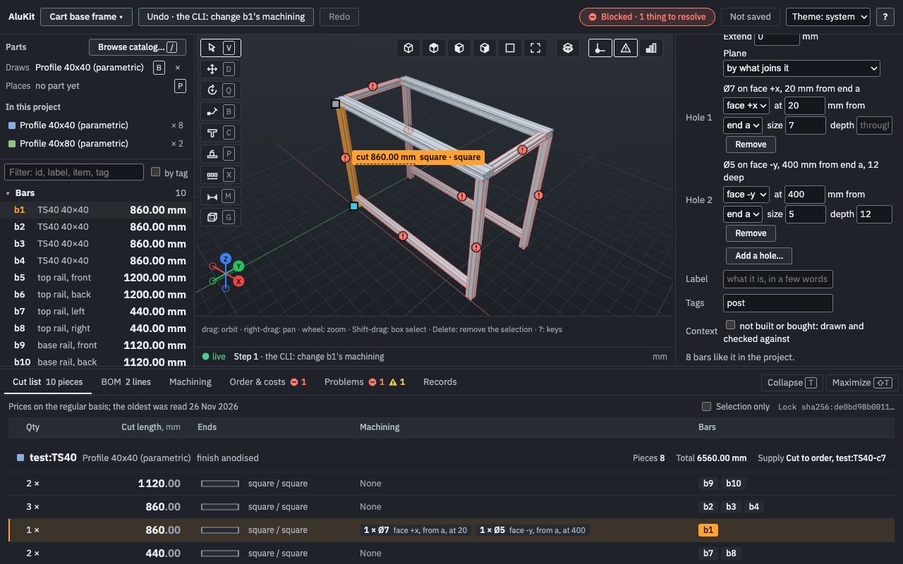
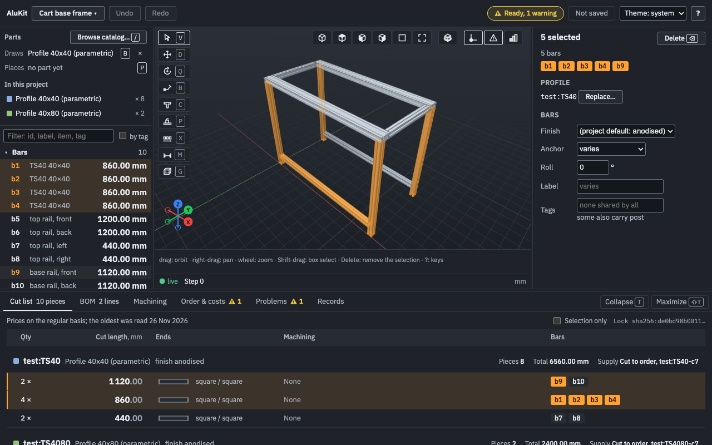
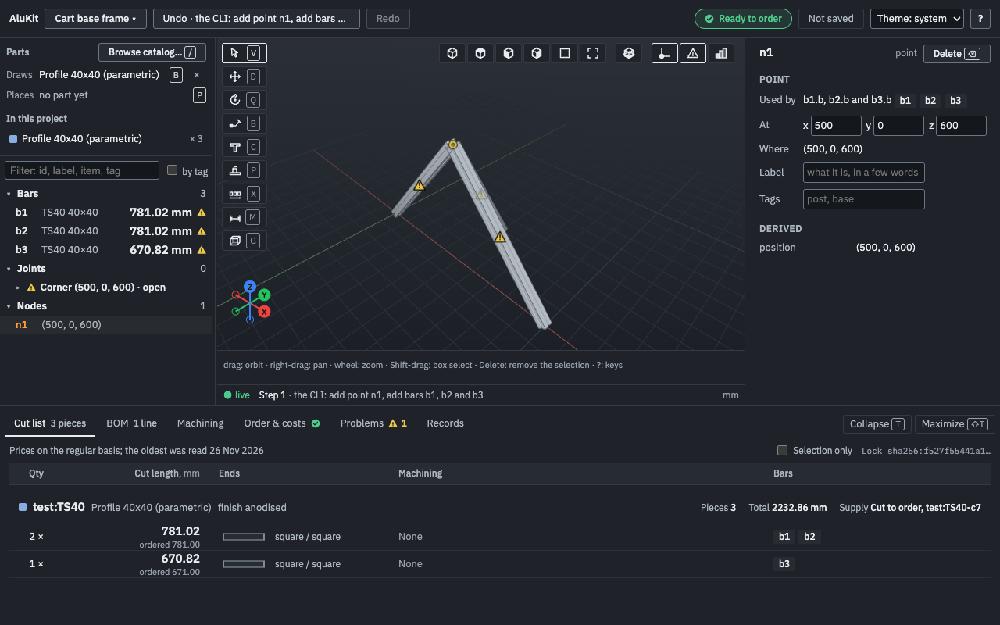
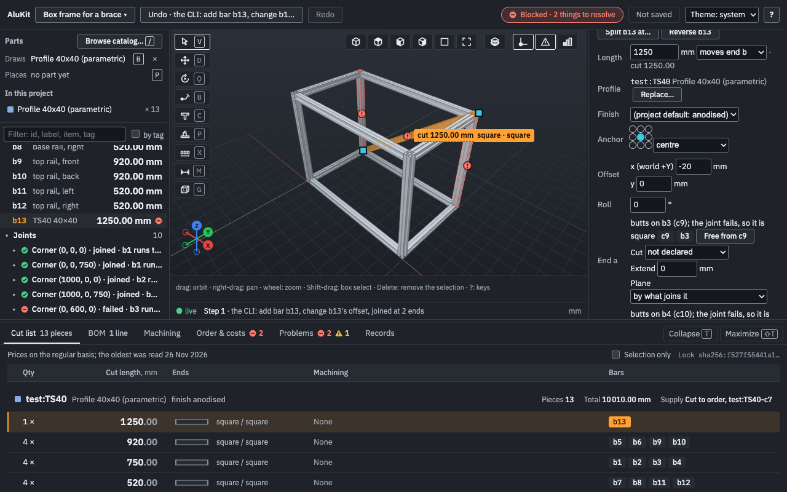
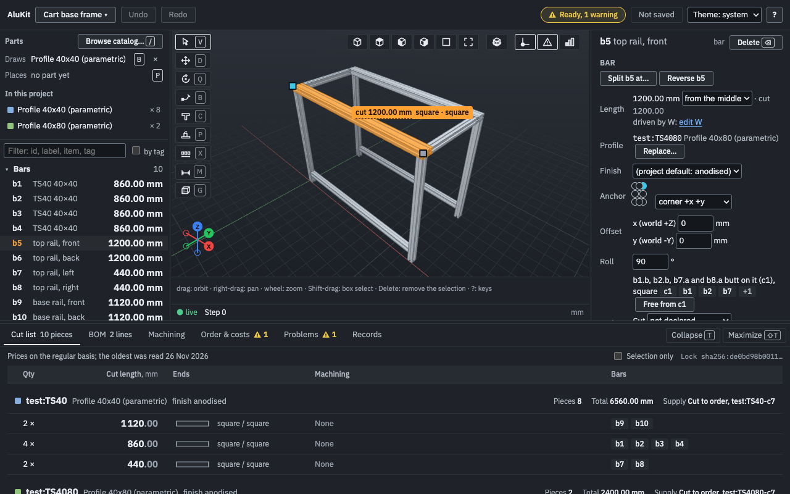

# AluKit editing round, E4: bars and ends

*Stream E4 of the [editing audit](editing-audit.md) (§7.8): a bar's ends edited in its rows (D2's
words among them), its offset and anchor, Split and Reverse, the holes a person adds, fields for
several selected, lengths that bind params, and a node's fields. It builds on E0's contracts
([e0-decisions.md](e0-decisions.md)), E1's core ([e1-decisions.md](e1-decisions.md)) and the end
handles ([drag-ends-decisions.md](drag-ends-decisions.md), cited as "drag n"). Every edit is a
command the core already had (`setBar`, `setConnection`, `removeEntity`, `splitBar`,
`reverseBar`, `moveNode`, `label`, `tag`), sent as `alukit do` would send it: nothing new in the
commands or the CLI, so CLI parity is the existing commands' (§7.5's rule). The one change in the
core is the BOM's Markdown (e4 22); after the stream, the end hold reads the claims (e4 23, 24). Decisions are cited as "e4 n". Labels: **measured** (a test or
a run says so), **read** (from the code or the page cited), **inferred**.*

## Done

| Id | What | Where | Test | Failed first |
|---|---|---|---|---|
| E4.1 | Each end's row edits its cut (not declared, angle, square), its extension, its plane (by its joint; stopped at a face; flush with an end; picked in the view) and frees it from the joint that claims it; the words name that joint, even when it fails (D2) | `src/ui/inspector/{Ends.tsx,endEdits.ts,words.ts}`, `src/ui/tools/wire/ends.ts` (`endPick`); the view model's `claims` (`src/server/view.ts`, `src/ui/model.ts`) | `ends.spec`: the audit's brace reads "butts on b3 (c9); the joint fails, so it is square", gets both cuts from its rows and derives with no error, cut 1150 as by hand; b3's end b stopped at b1's face +x from its row and picked in the view writes `plane.face`; an extension; Free; `endEdits.test.ts`, `inspector.test.ts` (D2) | yes |
| E4.2 | The Offset row (`off_mm` along the section's x and y, each named by its world direction) and the anchor picked on the section's dots, the command bar's picker made one component | `BarFields.tsx` (`OffsetRow`, `AnchorRow`), `src/ui/common/AnchorDots.tsx`, `src/ui/tools/CommandBar.tsx` (E3's) | `edit.spec`: −20 typed in the brace's x moves it into the frame's plane: the errors and the derived bar equal the CLI's `setBar off_mm [-20, 0]` | yes |
| E4.3 | Split here (the menu's station), Split at… (a typed distance, a splice when asked) and Reverse, from the menu and the inspector's action row; `splitBatch` built | `src/ui/inspector/{barActions.ts,ActionRow.tsx}`, `BarFields.tsx` (`SplitForm`), `src/ui/edit/batches.ts` (`splitBatch`'s body) | `edit.spec`: b9 split at 400 gives 360 and 760, which sum to its 1120; one Undo restores b9; Reverse; `barActions.test.ts` | yes |
| E4.4 | "Add a hole on b1's face +x, 20 mm from end a…" on the menu over a bar's side; the inspector's hole rows edit and remove, one step each | `src/ui/inspector/{holes.ts,Holes.tsx}`, `barActions.ts` (`add-hole`, `holeAsked`) | `edit.spec`: a Ø7 hole 20 mm from end a on b1's +x face gives the `alukit machining` of the CLI's `setBar ops`; changed to M6; removed; `holes.test.ts` | yes |
| E4.5 | Fields for several selected: options, anchor, roll, label and tags, each its shared value or "varies"; one step | `src/ui/inspector/{many.ts,ManyFields.tsx}` | `edit.spec`: four legs set to finish black in one step, one BOM line of four; one Undo takes it back; `many.test.ts` | yes |
| E4.6 | A length typed as a value or an expression (D-UX-17), a param written as typed; end b, end a or both ends from the middle move | `src/ui/inspector/length.ts`, `BarFields.tsx` (`LengthRow`) | `edit.spec`: `=D` on b7 writes `D` in its end b, nothing moving; from the middle, 400 keeps b13's centre; `inspector.test.ts` | yes |
| E4.7 | A node's fields: what uses it; a point's x, y, z or a station's bar, distance, end and face, each one `moveNode` | `src/ui/inspector/{node.ts,NodeFields.tsx}` | `edit.spec`: a tripod's shared node moved by its z field moves every leg's end: the cut list is the CLI's `moveNode`; `node.test.ts` | yes |
| (core) | The BOM's Markdown marks an `est` mass as it marks a `calc` one | `src/core/bom/format.ts` | `generate.test.ts`; `cli.test.ts`'s cart line now asserts the mark | yes |

## Research

| Source | What it does | What AluKit takes |
|---|---|---|
| Inventor Frame Generator's end treatments ([Trim/Extend, Miter, Notch][inv-ends]) | A member is trimmed or extended to a picked model face, with an offset; one treatment replaces another on that end | An end stopped at a face, picked in the view or chosen from the faces its line meets; a plane replaces the end's joint (e4 4–6) |
| Inventor's [Lengthen/Shorten Frame Member][inv-len] | One end or both ends move; a positive distance extends | Which end moves: end b, end a, or both from the middle (e4 16) |
| Revit's Properties palette ([multiple values][rvt-varies], [the palette][rvt-props]) | With several elements selected, the parameters they share; a value that differs reads `<varies>`; an edit applies to all | E-UX-15's "varies", one step, one patch per entity (e4 13) |
| Fusion's [Hole][f360-hole] | A face picked, then the hole's centre dimensioned and its size, depth and thread chosen in the dialog | The menu's face and station prefill the form; a size field takes a drill or a thread (e4 11) |

## Ends (E4.1, D2)

| # | Decision | Why |
|---|---|---|
| 1 | **An end's words name the joint that claims it, from derive's claims**, which the view model now carries (`claims`: every provider of each end, whether or not its plane resolved; not part of `alukit.derived/1`): "butts on b3 (c9)", and when the claim fails, why it fails as derive reads it: "butts on b3 (c9); the joint fails, so it is square", or "two joints claim it". A corner's through end names what bears on it ("b7.a butts on it (c1)"); a miter is "mitred with", a splice "spliced to", a pivot "hinged" | D2: a failed claim leaves the derived plane's provider as the default (**measured**: the brace's two ends read `by: "default"`), so the words said "open: nothing joins it" and offered a Join that `autoConnect` refuses. The claims are the rule `autoConnect` and the checks already apply (**read**: `derive`), so the words cannot disagree with them. "butts on" is what the end handles say (drag 4) |
| 2 | **The cut and the extension are a `setBar` merge patch on `ends.<e>`**: the cut not declared, angle or square; the extension in mm, a param written as typed. An end left empty is removed, and `ends` with it | The document's own fields (§4.5): what the CLI's `setBar` writes, so CLI parity is that command's |
| 3 | **The plane is one of four**: by its joint (the default), stopped at a face, flush with an end, or its own plane (said when written, edited as JSON). The faces offered are the side faces of other bars that the end's line meets beyond the bar's other end, the nearest first, each with how far the end goes ("b1's face +x · 280 mm longer"); the ends offered are the eight nearest | Inventor's Trim/Extend to a face; listing only faces the line meets means no choice derives to a refusal (**measured**: `endEdits.test.ts`) |
| 4 | **"Pick in the view" lets the next press in Select pick the face or end**: the end handles' grab (`wire/ends.ts`, `endPick`) takes it. A bar picked gives the clicked face when the line meets it, else the first face of that bar the line meets; an end picked gives the clicked end face, else the nearer end. A press that gives nothing keeps the pick armed and says why; Esc, another selection or another tool drops it | No new tool or mode: Select's grab is E4's already (the end handles), and a click lands where the person is looking (A14). A click on b1's top, which the line never meets, still stops b3 at b1's +x face (**measured**: `ends.spec`) |
| 5 | **A plane frees the end from its joint in the same step, and declares `cut: "angle"` when the plane is angled and no cut is declared** | An end has one provider (§4.5): a plane beside a butt that still claims the end is "two joints claim it". E-UX-11: the document stays explicit, as `autoConnect` declares the cut it makes |
| 6 | **"Free from c9" drops the end from the joint that claims it, in one step**: from a butt's `ends`; the joint removed when it was its last end, or a miter's or splice's; a corner's through end becomes the butt's other end, or `"none"` | One step that leaves no connection naming nothing; `setConnection` and `removeEntity` are the CLI's own paths |

## Offset and anchor (E4.2)

| # | Decision | Why |
|---|---|---|
| 7 | **The Offset row edits `off_mm` along the section's x and y, each labelled with the world direction it runs in** ("x (world +Y)"), a param written as typed; both nought removes it | Which way a section's x points is not obvious: on the audit's brace the offset that brings it into the frame's plane is [−20, 0], along its section x (world +Y), not the [0, 20] the audit names (**measured**: `alukit do --dry-run`, and `edit.spec`'s oracle) |
| 8 | **The anchor row shows the section's dots beside its list: the command bar's picker, now one component** (`AnchorDots`) both use; the command bar's markup and its tests are unchanged | E4.2's "reuse the command bar's picker"; one picker, so one look and one set of keys |

## Split and Reverse (E4.3)

| # | Decision | Why |
|---|---|---|
| 9 | **Split here splits at the menu's station, to the whole millimetre; Split at… opens a form for a typed distance** (an expression over params, valued: `splitBar` takes a number) **and a splice box**. A bar in a run is spliced whatever the box says | E-UX-21: no connector bought unasked, and a run's bars are spliced by the core anyway (**read**: `splitBar`). The station is rounded, not snapped: E-UX-21's snap needs the snap engine in the menu's context, which E0 did not give it; the typed form is exact |
| 10 | **Reverse says first why not**, in the core's words: a bar in a run ("reverse the run"), a free end b. **The inspector shows the bar actions as buttons** (`ActionRow`, reading the registry), so each has a place besides the menu | The same refusal before and after the click (**read**: `reverseBar`); E-UX-1: an action in the menu is also somewhere a person can see it |

## Holes (E4.4)

| # | Decision | Why |
|---|---|---|
| 11 | **"Add a hole on b1's face +x, 20 mm from end a…" is on the menu only over a bar's side face** (±x, ±y), the station rounded to the millimetre; it opens the inspector's form there, whose distance, end, size (a drill, or a thread such as `M6`) and depth (empty: through) a typed value sets. A button opens the form too | E-UX-22; a hole goes in a side (§4.4's `ops` faces); Fusion's Hole: the face picked, then the numbers typed |
| 12 | **Each hole is a row: its face, distance, end, size and depth edited in place, and Remove. Every change is one `setBar` of the whole `ops` list**; a countersink or counterbore the row does not show stays; the last hole removed removes `ops` | A merge patch replaces a list whole (RFC 7386), so the list is the unit; the CLI's `setBar ops` is the oracle (**measured**: `alukit machining` the same) |

## Several selected (E4.5)

| # | Decision | Why |
|---|---|---|
| 13 | **With several bars selected, the inspector edits their options (when they share one profile), anchor and roll; with any of the document's entities, their label and tags. Each shows the value they share, or "varies"; a change is one step, one patch per entity** | E-UX-15; Revit's palette. Options need one item's choices, so they show only when the profile is shared |
| 14 | **The tags field shows the tags all of them carry; one `tag` command adds a new tag to all and removes a shared tag left out from all; a tag only some carry is left as it is**, and said below the field | A tag on two of five is not lost by an edit that never showed it |
| 15 | **Length is not among the shared fields** | Each bar's length has its own end and driver (e4 16, 17); one typed value would move different ends. **Inferred**; a later round can add it with a "which end" for all |

## Lengths (E4.6)

| # | Decision | Why |
|---|---|---|
| 16 | **A typed length is read as the command bar reads a value (D-UX-17)**, and a param is written as typed: `=D` on a rail along y writes `D` in the coordinate of end b that runs along it. **A select beside the field moves end b (the default), end a, or both ends from the middle**, which keeps the centre (a half written `300 - (D / 2)` when typed with a param) | E-UX-16; Inventor's Lengthen/Shorten (one end, or both). Off the world axes no one coordinate holds an expression, so it asks for a number, as `moveEnd` does |
| 17 | **The field still sends a `setBar` patch of the end's coordinates, not `moveEnd`** | `moveEnd` refuses an end a joint holds (**read**: core `hold.ts`), so `=D` on a butted side rail, E4.6's own case, would be refused; the patch moves the design point and the joint follows it |

## Nodes (E4.7)

| # | Decision | Why |
|---|---|---|
| 18 | **A node selected says what uses it** (the bar ends at it, and planes through it) **and edits where it is: a point's x, y, z, or a station's bar, distance, end and face, each one `moveNode`**, a param written as typed. A pivot's point is said, not edited: the pivot sets it | `moveNode` moves what uses the node (§6), as the CLI does (**measured**: the tripod's cut list the CLI's). The audit's "the skill's example (which uses nodes)" is not so: the worked example has no node (**read**: `skills/alukit`), so the test builds a tripod on three legs that share one |

## Across the stream

| # | Decision | Why |
|---|---|---|
| 19 | **Every edit here is a step the CLI would send, and every form commits on Enter or its button; Esc closes it** | One undo per gesture (E0); a form opened from the menu is the inspector's, so the person sees the bar it acts on |
| 20 | **A typed value that cannot be read says why under its row, and sends nothing** | Fields never guess (D-UX-17) |
| 21 | **A choice's state is keyed by what is written** (the plane select, the form's prefill), not reset by an effect after drawing | **Measured**: an effect that reset the plane select after the step's revision overrode a choice made since |
| 22 | **The BOM's Markdown marks an `est` mass as it marks a `calc` one**, and its heading says what `est` means; CSV and JSON already carried `mass_src` | An estimate read as if published (§3.5's fidelity table); the brief's core item, failing test first |

## An end a failing joint claims (after the stream)

The defect left for E1 below: an end whose joint fails was held by nothing. Fixed in the core,
failing tests first.

| # | Decision | Why |
|---|---|---|
| 23 | **What holds an end is the providers that claim it, not the one whose plane it got.** Core `endHold` takes the end's claims (derive's, the view model's `claims` in the app) and its `by`, which only says whether the claim fails. A joint that fails (an angled end that declares no cut, a miter of two sections) holds its end as a joint that derives does: `moveEnd` refuses it without `detach` and frees it from the joint with it; a failing miter, splice, pivot or plane fixes it. The words add why, in D2's terms: "b13.a butts on b3 (c9), and the joint fails: give detach: true to free it and move it"; the end handle says "…: dragging frees it". The handles and the length label call the same `endHold`, so nothing in the app computes holding apart from it | **Measured**: before, `moveEnd { end: "b13.a", by_mm: 10 }` on the audit's brace with its cuts undeclared moved the end and left c9 listing it, and the handle read `free` (`move.test.ts`, `ends.test.ts`, failing first). The claims are the rule `autoConnect`, the checks and D2's words already apply (e4 1), so the hold now agrees with them. `transform`'s follow and detach read the document's connections, never `by`, so they already kept or freed such an end as a working one's (**measured**: `transform.test.ts`'s case passed before the fix and guards it now) |
| 24 | **Two joints on one end hold it by both.** A provider that fixes the end (its own plane, a miter, a pivot, a splice, a named `through_end`) wins; otherwise `detach` drops it from every butt that lists it, each going with its last end, and `moveEnd`'s answer lists them (`detached: ["c1", "c2"]`, a list now, as `transform`'s `freed` is). A claim name the hold does not know fixes the end rather than freeing it | A butt left listing the end would still claim it, and would be its only provider wherever it lands; the inspector's Free already drops it from every connection that lists it (e4 6). G11 is the case: c1 and c2 both butt b2.a. Refusing an unknown provider is the safe side: a move never lets go of what it cannot name. Call 108 |

## Not changed, for E1

- `hold.ts`'s `endHold` read the derived plane's `by`, so an end whose claim fails (`by:
  "default"`) was held by nothing: `moveEnd` and the end handles treated it as free, though
  derive's claims say a joint claims it. **Fixed after the stream: the hold reads the claims too
  (e4 23, 24).**

## Screenshots

1280 × 800, dark.

| | |
|---|---|
|  |  |
| An end's row (D2) | A face stop picked in the view |
|  |  |
| The bar's actions on the menu | Holes |
|  |  |
| Several selected | A node's fields |
|  |  |
| Offset and anchor | A length and which end moves |

## Tests

- `tests/e2e/ends.spec.ts`: the audit's brace (D2's words, both cuts from the rows, no error, cut
  1150); a face stop from the row and picked in the view; an extension and Free.
- `tests/e2e/edit.spec.ts`: `=D` and the middle (E4.6); split and reverse (E4.3); the offset and the
  anchor dots (E4.2); four legs' finish (E4.5); a hole against `alukit machining` (E4.4); a node's
  field against `moveNode` (E4.7).
- `src/ui/inspector/inspector.test.ts`: D2's words; lengths bound to params from either end or the
  middle. `endEdits.test.ts`: cuts, extensions, faces and ends offered, picks, freeing.
  `barActions.test.ts`: `splitBatch`, Split here, Reverse. `holes.test.ts`, `many.test.ts`,
  `node.test.ts`.
- `src/core/derive/generate.test.ts`: the `est` mark; `src/cli/cli.test.ts` (E1's): the cart's
  carriage line asserts it.
- `tests/e2e/menu.spec.ts` (E2's): the menu on b1 lists Split here, Split at…, Reverse and the hole
  entry after Replace; the type-ahead's index follows. Nothing else changed.

[inv-ends]: https://help.autodesk.com/cloudhelp/2025/ENU/Inventor-Help/files/GUID-BE98918A-2419-4432-AAE5-46A3E56552FE.htm
[inv-len]: https://help.autodesk.com/cloudhelp/2017/ENU/Inventor-Help/files/GUID-7829DFC9-B0E1-4302-8BA4-C39B789D2AFB.htm
[rvt-varies]: https://help.autodesk.com/cloudhelp/2024/ENU/Revit-Customize/files/GUID-A1F618B8-8C65-4D4B-B2E8-E24A190900B6.htm
[rvt-props]: https://help.autodesk.com/cloudhelp/2024/ENU/Revit-GetStarted/files/GUID-A764EA7A-FE26-469B-857C-F3A70812FC34.htm
[f360-hole]: https://help.autodesk.com/cloudhelp/ENU/Fusion-Model/files/GUID-3A76B269-8C8D-437B-8F4A-85D0B2BBA492.htm
