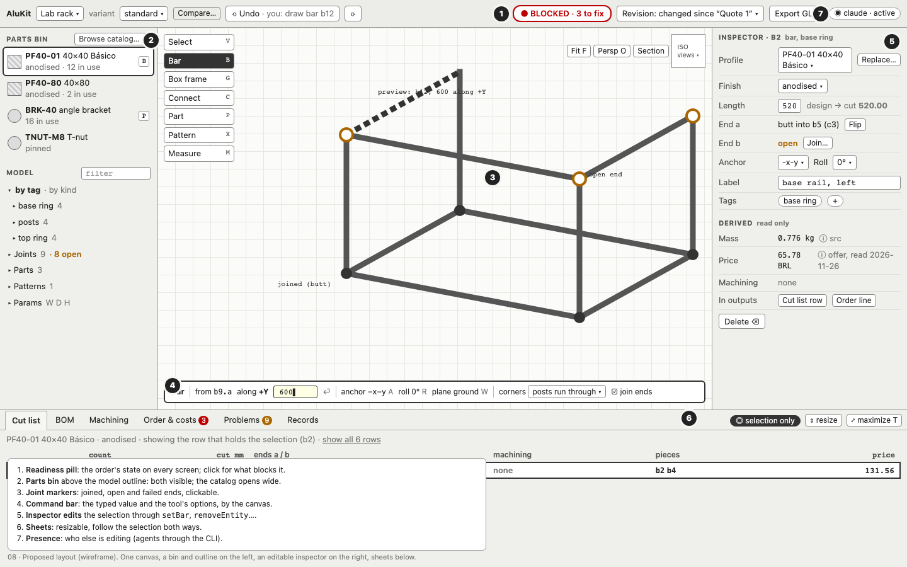
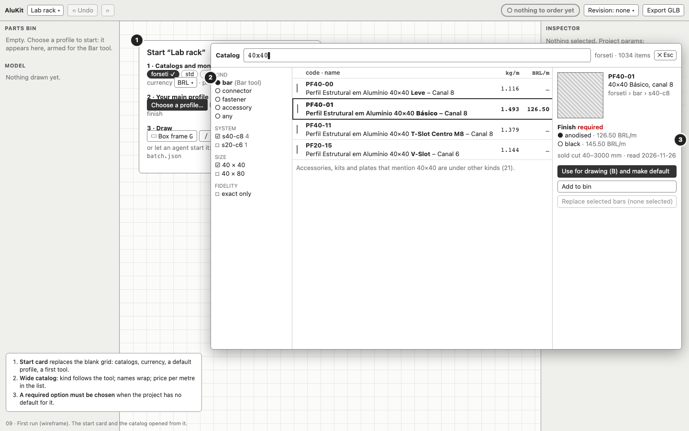
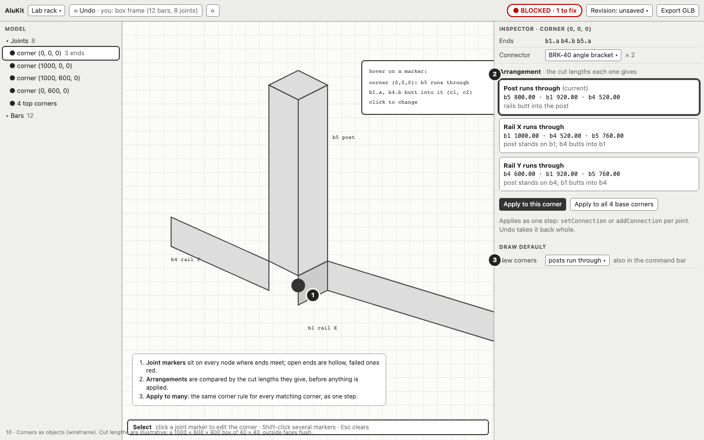
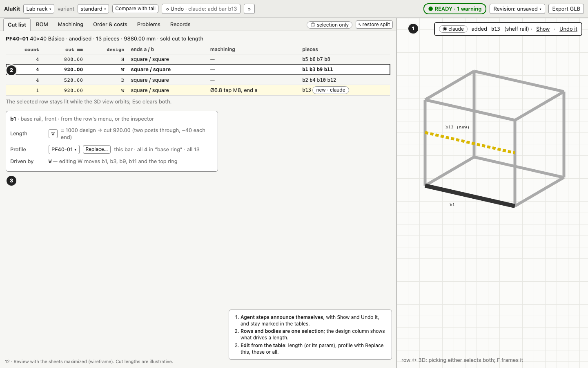
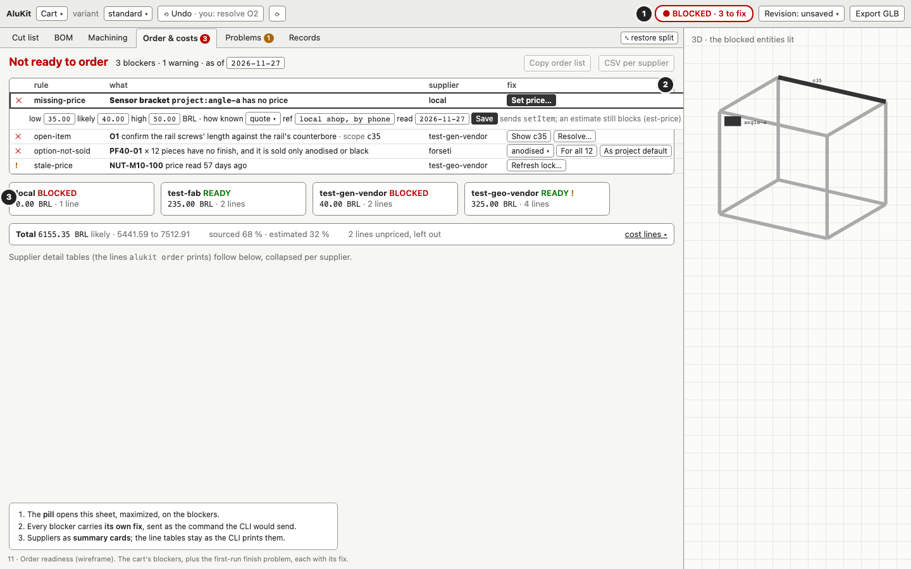

# Task flows and information architecture: findings and a redesign proposal

*2026-11-27. One of three parallel UX proposals (the others cover heuristics and first run, and
visual design). This one covers **task flows and information architecture**: what a person has to
do, in what order and where, to get each job done. It changes no product code.*

*Labels, as the decision notes use them: **measured** (driven in the built app with Playwright,
Chromium on SwiftShader, 1440 × 900, on scratch copies of `tests/fixtures/cart` and of a new empty
`forseti` project; counts are what the script did), **read** (from the code or the docs at this
commit), **inferred** (reasoning, not run), **vendor** (from a vendor's own page, or from search
excerpts of one where the page refused a direct read).*

## Contents

1. [Summary](#1-summary)
2. [The jobs, walked](#2-the-jobs-walked)
3. [Problems, ranked](#3-problems-ranked)
4. [What established tools do](#4-what-established-tools-do)
5. [Proposal: the information architecture](#5-proposal-the-information-architecture)
6. [The primary flows, redrawn](#6-the-primary-flows-redrawn)
7. [What to keep](#7-what-to-keep)
8. [Recommendations, ranked](#8-recommendations-ranked)
9. [What the proposal asks of the contract](#9-what-the-proposal-asks-of-the-contract)
10. [Open questions](#10-open-questions)

## 1. Summary

The app is organised around **the document's structure**: a tree of entities, a catalog column, a
read-only properties panel and a drawer of ten tabs, one per output or record. The jobs a person
comes with (*draw a frame, fix a corner, change a bar, get to an order I can send*) cut across
those panels, and three of them end in a dead end in the app today.

**The eight problems that matter most** (section 3 has the evidence):

1. **Nothing drawn can be edited or deleted in the app.** The properties panel is read-only;
   Delete, Backspace, double-click and right-click do nothing (measured). Changing a bar's length
   or profile means Undo and redraw, or the CLI.
2. **Joints are invisible and decided by drawing order.** A 1000 × 600 rectangle drawn with
   auto-connect gave four different cut lengths (1040, 600, 1000, 560) and eight open corners
   (measured). Closing one corner with Connect said "made c9" and silently created an error on
   another bar.
3. **The order's state is buried.** BLOCKED shows only inside the Order tab, which has no badge,
   while the Checks tab says "0 errors" (measured on the cart). Blockers name their cause but offer
   no fix, and two kinds (a missing price, a missing finish) have no fix anywhere in the app.
4. **The first bar a new user draws blocks the order.** The catalog card offers the finish
   "(the project's default)" in a project that has none; the bar is drawn without one and the order
   says `option-not-sold … not sold with` (measured).
5. **Project setup lives only in the CLI or the JSON.** Catalogs, currency, the default profile and
   finish, kerf and order rules have no command and no screen (read).
6. **The catalog and the model fight for one 260 px column**, names truncate before the words that
   tell profiles apart, and search for "40x40" ranks a caster plate first (measured).
7. **Outputs, problems, records and history share one flat, fixed-height drawer** of ten tabs,
   with one-way cross-selection: a row selects in 3D but does not frame it, and a 3D selection does
   not find its rows (measured, read).
8. **Feedback lands far from the act, and agents act unseen.** Command refusals appear in the top
   bar in schema terms (`pattern: addPattern: template/0: Invalid input`); an agent's edit arrives
   with no sign of who made it, and Undo would take it back (measured).

**The proposal in a few lines.** One persistent 3D canvas, with:

- a **parts bin and model outline** on the left (the bin holds what the project uses; the full
  catalog opens wide, on demand);
- an **editable inspector** on the right, for bars, parts, connections and corners;
- a **command bar** on the canvas for the active tool's typed value and options;
- **joint markers** in 3D that make every corner visible and changeable;
- **sheets** below: Cut list, BOM, Machining, Order & costs, Problems, Records, resizable and
  linked to the selection both ways;
- a **readiness pill** in the top bar that is always visible and opens the blockers, each with
  its fix.

Every action still sends the commands the CLI sends; four small contract additions (section 9)
unlock the rest.

**Top recommendations** (section 8 ranks all 16):

| # | Recommendation | Impact | Effort |
|---|---|---|---|
| R1 | Require a sold option when a bar is armed; no phantom "project default" | High | S |
| R2 | Readiness pill in the top bar; blockers listed first, each with its fix | High | M |
| R3 | Editable inspector, Delete, and Replace profile (this one, these, all like it) | High | M |
| R4 | Joint markers and a corner inspector that compares arrangements by cut length | High | M–L |
| R5 | Box frame tool: corner, `W,D`, height, corner rule; one parametric step | High | M |
| R6 | Sheets panel: grouped, resizable, two-way selection, "selection only" | High | M |
| R7 | Parts bin plus a wide catalog overlay with kind facets and required options | High | M |
| R8 | Start card and a project settings screen (catalogs, currency, defaults, rules) | High | M |
| R9 | Agent presence: a toast with Show and Undo it, a source on the Undo button | Medium | S |
| R10 | Consequences shown at the act: errors in the tool, a result chip after commit | Medium | S |

## 2. The jobs, walked

Each job was walked twice: as a first-time user (an empty `forseti` project made with
`alukit new --catalog forseti --currency BRL`) and as an expert (the cart fixture). Clicks count
pointer presses; keys count keystrokes, Enter included.

### 2.1 Start a project, pick catalogs, find a profile

| Step | First-time user (measured) | Note |
|---|---|---|
| Start | `alukit new` and `alukit serve` in a terminal; the tab opens on an empty grid | The CLI is the only way to make a project or choose its catalogs and currency (read: no command touches `catalogs`, `currency` or `defaults`) |
| Look around | Empty tree, "No pieces." in the drawer, "Select a bar…" on the right | No first step is offered ([01](img/flows/01-today-empty-project.png)) |
| Try to draw | Press Draw bar, click the grid | The hint says "no bar in the palette: set one from the catalog"; the click does nothing |
| Find a profile | Catalog tab, type `40x40` | 25 hits; a caster plate and a hinge kit rank above the basic profile, which comes 5th. Names cut off before *Leve*, *Básico*, *V-Slot* ([02](img/flows/02-today-catalog-search.png)) |
| Choose it | Click PF40-01, then Set as palette (draw) | The finish select reads "(the project's default)"; this project has no default finish |
| Total | **5 clicks, 7 keys** to the first possible bar, including the dead end | The tree is gone while the catalog is open: they share the column |

Expert: the same path, minus the dead end (3 clicks and the search). Neither run can add a
catalog, change the currency or set a default profile in the app.

### 2.2 Draw a rectangular base frame with four posts, connect the corners

| Step | Measured | Result |
|---|---|---|
| Ground rectangle, 1000 × 600 | 4 bars: click a start, hover the axis, type the length, Enter | Cut lengths **1040, 600, 1000, 560**: auto-connect's corner rule (the through bar is the one passing through, else a vertical, else the lowest id) runs whichever bar came first through both its corners |
| Four posts, 800 | 4 bars from the corners, typed | Each cut **820**; each post's foot is left unconnected |
| Top rectangle | 4 bars, corner to corner, two clicks each | Cut **960, 580, 980, 600**: the same chain |
| Total | **16 clicks, 35 keys**, 12 steps | 12 bars, 8 butts, **8 `unconnected` warnings** (one per corner), and an order already BLOCKED (section 2.5) |
| Connect one corner | `C`, click the rail (through), click the post's foot, Apply: **3 clicks, 1 key** | The panel says "made c9". Derive now reports **error `two-providers`: b1.a has 2 providers (c4, c9)**, shown only as a red "1" on the Checks tab and a red `b1` in the tree ([04](img/flows/04-today-connect-made-error-elsewhere.png)) |

The design records why: a frame whose posts stand under its rails "is drawn with auto-connect off
and joined with Connect", and whether the rule should change is open (design §4.5, call 6; read).
A person meets that rule as lengths they did not ask for. Nothing on screen says which bar runs
through at a corner; it shows only in the properties panel's derived section ("end a: square, by
c4, moved 20 mm") once you select the bar ([03](img/flows/03-today-drawn-box-readonly.png)).
Fixing all eight open corners this way would be eight more Connect rounds, each able to break
another corner as the first one did (inferred from the one measured).

### 2.3 Place a bracket and add a pattern

| Step | Expert on the cart (measured) |
|---|---|
| Find the bracket | Catalog tab, type `bracket`, click BRK-40, Set as palette: the tool switches to Place part |
| Place it | Click a face. **The first click, on a slat that is a pattern copy, showed the hint "b26@1 +y face at 0" and set nothing**; the second, on a post, took. Type 200, press Place |
| Total to place | **6 clicks, 10 keys** (5 without the failed click) |
| Pattern it | Pick the part in the tree, press Pattern (it has no key), "use selection", click the post, type pitch and count, Create: **5 clicks, 4 keys** |
| A wrong template | Refused with `pattern: addPattern: template/0: Invalid input` in the top bar, far from the panel ([06](img/flows/06-today-error-in-top-bar.png)) |

### 2.4 Edit a bar's length or profile

**Dead end** (measured). Selecting a bar shows its fields as JSON-like text (`a [0,0,0]`) and its
derived values, all read-only. Delete and Backspace change nothing (the revision stays at 12);
double-click and right-click open nothing. The only paths are Undo and redraw, a param the bar
happens to be drawn from (the Params tab can change `W`), or `alukit do '<setBar …>'`. The design
lists editing an existing connection as a v1 limit (§8; read); editing a bar or a part is not
listed at all, although `setBar`, `setPart`, `label`, `tag` and `removeEntity` exist (read).

### 2.5 Read the cut list, BOM and order; find why it is blocked; fix it

| Step | Measured on the cart |
|---|---|
| Is it ready? | Nothing outside the Order tab says so. The Checks tab says **"0 errors, 0 warnings"**; the Order tab, once opened, says **BLOCKED** ([05](img/flows/05-today-order-blocked.png)) |
| Why? | Reasons per supplier: `open-item O2`, `missing-price project:angle-a`, `open-item O1`, a `stale-price` warning. An entity link (`c35`) selects it in the tree and properties; the camera does not move to it |
| Fix O2 | Open items tab, Resolve…, type a resolution, Resolve, back to Order to see the effect: **4 clicks** and the text |
| Fix the missing price | **No path in the app.** The project item's price is `setItem` (CLI or JSON) |
| First-time user's order | BLOCKED from the first bar: `option-not-sold forseti:PF40-01: not sold with` (the option list prints empty) and a warning `has no offer that sells it by length`. No path in the app to set the finish on drawn bars |

The drawer is 32 % of the window's height, fixed, and open by default; it closes by clicking the
active tab again (read: `style.css`, `Drawer.tsx`). On 1440 × 900 it leaves the 3D view 572 px
tall.

### 2.6 Compare variants, save a revision, export GLB

| Job | Measured | Note |
|---|---|---|
| Compare variants | Pick `tall` in the top bar's switch; every view follows | No comparison in the app: flipping and remembering is the only way. `alukit diff . --variant standard --variant tall` does it in the CLI |
| Save a revision | Revision button, type a name, Save revision: **2 clicks** and the name | Works. The panel stays open until its button is pressed again; in the run it covered the Connect panel |
| Export GLB | **1 click** | Works, and names the variant in the file |

### 2.7 An agent edits while the tab is open

`alukit add bar … --as claude` against the running server: the bar appeared within a second
(measured). The top bar's Undo then read **"Undo addBar"**, with nothing to say it was the agent's
step; the Log tab is the only place that shows `cli:claude` ([07](img/flows/07-today-agent-edit.png)).
Nothing marks the new bar. (`--as agent:designer` was refused with "source: ui, cli, cli:<name> or
agent:<name>", a CLI wording issue outside this proposal's scope.)

## 3. Problems, ranked

Ranked by how often a job meets them and how badly they stop it.

| # | Problem | Evidence | Jobs hit |
|---|---|---|---|
| P1 | **No edit or delete for anything drawn.** Properties are read-only; no Delete, no Replace, no context menu | 2.4 (measured); `Properties.tsx` renders tables only (read) | Edit, every correction |
| P2 | **Joints are implicit, order-dependent and unseen.** Auto-connect picks the through bar by drawing order; open ends are warnings in a tab; Connect reports success while derive fails elsewhere, because the panel shows only diagnostics on the new connection's id (read: `newDiagnostics(outcome, [id])`) | 2.2 (measured) | Draw, connect |
| P3 | **The order gate is buried and has no fixes.** No badge on Order, Checks disagrees in tone, reasons name entities but offer no action; missing price, missing option and placeholder have no fix in the app | 2.5 (measured) | Order |
| P4 | **A required option can be skipped.** The palette's "(the project's default)" exists even when the project has none | 2.1, 2.5 (measured) | First bar, order |
| P5 | **Project setup is CLI-only.** No command sets `catalogs`, `currency`, `price_basis`, `defaults` or `order_rules` (read) | 2.1 | Start |
| P6 | **Catalog and model compete for one column; the catalog is too narrow to choose in.** Truncated names, small thumbnails, no price in the list, kind-blind ranking, the first 60 of 1034 when browsing | 2.1, 2.3 (measured) | Find, place |
| P7 | **One flat drawer mixes four kinds of thing** (outputs, diagnostics, document records, history) in ten tabs at a fixed 32 vh, with one-way linking to 3D | 2.5 (measured); `Drawer.tsx` (read) | Read outputs, fix |
| P8 | **Feedback is far from the act and in the code's words.** Refusals in the top bar notice; undo labels are command names (`Undo addBar, autoConnect…`); fields as JSON | 2.3, 2.7 (measured) | All |
| P9 | **Agent edits are silent.** No attribution on Undo, no highlight, history only in the Log tab | 2.7 (measured) | Agent co-editing, the product's distinguishing job |
| P10 | **Variants can be viewed but not compared, and editing while a variant is shown writes to the base document** with only a tooltip saying so | 2.6 (measured); design §8 (read) | Compare |
| P11 | **Tools are uneven.** Pattern has no key; a hint can promise a target the click then ignores (a pattern copy's face); face-joint fasteners are typed as item ids with no picker; the tool panel stacks above properties and pushes them down | 2.3 (measured); `ToolPanel.tsx` (read) | Place, pattern, connect |

## 4. What established tools do

Read on 2026-11-27. What each one teaches is in the last column, and section 8 cites it.

| Tool | What it does that matters here | Lesson |
|---|---|---|
| [Onshape Frames](https://www.onshape.com/en/features/frames) ([help](https://cad.onshape.com/help/Content/frame.htm), [cut list](https://cad.onshape.com/help/Content/frame_cut_list.htm)) | You pick a standard, a profile type and a size from lists. A **default corner type** (miter, butt, coped butt, none) applies to every corner, and **Corner override** changes it for the corners you select. Butt corners show **an arrow that flips which member runs through**. The cut list is built in (read) | Corners are first-class objects with a default and overrides, and "which bar runs through" is one click. Basis for R4 and R5 |
| [Onshape BOM](https://cad.onshape.com/help/Content/bill_of_material.htm) | **Editable cells are white, read-only grey**, and an edit in the table "automatically updates the properties at the part" (read) | Edit where you read: the sheets can carry the inspector's fields. Basis for R6 |
| [SketchUp drawing basics](https://help.sketchup.com/en/sketchup/introducing-drawing-basics-and-concepts) ([quick reference](https://download.sketchup.com/QRC2026/HC-QRC2026-en-SU-mac.pdf)) | Point and linear inferences; **arrow keys lock an axis** (right red, left green, up blue), Shift locks the current inference; **after a click you type a value and press Enter**, and may type again to amend it until the next operation; Entity Info edits a line's length afterwards (read) | AluKit's draw tool already has the inference and the typed length: keep them. Add axis keys, amend-by-typing after the act, and an editable inspector. Basis for R3, R11 |
| [SketchUp Materials panel](https://help.sketchup.com/en/navigating-materials-panel) | An **In Model** collection: the materials the model uses, kept current as they are added and purged (read) | A small "what this project uses" bin beside the outline, the big library elsewhere. Basis for R7 |
| Fusion ([marking menu](https://www.autodesk.com/products/fusion-360/blog/quick-tip-marking-menu/), [S key](https://www.autodesk.com/products/fusion-360/blog/quick-tip-the-s-key/), [sweep](https://www.autodesk.com/products/fusion-360/blog/?p=82023)) | Fusion has **no native frame generator**: users sweep a profile along a sketch, or buy a structural-member add-in modelled on Inventor's Frame Generator ([idea thread](https://forums.autodesk.com/t5/fusion-360-ideastation/fusion-360-frame-generator/idi-p/7103319/page/2), read). Tool access is a right-click radial menu and an S-key toolbox | Fusion's lesson here is about access, not frames: a context action on what is under the pointer (right-click) and a searchable command list. Basis for R12 |
| [item24 Engineering Tool](https://tools.item24.com/MXen/tools/engineeringtool/) ([product page](https://www.item24.com/en-ie/online-tools/engineeringtool)) | Browser tool; drag-and-drop from item's kit; it "automatically selects the appropriate Fastening Set"; templates; collision checks (vendor). The owner tried it: no custom catalog, and the interface doesn't let you do much ([BRAINSTORM](../../BRAINSTORM.md)) | **Avoid**: one vendor's catalog, and automation you cannot see or override. Keep AluKit's typed precision and open catalogs; make every automatic choice (the corner rule, the connector) visible and changeable |
| [MISUMI FRAMES](https://us.misumi-ec.com/service/promotion/frames/) | Desktop app. Frames are placed by clicking start and end points, with the length typed via Tab; brackets and nuts are added at assembly points and counted in the BOM; **blue marks a correctly fastened part, orange an alignment, red an error**; the parts list shows quantity, price and delivery as you design (vendor, from search excerpts: the pages refused a direct read) | Joint state as colour in the 3D view; the price as you draw. Basis for R2, R4 |
| [TSLOTS TBUILD](https://tslots.com/tbuild-design-software) | Web, drag and drop; **right-click an extrusion, Replace: this piece or every instance of the item** with another profile of the same size; real-time price; BOM and PDF export (vendor) | Replace with a scope. Basis for R3 |
| [Bosch Rexroth MTpro](https://www.boschrexroth.com/en/de/products/industrial-solutions/assembly-technology/engineering-software-mtpro/) ([design tools](https://www.boschrexroth.com/en/us/c/design-tools/)) | Layout Designer, online and on Windows; **generates order lists** and sends quote requests (vendor) | The order list is a destination, not a report. Basis for R2 |
| [MiniTec workstation configurator](https://www.minitec.de/en/products/workplace-systems/workstation-configurator) ([launch note](https://www.minitec.de/en/service/news/detailed-news/new-configurator-easier-getting-to-your-individual-workstation)) | **Starts from a basic frame whose dimensions you set**, then adds parts; checks plausibility; PDF and a request (vendor) | Start from a frame, not from a bar. Basis for R5 |
| [OpenBuilds Part Store](https://openbuildspartstore.com/blog/openbuilds-vslot-now-available-in-all-new-500mm-lengths/) | Fixed stock lengths; no build-list or cut-list tool was found (search) | AluKit's cut list with nesting is already beyond the hobby stores: keep it prominent |

## 5. Proposal: the information architecture

### 5.1 Principles

1. **One canvas, always there.** No modes that hide the 3D view; the sheets grow and shrink
   around it. The loop *draw → see the cut and the price → adjust* stays on one screen.
2. **Organise by job, not by data type.** Build with the bin and the tools; inspect and change
   with the inspector; read and buy with the sheets; settle the project once in settings.
3. **Every automatic choice is visible and reversible in place:** the through bar at a corner,
   the connector, a default option.
4. **Show consequences where the act happened**, in the person's words (cut lengths, not
   command names).
5. **The CLI and the app stay one system:** every control sends a command the CLI could send,
   and every step from the CLI shows in the app, attributed.

### 5.2 Regions



```
┌ Top bar ──────────────────────────────────────────────────────────────────────────────────────┐
│ AluKit  Project ▾  variant ▾ [Compare]  ⟲ Undo · who: what  ⟳   ● BLOCKED · 3   Revision ▾  ⤓  ◉ │
├ Left ───────────┬ Canvas ────────────────────────────────────────────────┬ Inspector ─────────┤
│ PARTS BIN       │ tool rail        3D view, joint markers     view ▾ fit │ the selection,     │
│  armed bar (B)  │ V B G C P X M                                          │ editable:          │
│  armed part (P) │                                                        │  bar · part ·      │
│  + Browse… (/)  │                                                        │  connection ·      │
│ MODEL           │                                                        │  corner · several  │
│  by tag / kind  │ ┌ command bar: tool · typed value ⏎ · options ───────┐ │ nothing: params    │
│  Joints ⚠ open  │ └──────────────────────────────────────────────────────┘ │ [Delete]           │
├─────────────────┴────────────────────────────────────────────────────────┴────────────────────┤
│ SHEETS  Cut list · BOM · Machining · Order & costs ③ · Problems ⑨ · Records   ◎ selection ⇕ ⤢ │
└────────────────────────────────────────────────────────────────────────────────────────────────┘
```

| Region | Holds | Replaces |
|---|---|---|
| Top bar | Project menu (settings, catalogs, revisions, export, history), variant and Compare, Undo and Redo naming **who** and **what**, the **readiness pill**, the revision pill, Export GLB, presence | Today's top bar; the pill and presence are new |
| Left: Parts bin | The items the project uses or pins, each with its options; one click arms it for Bar or Part; "Browse catalog…" (`/`) opens the catalog wide | The Catalog tab |
| Left: Model | The outline by tag or by kind, with **Joints** (open ones counted), Parts, Patterns, Params | The Project tab; Joints and Params are new groups |
| Canvas | Tool rail (left edge), view controls (top right), joint markers, the command bar (bottom edge) | The toolbar that mixed tools and views; the tool panel's typed fields and options |
| Inspector | Editable fields of the selection; derived values read-only with provenance; Delete; "In outputs" links; with nothing selected, the params | Properties (read-only) and the tool panel above it |
| Sheets | Cut list, BOM, Machining, Order & costs, Problems, Records; collapsed, split or maximized; "selection only" | The ten-tab drawer |
| Catalog overlay | Wide browser: kind facets defaulting to the active tool's kind, system, size, full names, price per metre, required options, Use / Add to bin / Replace selection | The 260 px catalog column |
| Project settings | Catalogs, currency, price basis, default bar and finish, kerf and trim, order rules, fx | Hand edits of `alukit.json` |

### 5.3 Where today's places go

| Today | Proposed home |
|---|---|
| Catalog tab | Parts bin, plus the catalog overlay |
| Project tree | Model outline under the bin |
| Toolbar (tools and views together) | Tool rail and view controls, apart |
| Tool panel (right, above properties) | Command bar on the canvas; the face joint's long form moves to the inspector |
| Properties | Inspector, editable |
| Drawer: Cut list, Machining, BOM | Sheets, same names |
| Drawer: Order, Costs | Sheets › Order & costs: blockers first, supplier cards, totals, cost lines, then the CLI's line tables |
| Drawer: Checks, Open items | Sheets › Problems (checks, open ends, open items), mirrored by joint markers in 3D and by blockers in Order |
| Drawer: Params | Inspector with nothing selected; Records |
| Drawer: Decisions, Log | Sheets › Records (Decisions, Variants, Revisions, History) |
| Revision popover | Revision pill → Records › Revisions |
| Top bar notice | Errors in the tool or inspector that caused them; the top bar keeps only global news (export done, connection lost) |

### 5.4 Keys

All of today's keys stay: `V B C P M` choose tools; `R A W`, digits, Backspace and Enter work
inside Draw; `F` fits, `O` toggles the projection, `Esc` steps back; Ctrl or Cmd with `Z` undoes,
and with Shift redoes. Added, all free today (read: `TOOL_KEYS` and the tools' key handler):

| Key | Does | After |
|---|---|---|
| `G` | Box frame tool | MiniTec's frame-first start |
| `X` | Pattern (today it has no key); also `x4 @150` typed in the command bar after placing | SketchUp's typed arrays after a copy |
| `Delete`, `Backspace` | Delete the selection (in Select, nothing typed), with the referrers listed first | — |
| `→ ← ↑` | Lock the draw axis to X, Y, Z | SketchUp's arrow-key locks |
| `/` | Open the catalog with the search focused | — |
| `T`, `Shift+T` | Sheets: collapse or split; maximize | — |
| `?` | A sheet of every key | — |
| Right-click | Context actions on what is under the pointer: Replace, Flip corner, Delete, Select all like this | Fusion's marking menu; TBUILD's Replace |

## 6. The primary flows, redrawn

Counts in the "proposed" column are **inferred** from the wireframes, for comparison with the
measured counts of section 2.

### F1. Start a project and set it up



```
alukit new + alukit serve         (unchanged: the CLI makes the project)
  → canvas shows a START CARD
      1 Catalogs: forseti ✓  + std  + ref-hiwin  + a folder…   currency BRL ▾   [setProject]
      2 Main profile: [Choose a profile…] ──► catalog overlay, kind = bar
            search "40" → PF40-01 → finish: anodised (required) → [Use for drawing and make default]
                                                        [setProject: defaults.bar]
      3 Draw: [Box frame G]  [Bar B]
```

Today: 5 clicks and 7 keys, a dead end, and a bar that blocks the order. Proposed: about 4 clicks
and 2 keys to an armed, sold profile that is also the project default; catalogs and currency are
changeable later in Project settings.

### F2. Find a profile

```
/  (or "Browse catalog…" in the bin)
  → wide overlay: search focused; Kind preselected from the active tool (Bar → bar)
  → facets: system, size, fidelity; rows show full names, kg/m and price per metre
  → card: big section, required options marked, offers
  → [Use for drawing] arms it   [Add to bin]   [Replace selected bars]
```

Search ranking gains one rule: within the same rank, items of the active tool's kind come first
(`src/catalog/search.ts` is shared with `alukit catalog search`, which would take the same hint as
`--kind` already does, so the two keep ranking alike).

### F3. Draw a rectangular base frame with four posts, and its corners



**Fast path: Box frame (`G`).**

```
G → click a corner on the ground → type 1000,600 ⏏ → type 800 ⏏
  → options in the command bar: rings [base ✓] [top ✓] · corners [posts run through ▾]
    · faces [outside flush ▾] · [✓] make params W D H
  → Enter: one batch = setParam ×3 + addBar ×12 + addConnection ×8   (one undo step)
```

About 2 clicks and 12 keys, versus 16 clicks and 35 keys today, and the result is symmetric,
parametric and closed: no open corners. Every command in the batch exists; the tool predicts ids
with `core/ids.ts`, as the pivot batch already does (read: m4c decision 17).

**Bar by bar** (unchanged gestures, plus what it is missing):

```
B → click → type 1000 ⏎      result chip by the bar: "b1 · cut 1000 · ends open"
  … next bar closes on b1:   chip: "b2 · cut 560 · butts into b1 at c1 [Flip]"
  joint markers appear at every node: ● joined  ○ open  ✕ failed
  Problems badge: "8 open ends" → [Join open corners…] → rule ▾ → one batch
```

**Changing a corner:** click a marker (or `Joints` in the outline). The inspector lists the ends
that meet, the connector, and the possible arrangements with the cut lengths each gives; **Apply
to this corner** or **to all matching corners**, as one step (`setConnection`, or
`removeEntity` plus `addConnection`). Showing those cut lengths before applying needs a dry run
(section 9, A2); without it, the inspector shows the arrangement's rule and the result appears
after Apply, still one Undo away.

### F4. Place a bracket and pattern it

```
click BRK-40 in the bin (or P with it armed)
  → hover a face: the hint shows the distance from the nearer end, live
  → click: placed at once (one step); the command bar shows  at [200▌] from end a ▾ · roll 0° ▾
  → type 150 ⏎ to move it (amends the same step's part with setPart)
  → type x4 @150 ⏎ : pattern along that bar, the part as template (addPattern)
```

About 2 clicks and 12 keys, against 11 clicks and 14 keys today. Hovering a pattern copy says
"copies take no parts: click b26, the template" instead of promising a target the click ignores.
The Pattern tool (`X`) stays for the general case, its template defaulting to the selection.

### F5. Edit a bar's length or profile



```
select the bar (3D, outline or a sheet row)
  → Inspector: Length [520]  design → cut 520.00       setBar (moves the free end along the axis)
              or: Length W  "driven by W: edit W"       setParam
     Profile [PF40-01 ▾] [Replace…] → this bar · all 4 in "base ring" · all 13 like it
                                                         setBar ×n in one batch
     Ends: butt into b5 (c3) [Flip] · open [Join…]
     [Delete ⌫] → "b2 is named by c3, c4: remove them too?"   removeEntity {cascade}
```

Today: impossible in the app. Proposed: select, type, Enter: one step.

### F6. Read the outputs, see why the order is blocked, fix it



```
top bar pill: ● BLOCKED · 3 to fix  ──click──►  Sheets maximized on Order & costs
  "Not ready to order · 3 blockers · 1 warning · as of 2026-11-27"
   ✕ missing-price   Sensor bracket has no price        [Set price…]  → setItem (low/likely/high, src)
   ✕ open-item       O1 confirm the rail screws' length [Show c35] [Resolve…] → resolveOpen
   ✕ option-not-sold PF40-01 × 12 have no finish        [anodised ▾][For all 12][As default]
   ! stale-price     NUT-M10-100 read 57 days ago       [Refresh lock…] → lockUpdate
  supplier cards (READY / BLOCKED, totals) → totals → cost lines → the CLI's line tables
  the pill turns ● READY → [Copy order list] [CSV per supplier] enabled
```

Each fix sends the command the CLI would send, so `alukit order` agrees at once. Today: 4 clicks
across two tabs for an open item, and no fix in the app for the other blockers.

**Cross-selection everywhere.** A row selects its entities in 3D, and `F` frames them. A 3D
selection lights its rows; "selection only" filters every sheet to it. Problems rows carry the
same fixes as Order rows.

### F7. Compare variants, save a revision, export

```
variant ▾ standard   [Compare…] → pick tall → Compare sheet:
   entities only in one side · cut lengths that moved · BOM and order lines · totals Δ
   (the content of `alukit diff . --variant standard --variant tall`)
viewing a non-default variant: a strip under the top bar,
   "Viewing tall. Edits go to the base document."  [Back to standard]
Revision pill: "changed since Quote 1" ▾ → Save as… · Verify · Compare with this revision
Export GLB: unchanged, one click
```

### F8. Work alongside an agent

```
agent step arrives (SSE, source cli:claude)
  → toast: "◉ claude added b13 (shelf rail) · Show · Undo it"   (Show = select and frame)
  → the new or changed entities flash; rows marked "new · claude" until the next own step
  → Undo button: "Undo · claude: add bar b13"
  → Records › History: every step with its source, as `alukit log` prints it
```

## 7. What to keep

- **The command model.** One gesture, one step; Undo and Redo on the server's log for every
  source; no unsaved state in a tab. Everything here sends existing commands, or the additions of
  section 9 with their CLI twins.
- **The draw tool's feel**: the axis that follows the pointer, Shift to free it, typed lengths with
  Enter and nothing pulling once digits are typed, `A`, `R` and `W`. It already matches SketchUp's
  model; this proposal adds to it.
- **Analytic snapping and the hint by the pointer.** It is fast and exact.
- **Provenance on every number**, including in the inspector's derived section.
- **Outputs that equal the CLI's**, byte for byte. The sheets add summaries above the tables but
  keep the tables.
- **The order rules engine.** The block or warn gate is the product's strongest idea; the proposal
  only moves it where it is seen.
- **Export in one click, revisions that save and verify, the section plane as a view setting, the
  read-only banner with Restore, the outline's "by tag" grouping and filter.**

## 8. Recommendations, ranked

Ordered by impact over effort. Effort: S is days, M a week or two, L more; for the app only.
"Contract" says whether the server or CLI contract must grow (section 9).

| # | Recommendation | Fixes | Impact | Effort | Contract | Basis |
|---|---|---|---|---|---|---|
| R1 | When arming a bar whose option has no project default, require a choice (preselect the cheapest sold option); never draw a bar with an option no offer sells | P4 | High | S | none | Measured first-run block |
| R2 | **Readiness pill** in the top bar from `/api/order`'s status; Order & costs opens on a blockers list; each blocker has its fix (`resolveOpen`, `setItem`, `setBar` options, `setPart`, `lockUpdate`) | P3 | High | M (pill alone S) | none | MTpro order lists; MISUMI live price |
| R3 | **Editable inspector**: profile with Replace (this, these, all like it), finish, length or its param, anchor, roll, ends, label, tags; parts' station and roll; connection fields. **Delete** with referrers listed (`removeEntity`, cascade on confirmation) | P1 | High | M | none | SketchUp Entity Info; TBUILD Replace |
| R4 | **Joint markers** in 3D (joined, open, failed) and a **corner inspector** with Flip and arrangements; "Join open corners" as one batch | P2 | High | M; L with live previews | A2 for previews; A4 for a default rule | Onshape corner override and flip; MISUMI colours |
| R5 | **Box frame tool** (`G`): corner, `W,D`, height, rings, corner rule, faces flush, params; one batch | P2, first run | High | M | none (A4 for the rule outside this tool) | MiniTec frame-first; Onshape default corner |
| R6 | **Sheets**: six grouped tabs, resizable and maximizable, state kept per viewer; two-way selection, `F` frames a row, "selection only"; Problems merges checks, open ends and open items | P7 | High | M | none | Onshape BOM |
| R7 | **Parts bin plus a wide catalog overlay** (`/`): kind facet from the active tool, full names, price per metre, required options, Use, Add to bin, Replace selection; kind-aware ranking shared with `catalog search` | P6, P4 | High | M | the ranking hint in `catalog search` | SketchUp In Model |
| R8 | **Start card and Project settings**: catalogs, currency, price basis, default bar and finish, kerf, trim, order rules | P5 | High | M | A1 `setProject` | MiniTec, item24 templates |
| R9 | **Agent presence**: toast with Show and Undo it, highlight, "new · claude" marks, Undo naming the source | P9 | Medium | S | none (the log already carries the source) | — |
| R10 | **Consequences at the act**: refusals in the panel or inspector that sent them, in words; derive's *new* diagnostics anywhere after a step, not only on the new id; a result chip after each draw ("cut 560 · butts into b1 · Flip") | P8, P2 | Medium | S | none | — |
| R11 | **Command bar** on the canvas: the typed value, the tool's options, axis keys `→ ← ↑`, amend by typing after the act, `x4 @150` arrays | P11 | Medium | M | none | SketchUp Measurements box |
| R12 | **Right-click context actions** and a key sheet (`?`): Replace, Flip, Delete, Select all like this, Join | P1, P11 | Medium | S | none | Fusion marking menu |
| R13 | **Compare variants** sheet and the "edits go to the base" strip | P10 | Medium | M (strip S) | A3 `/api/diff` | `alukit diff` |
| R14 | **Plain labels**: undo and history as actions ("draw bar b12"), end treatments as sentences ("extended 20 mm to the far face of b4"), fields as forms, not JSON | P8 | Medium | S | none | — |
| R15 | **Tool fixes**: Pattern key `X`; hover on a pattern copy explains itself; item pickers from the bin for fasteners and stacks in face joints | P11 | Low–Med | S | none | — |
| R16 | **Small layout fixes**: tools apart from views; popovers close on outside click and `Esc`; the drawer's tab no longer toggles it closed (an explicit collapse instead) | P7, P8 | Low | S | none | — |

**A suggested order.** First the S items with no contract change (R1, the pill of R2, R9, R10,
R14, R15, R16): together they remove the measured dead ends' worst surprises. Then R3 and R6,
which change the most jobs. Then R4, R5 and R7, the build experience. Then R8 and R13 with their
contract additions.

## 9. What the proposal asks of the contract

Everything above sends existing commands, except four additions. Each keeps the parity rule: the
app and the CLI gain it together.

| # | Addition | Used by | CLI twin |
|---|---|---|---|
| A1 | `setProject`: an RFC 7396 merge patch over `catalogs`, `currency`, `price_basis`, `fx`, `defaults` and `order_rules`, validated like any command, one step in the log | R8, R1's "make default" | `alukit do '[{"cmd":"setProject",…}]'` |
| A2 | `dryRun: true` on `POST /api/commands`: apply, derive, answer the diagnostics and the cut lengths that would move, write nothing, add no step | R4's previews, R10's chip before commit | `alukit do --dry-run` |
| A3 | `GET /api/diff?a=…&b=…` answering what `alukit diff --format json` prints, sides as the CLI names them (`variant:`, `rev:`) | R13 | `alukit diff` (exists) |
| A4 | A corner preference on `autoConnect` (for example `prefer: "vertical" \| "horizontal" \| "first"`), and a `defaults.corner` the draw tool reads | R4, R5 | `alukit do` with the same argument |

A2 is the one with design weight: §7.1 says a tab holds no unsaved state, and a dry run keeps that
(nothing is written), but it is a second derive path per gesture and needs the same queue as a
step to answer against the current revision.

## 10. Open questions

1. **The corner rule** (design call 6, open): should the default be "posts run through", a
   per-project default (A4), or stay "the bar passing through, else a vertical, else the lowest
   id" with Flip as the remedy? The box frame tool needs an answer either way.
2. **Dry run (A2)**: acceptable as an addition to §7.1, or should previews be computed in the
   browser from the view model, which already carries the frame code (m4b decision 12)?
3. **Placing on click**: should Place commit on the click and be amended by typing (F4), or keep
   the explicit Place button? Committing at once is faster but makes a mis-click a step to undo.
4. **Edits while a variant is shown**: keep writing to the base document (today's rule, §4.10), or
   offer "edit this variant's override" where the change is a param?
5. **Joints in the outline**: corners are not entities (connections are); should the outline list
   nodes where ends meet, or connections grouped by node?
6. **Box frame anchors**: outside faces flush (the cart's convention) or centre lines on the typed
   dimensions? The typed `1000,600` means different cut lengths under each.
7. **Coordination**: the heuristics and first-run proposal likely covers the start card and the
   empty state (F1, R8); the visual proposal covers the look of the pill, markers and sheets.
   This document fixes their place and behaviour only.

## Images

`img/flows/01` to `07` are screenshots of the built app at this commit (measured); `08` to `12`
are wireframes rendered from [`img/flows/mockups.html`](img/flows/mockups.html), with
illustrative numbers.

| | |
|---|---|
| [01](img/flows/01-today-empty-project.png) | An empty project: no first step offered |
| [02](img/flows/02-today-catalog-search.png) | Catalog search for `40x40`: accessories first, names cut off |
| [03](img/flows/03-today-drawn-box-readonly.png) | The drawn box: b1 cut 1040 for a 1000 line; properties read-only |
| [04](img/flows/04-today-connect-made-error-elsewhere.png) | Connect says "made c9"; the error it caused shows only as a badge |
| [05](img/flows/05-today-order-blocked.png) | The cart's order: BLOCKED inside a tab, reasons without fixes |
| [06](img/flows/06-today-error-in-top-bar.png) | A refused pattern, reported in the top bar; fields shown as JSON |
| [07](img/flows/07-today-agent-edit.png) | An agent's bar arrives; Undo would take it back, unattributed |
| [08](img/flows/08-proposed-layout.png) | Proposed layout |
| [09](img/flows/09-proposed-first-run.png) | Start card and the wide catalog |
| [10](img/flows/10-proposed-corners.png) | Joint markers and the corner inspector |
| [11](img/flows/11-proposed-order-readiness.png) | Order readiness with fixes |
| [12](img/flows/12-proposed-review-edit.png) | Review with two-way selection, editing from a row, an agent's step |
