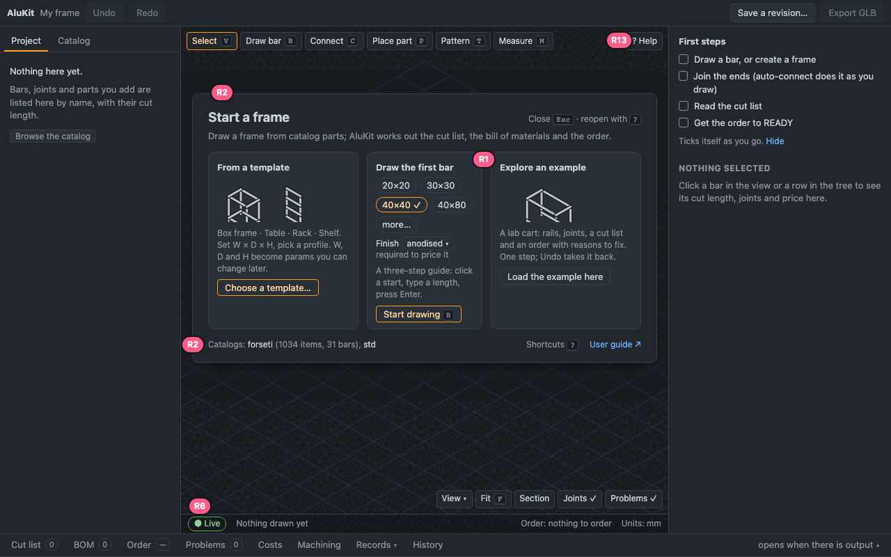
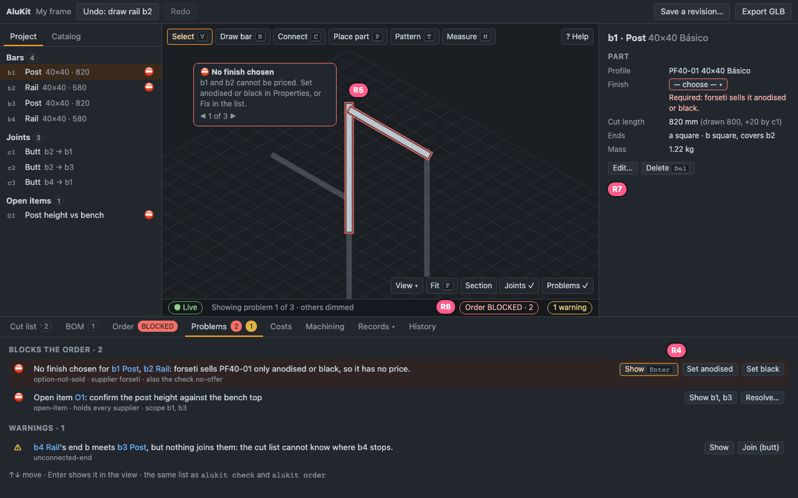

# AluKit UX review: heuristics, first run and feedback

*2026-11-27. One of three parallel UX reviews. The other two cover task flows and information
architecture, and visual design. This one covers usability heuristics, the first-run experience
and feedback. It changes no product code.*

The owner tried a commercial profile configurator and found that its interface "didn't let him
do anything". The test for this review is that complaint turned around: **in the first minute in
AluKit, a new user should have a frame on screen, a cut list under it, and know what still stands
between them and an order.** Today a user who follows the README gets a frame. The order is then
blocked, by a message that ends in mid-sentence (E3).

## Contents

1. [Method](#1-method)
2. [What already works](#2-what-already-works)
3. [Heuristic evaluation](#3-heuristic-evaluation)
4. [First run, step by step](#4-first-run-step-by-step)
5. [Feedback design](#5-feedback-design)
6. [The proposal, ranked](#6-the-proposal-ranked)
7. [Open questions](#7-open-questions)
8. [Sources](#8-sources)

## 1. Method

- **Build:** this branch at `d53ad4d`, `pnpm build`, served with `alukit serve`.
- **Three projects, each a scratch copy:**
  - **cart:** the `tests/fixtures/cart` project.
  - **empty:** what `alukit new <dir>` makes with no options. Its catalog is `std`.
  - **README path:** `alukit new <dir> --name "My frame" --catalog forseti --currency BRL`, as the
    README's Quickstart says.
- **Driving:** Playwright scripts in Chromium (SwiftShader, 1280 × 800). They took screenshots,
  clicked, typed, used the keyboard, and read the page and `window.__alukit`. The scripts were
  throwaway and are not committed; the boards keep what they showed.
- **Errors provoked:**
  - a failing project check and a bar end moved out of place, sent through the CLI while the app
    was open;
  - removing a param that the document reads;
  - wrong picks in Connect;
  - a JSON syntax error, then a misspelt field, written into `alukit.json` (read-only mode);
  - undo and redo of a step the CLI made;
  - typing a unit after a length.
- **Code:** read under `src/ui/` and `src/viewer/`, design §5.5 and §8, and the M4a, M4b and M4c
  decision notes.
- **Accessibility:** focus order recorded over 30 Tab presses; target sizes and text contrast
  measured with computed styles. No automated checker is installed, so none was run.
- **Severity** follows Nielsen's 0–4 scale: 0 not a problem, 1 cosmetic, 2 minor, 3 major,
  4 catastrophe. It weighs how often the problem occurs, its impact, and whether it persists.
- **Provenance:** every finding says how it is known:
  - **measured:** seen in the running app;
  - **code:** read from the executing code;
  - **inferred:** a judgement.

The evidence is on nine annotated boards (E1–E9) and three wireframes (M1–M3) in
[`img/heuristics/`](img/heuristics/). Each finding cites its board.

## 2. What already works

Keep these. Several of the proposals below extend them rather than replace them.

- **Live sync with the CLI and agents.** A CLI edit reaches open tabs in milliseconds (M4a
  decision, **read**). Undo names the step it will take back.
- **The draw gesture itself.** Click, then type a length and press Enter, with an axis guide in
  the axis colour and a snap label by the pointer ("end b1.b", "b2 +y face centre"). Once digits
  are typed, nothing pulls the line (**measured**, E4). This is the SketchUp Measurements-box
  pattern, and it is the best part of the app.
- **Help where the action is.**
  - Connect disables Apply and says why ("a miter takes two ends").
  - The record forms show a refusal under the form that sent it (E6).
- **Provenance.** Popovers on derived numbers, and dimmed outputs (`aria-busy`) while a newer
  revision prices.
- **Read-only mode.** It is announced in a red banner with `role="alert"`, and the tools are
  disabled (E7).
- **Text contrast.** Text passes WCAG 1.4.3 (**measured**): dim text `#8b949e` on `#22272e` is
  4.88:1, the viewport help line 5.38:1, and the drawer tabs 9.73:1.

## 3. Heuristic evaluation

**Sev** is the severity, 0–4. **Board** is the evidence image. **How known** is the provenance.

### H1 Visibility of system status

| # | Finding | Sev | Board | How known |
|---|---|---|---|---|
| F1 | **Auto-connect changes the bars you drew, and says nothing.** A post typed as 800 is cut at 820, and the rail drawn from its top as 600 is cut at 580. The butt moved the post's end up 20 mm to cover the rail. The only trace is "end b: square, by c1, moved 20 mm" in Properties, after selecting b1. | 3 | E4 | measured |
| F2 | **Order readiness shows only inside the Order tab.** A project with four blocking reasons looks like this in the top bar: "live · rev 3 · Revision: unsaved". The Checks badge counts errors only, so a warning that blocks the order (F18) leaves no badge at all. | 3 | E3, E5 | measured |
| F3 | **Two different "revisions" sit side by side.** "rev 3" is the history counter, and it goes up on undo (rev 1 → 2 on undo, → 3 on redo). "Revision: unsaved" is a named snapshot. | 2 | E7 | measured |
| F4 | **Read-only mode does not say what you are looking at.** The "live" pill stays green, and the scene shows the server's last good state with no label, while the file on disk says something else. | 2 | E7 | measured |
| F5 | **Select gives no hover feedback.** Nothing lights before a click, so you only learn what a click picks after making it. Connect does show what it would pick. | 2 | E5 (absence) | code: `scene.ts` sends pointer moves only to an active tool |
| F6 | **Edits by an agent or the CLI arrive silently.** Bars appear, move or vanish. Only the Log tab, and the undo button's tooltip, say who did it. In a tool built for agents to drive, this is the main status a user needs. | 3 | E6 | code: `store.ts` `onEvent("rev")` updates the model and nothing else |
| F7 | **Draw bar with an empty palette contradicts itself.** It says "click a start point", but a click does nothing. The fix ("pick one in the catalog") has no button and lives in a hint by the cursor. | 2 | E1 | measured |

### H2 Match between the system and the real world

| # | Finding | Sev | Board | How known |
|---|---|---|---|---|
| F8 | **The machine's words reach the person:** "Undo addBar, autoConnect, autoConnect", "setParam: D is read by b3 (a/1)…", Properties printing raw JSON (`{"rail_holes":{"along":"r2",…}}`), `through`, `butt`, and fields named `a`/`b` holding `[0,0,800]`. | 3 | E4, E5, E6 | measured |
| F9 | **Anchors are codes in a drop-down** (`c`, `-x-y`, `+x+y`, `-x` …) with no picture of the section. A user has to know the section's local axes to choose one. | 2 | E1 | measured |
| F10 | **Persp/Ortho names the current state, not the action.** It reads as either. | 1 | E1 | measured |
| F11 | **Units and precision drift.** <ul><li>The typed-length hint reads "length: 800" with no unit.</li><li>Properties round to 3 decimals, the cut list to 2, Measure to 2, the hint to 2.</li><li>The catalog list prints "7.356726885756334 kg/m" (std's equal angle, in the list's text).</li></ul> | 2 | E4 | measured |

### H3 User control and freedom

| # | Finding | Sev | Board | How known |
|---|---|---|---|---|
| F12 | **Nothing can be deleted in the app.** There is no Delete key, button or menu (Delete and Backspace on a selected bar left the revision unchanged). Undo helps only if the bar was the last step. Otherwise it is `alukit do … removeEntity`. | 4 | E4 | measured; code: no `removeEntity` in `src/ui/` |
| F13 | **Nothing can be edited in place.** Properties are read-only, so changing a bar's length, profile, finish, anchor or roll means drawing it again or using the CLI. (The task-flow review covers editing; it is listed here for its severity.) | 3 | E4 | code: `Properties.tsx` |
| F14 | **Undo crosses sources without saying so.** The top bar's "Undo addCheck, setBar" took back a step the CLI made; only the tooltip says "(cli)". A person can undo an agent's batch believing it is their own last click. | 3 | E6 | measured |
| F15 | **"Restore last good" writes over the file on disk** (the hand edit) with no confirmation and no word on what is lost. | 3 | E7 | code: `host.ts` `restore()` |
| F16 | **Switching Project ↔ Catalog throws away** the search, the filters and the open item card. | 2 | E2 | measured; code: `App.tsx` unmounts the tab |
| F17 | **Typing a unit drops the bar.** While drawing, `1.2m` became "1.2", then `m` switched to Measure and the gesture was lost, with no message. Every tool letter (V, B, C, P, M) does this mid-gesture. | 3 | E8 | measured; code: `drawKey` passes letters on to `TOOL_KEYS` |

### H4 Consistency and standards

| # | Finding | Sev | Board | How known |
|---|---|---|---|---|
| F18 | **One problem, three vocabularies.** A missing finish is a WARN `no-offer` in Checks, a BLOCK `option-not-sold` in Order, and nothing in the tree or the badge. Checks has error/warn/info, Order has block/warn, and the tree has a red id for errors only. | 3 | E3 | measured |
| F19 | **Orange means everything.** It is the selection colour, the colour of picked ends, the draw preview, the active tool's outline and the accent. The active tool's outline also reads as keyboard focus. | 2 | E9 | code: `mesh/style.ts`, `overlay.ts`, `style.css` |
| F20 | **Esc means three things:** cancel the gesture, leave the tool, clear the selection. Connect's Esc drops every pick at once, not the last one. | 1 | — | code |
| F21 | **The layout breaks at 1280 px.** The toolbar wraps to two rows, and the auto-connect check box sits alone with its label on the next line. | 2 | E1 | measured |

### H5 Error prevention

| # | Finding | Sev | Board | How known |
|---|---|---|---|---|
| F22 | **The README's first frame is born blocked.** The item card offers finish "(the project's default)", but a new project has no default, so the bars are drawn with no finish. Forseti sells PF40-01 only anodised or black, so the bars have no price and the order is BLOCKED. Nothing warned at the moment of choosing. | 4 | E2, E3 | measured |
| F23 | **Search ignores what you are doing.** "40x40" ranks a caster plate first and a hinge kit second; the profiles come 3rd to 5th. Picking the first hit and pressing "Set as palette" switches to Place part. | 3 | E2 | measured |
| F24 | **`alukit new` without `--catalog` gives `std` only:** 19 items (fasteners, threaded rod, flat bar, RHS) and no T-slot profile. The app cannot add a catalog and does not say one is missing. | 3 | E2 | measured |
| F25 | **Connect takes wrong picks first and explains after.** A bar and two ends for a miter are all accepted, then the panel says "a miter takes two ends". | 2 | — | measured |
| F26 | **Disabled tools don't say why.** In read-only mode their tooltips still read "Draw bar (B)". | 1 | E7 | measured |

### H6 Recognition rather than recall

| # | Finding | Sev | Board | How known |
|---|---|---|---|---|
| F27 | **Ids stand in for things.** Tree rows read "b1 forseti:PF40-01" and "c1 butt": no role, no length, nothing about what is joined. Item ids (`test:TS40`, `forseti:PF40-01`) stand where a name would ("40×40 Básico"). Reasons and cut-list rows link `c35`, `b24`. With 39 bars, `b14` means nothing without a label, and the draw tool writes no label. | 3 | E4, E5 | measured |
| F28 | **The keys are hidden.** <ul><li>B, C, P, M and V appear only in tooltips.</li><li>R, A, W, Shift and typed lengths are in the Draw panel's small print.</li><li>F and O are in tooltips and the guide.</li><li>Pattern has no key, and there is no shortcut list.</li></ul> | 3 | E1 | measured; code |
| F29 | **The item card speaks schema:** `mass_kg_per_m`, `area_mm2`, `Ix_mm4`, `fidelity exact`, `s40-c8`. | 2 | E2 | measured |
| F30 | **Snap kinds differ only by colour.** Green, blue, grey and white, all on the same square marker. The label by the pointer names the kind, which saves it from being a 1.4.1 failure on its own. | 2 | E4 | code: `overlay.ts` |

### H7 Flexibility and efficiency of use

| # | Finding | Sev | Board | How known |
|---|---|---|---|---|
| F31 | **A typed length is digits only:** a positive plain number of mm. You can't type a param (`H`), an expression (`W - 80`), a unit, a sign or a coordinate, although the document takes an expression anywhere a number goes. | 3 | E8 | code: `parseLength`, `drawKey` |
| F32 | **No chaining.** After Enter the tool goes back to "click a start point". A rectangle of four rails is four starts, four ends and four lengths. | 2 | — | code: `commitBar` resets the gesture |
| F33 | **The document's default bar is ignored.** The cart's `defaults.bar` is TS40 anodised, but the palette starts empty in every tab and every session, so each session begins with a trip to the catalog. | 2 | E1 | code: only `Catalog.tsx` writes the palette |

### H8 Aesthetic and minimalist design

| # | Finding | Sev | Board | How known |
|---|---|---|---|---|
| F34 | **An empty project spends its space saying nothing.** The drawer is open at a third of the height to say "No pieces.", the tree is blank, and the right panel says "Select a bar…" when there is nothing to select. | 2 | E1 | measured |
| F35 | **Audit stamps on every output.** The lock hash, price basis and oldest read date head each output tab. Auditors need them; builders don't. | 1 | E3 | measured |

### H9 Help users recognise, diagnose and recover from errors

| # | Finding | Sev | Board | How known |
|---|---|---|---|---|
| F37 | **The first error a new user meets is unreadable.** Order says "forseti:PF40-01: not sold with" (an empty option list, so the sentence stops). Checks says "forseti:PF40-01 [] has no offer that sells it by length". Neither says "choose a finish". | 3 | E3 | measured |
| F38 | **A reason's link selects, and that is all.** Clicking c35 in an order reason selects it, but the camera doesn't move, nothing pulses, and the tree doesn't reveal it (connections sit below 39 bars). A face connection's fasteners are a few pixels. The open item that blocks (O1) is plain text, not a link. | 3 | E5 | measured |
| F39 | **Item ids in diagnostics are links to nothing.** Clicking `forseti:PF40-01` in Checks "selects" an item id, and Properties then say "A pattern copy: derive makes it from its template", which is false. | 3 | E3 | measured |
| F40 | **Refusals are cut off and written as paths.** The top-bar notice is truncated with an ellipsis, with no tooltip and no way to expand it (`scrollWidth > clientWidth`). The full text lists 21 references as paths: `b3 (a/1)`, `b19 (b/on/at_mm)`. | 2 | E6 | measured |
| F41 | **Read-only messages drop what the server knows.** "unknown field "anchr"" names no entity, although the diagnostic carries `entity: "b1"`: the banner shows the list only when there are two or more problems. There is no "did you mean anchor?". | 2 | E7 | measured; code: `ReadOnlyBanner` |
| F42 | **Problems are never drawn in 3D.** A failing check, an end-far warning or a bar that does not derive leaves the scene looking healthy. | 3 | E5 | measured; code |

### H10 Help and documentation

| # | Finding | Sev | Board | How known |
|---|---|---|---|---|
| F43 | **No help in the app.** There is no link to the guide, no shortcut list and no first-run hint. Butt, anchor, roll and work plane are never explained. The only help is the draw panel's small print and the line at the viewport's foot. | 3 | E1 | measured; code |

### Accessibility (WCAG 2.2)

| # | Criterion | Finding | Sev | Board | How known |
|---|---|---|---|---|---|
| A1 | [2.1.1 Keyboard](https://www.w3.org/WAI/WCAG22/Understanding/keyboard) | The core task needs a pointer. The canvas is not focusable (`tabIndex -1`). There is no keyboard way to choose a start point, pick an end in Connect or a face in Place. Typed lengths work only after a mouse click. Drawing a bar between two points is not path-dependent, so the criterion's exception does not apply. The CLI gives agents parity, but not a keyboard user of the app. | 3 | E9 | measured |
| A2 | [2.4.3 Focus Order](https://www.w3.org/WAI/WCAG22/Understanding/focus-order), 2.4.1 Bypass Blocks | Tab walks every tree row before it reaches the toolbar: about 95 stops in the cart (7 before the tree, 6 group headers, 39 bars, 2 runs, 33 connections, 8 parts, 2 patterns). There are no landmarks and no skip link, and the tree is not one composite widget with arrow keys. | 2 | E9 | measured order; counted rows |
| A3 | [2.4.7 Focus Visible](https://www.w3.org/WAI/WCAG22/Understanding/focus-visible) | Focus is the browser's default 1 px ring. It passes, but barely, and the orange active-tool outline competes with it (F19). | 2 | E9 | measured |
| A4 | [4.1.3 Status Messages](https://www.w3.org/WAI/WCAG22/Understanding/status-messages) | There is no live region: refusals, "exported x.glb", the snap hint and connection outcomes are never announced. The read-only banner's `role="alert"` is the one exception. | 2 | — | measured: no `aria-live` or `role=status` in the DOM |
| A5 | [1.4.1 Use of Color](https://www.w3.org/WAI/WCAG22/Understanding/use-of-color) | Colour alone carries three meanings: <ul><li>tree rows with errors (a red id only);</li><li>provenance (the colour of a dotted underline);</li><li>snap kinds (F30).</li></ul> READY and BLOCKED have text and pass. | 2 | E4 | code |
| A6 | [2.5.8 Target Size](https://www.w3.org/WAI/WCAG22/Understanding/target-size-minimum) | Some targets fall under 24 px: <ul><li>toolbar buttons are 23 px tall;</li><li>tree rows are 22 px, stacked with no gap;</li><li>the pick lists' "×" buttons.</li></ul> | 1 | E9 | measured |
| A7 | [2.1.4 Character Key Shortcuts](https://www.w3.org/WAI/WCAG22/Understanding/character-key-shortcuts) | The single-letter keys can't be turned off or remapped. They are live whenever focus is outside a text field. F17 is the same mechanism eating typed input. | 1 | E8 | code |
| A8 | [4.1.2 Name, Role, Value](https://www.w3.org/WAI/WCAG22/Understanding/name-role-value) | <ul><li>The Checks tab's accessible name is "Checks1" (the badge has no label).</li><li>The drawer tabs have no `tabpanel`, no `aria-controls` and no arrow keys.</li><li>The "×" and "↑" buttons have no name.</li><li>The tree has no tree role.</li></ul> | 2 | E9 | measured |

**Summary of severities:** 50 findings. Two are catastrophes (F12, F22), 20 are major
(severity 3), 22 are minor (severity 2) and 6 are cosmetic (severity 1). Both catastrophes are
on the first-run path. One blocks the first order (F22). The other is a missing basic action
(F12). There is no F36: it was folded into F11.

## 4. First run, step by step

### 4.1 What happens today (measured)

```
 alukit new ~/frames/x            ──► catalog: std only. No T-slot profile exists.     DEAD END (F24)
 alukit new … --catalog forseti   ──► the app opens on an empty grid (E1):
   1. Nothing says where to start. Draw bar says "click a start point";
      a click does nothing (F7).
   2. Find the Catalog tab; search "40x40"; skip the caster plate and the hinge kit (F23).
   3. Open the profile's card; leave finish at "(the project's default)" (F22);
      press Set as palette.
   4. B, click the origin, move up, type 800, Enter.   ✓ a post (this part is good)
   5. Click the post's top end, move along X, type 600, Enter.
      ✓ a rail, and the post silently becomes 820 (F1)
   6. Open Order: BLOCKED, "option-not-sold forseti:PF40-01: not sold with" (F37).
      Checks: a warning with "[]"; no badge (F18).
      Clicking the item link says "a pattern copy" (F39).
```

Reaching a first bar takes five clicks and two typed inputs, and you have to know the README.
Reaching a first *orderable* frame is impossible without reading the code or the design: the fix
is to pick a finish, which no message names.

### 4.2 How good tools onboard (research)

| Tool | Pattern | Lesson for AluKit |
|---|---|---|
| SketchUp | A Welcome window with **templates**. The **Instructor** panel teaches the active tool. Inference has a colour *and* a ScreenTip name ("Endpoint", "On Edge", "On Red Axis"). The **Measurements box** takes typed lengths, with `[x,y,z]` absolute and `<x,y,z>` relative ([drawing basics](https://help.sketchup.com/en/sketchup/introducing-drawing-basics-and-concepts); welcome and Instructor from a search summary, not fetched) | AluKit already has the typed length and the snap name. Add the template start, a per-tool instructor, and a box that is always there. |
| Onshape | Tutorials are ordinary documents with a progress tracker and a **Check** button ([Explore Onshape](https://cad.onshape.com/help/Content/Home/explore_onshape.htm), [Learning Center](https://www.onshape.com/en/blog/learn-cad-onshape-learning-center)) | Learn by doing in the real file, with progress checked against the model's real state. |
| Fusion | A Learning panel you can reopen from Help; sample designs in the data panel. Sketch dimensions are typed in place, and constraint glyphs sit on the geometry ([dimensions](https://help.autodesk.com/cloudhelp/ENU/Fusion-Sketch/files/SKT-SKETCH-CREATE-DIMENSIONS.htm), [constraints](https://help.autodesk.com/cloudhelp/ENU/Fusion-Drawing/files/DWG-SKETCH-CONSTRAIN.htm); the Learning panel page returned 404, so that part is unverified) | Glyphs on the geometry for joints; help you can reopen. |
| Shapr3D | A first-launch tutorial that users complain they cannot skip ([forum, secondary](https://discourse.shapr3d.com/t/skipping-intro-tutorial/17130)). A numbered starter guide in support ([starter guide](https://support.shapr3d.com/hc/en-us/sections/13077968770332-Starter-guide)) | Never force the tour. |
| Figma | A new file starts from scratch or from a template ([Create a new file](https://help.figma.com/hc/en-us/articles/360038511153-Create-a-new-file)) | Offer a template next to a blank start. |
| item24 (the profile configurator the owner tried) | Fasteners added automatically; design errors flagged visually; parts list and machining plan as outputs ([vendor blog](https://blog.item24.com/en/digital-engineering-en/construction-using-aluminium-profiles-this-software-makes-it-easier-than-ever/)) | The claims are the right ones. The owner's experience says the path to the first result was missing, and that path is what this proposal designs. |
| NN/g | Empty states should teach and give direct paths to action, such as loading demo data ([empty states](https://www.nngroup.com/articles/empty-state-interface-design/)). Push tutorials get skipped and forgotten; contextual help works better and should be revisitable ([onboarding tutorials](https://www.nngroup.com/articles/onboarding-tutorials/)) | The empty viewport *is* the onboarding surface; help stays one key (`?`) away. |

### 4.3 The proposal: a welcome that is the empty state (M1)



An empty project (no bars, no parts) opens with a **Start a frame** card *inside* the viewport. It
is not a modal: the toolbar stays live and Esc closes the card. The card comes back with `?` or
by deleting everything. It offers three ways in, side by side, because the user knows best which
one they want:

1. **From a template** (fastest to a whole frame). Box frame, table or bench with a shelf, 2-post
   upright, cube shelf (the list is open question Q2). A small form asks for W × D × H, the
   profile (with its finish) and which bars run through at the corners. A live ghost preview shows
   in the viewport while the numbers change, and **Create** sends one command batch, so one Undo
   removes it. W, D and H are written as **params**, and the bars refer to them, so the user meets
   AluKit's strongest idea (change H in Params and every post follows) in the first minute.
2. **Draw the first bar** (learn the tool). Profile chips show the project's commonest bars
   (20×20, 30×30, 40×40, 40×80 when the catalogs have them) and a **required** finish. Start
   drawing sets the palette, switches to Draw and shows a three-step coach strip: click a start,
   type a length and press Enter, done. Each step ticks when the real event happens, as Onshape's
   Check does, and the strip can be skipped at any time.
3. **Explore an example.** A lab cart, loaded into the empty project as one step (Undo takes it
   back), or the command to make a separate copy. It shows outputs and an order with reasons to
   fix: the product's payoff, seen before any work. The fixture cart uses synthetic test
   catalogs, so this needs an example built on the shipped catalogs: a Forseti cart, kept as a
   command batch beside the templates.

Around the card:

- **A catalog line** names the catalogs and counts their bars. When no catalog has a profile (the
  `std`-only default, F24), it says so and gives the fix. Today that fix is an edit to `catalogs`
  in `alukit.json`, which the server takes in live. Q1 asks for a command.
- **The drawer starts collapsed.** Its tabs show counts ("Cut list 0 · Order —"), and it opens by
  itself, once, on the Cut list when the first bar lands (the payoff moment).
- **The right panel shows First steps when nothing is selected.** A four-line checklist ticks
  itself from the model: a bar exists; an end is joined; the cut list has been opened; the order
  is READY. It can be hidden.
- **The tree's empty state** says what will appear there, with a "Browse the catalog" button.

**Targets** (inferred, to be measured in a test with the owner):

- a first bar within 30 s of opening;
- a template frame within 60 s;
- a READY order on the template path with no detour, because the template asks for the finish.

### 4.4 Wireframes for the first-run pieces

Template form (opens from card 1; the ghost frame draws live behind it):

```
┌ Box frame ───────────────────────────────────────── × ┐
│  W  [ 600 ] mm    D  [ 400 ] mm    H  [ 800 ] mm      │
│  Profile  [ 40×40 Básico (PF40-01)          ▾ ]       │
│  Finish   (●) anodised  ( ) black        required     │
│  Corners  (●) posts run through   ( ) rails run through│
│  Shelf    [✓] at [ 100 ] mm from the floor            │
│                                                       │
│  Makes 4 posts, 8 rails, 8 butt joints                │
│  W, D, H become params                                │
│                         [ Cancel ]  [ Create frame ]  │
└───────────────────────────────────────────────────────┘
```

Coach strip (top of the viewport, during the guided first bar):

```
 First bar ·  ✓ 1 Click a start   ● 2 Type the length, press Enter   3 Done   [Skip]
```

After the first frame (a toast at the viewport's top right, and the First steps ticking):

```
┌──────────────────────────────────────────────────────────────┐
│ ✓ Created a box frame: 12 bars, 8 joints. Cut list: 12 pieces │
│   [Undo]  [Change H]  [See the order]                         │
└──────────────────────────────────────────────────────────────┘
```

## 5. Feedback design

### 5.1 Principles

1. **Say it where the eyes are.** The pointer gets the snap and the next action. The scene gets
   joints and problems. The panels get detail. The status bar gets the state that persists. Toasts
   report a step's outcome.
2. **Show consequences, not commands.** "b1 800 → 820 mm" beats "autoConnect".
3. **Never colour alone.** Every state has a shape or a word too (WCAG 1.4.1, 1.4.11).
4. **Every problem has a Show and, where a command can fix it, a Fix.** Fixes are command
   batches, so they are one undo step, and the CLI can do the same thing.
5. **Keep CLI parity.** Every message the app rewords for people stays tied to the diagnostic's
   `code`. Where the core message is wrong for everyone ("not sold with"), fix it in core, so
   `alukit order` reads better too.

### 5.2 The feedback matrix

| Event | Pointer (HUD) | Scene | Panels | Status bar | Toast | Today |
|---|---|---|---|---|---|---|
| Hover in Select | name of what a click picks: "b5 Top rail, front" | pre-highlight outline (not orange) | — | — | — | nothing (F5) |
| Snap | glyph by shape: ● end/node, ◆ face centre, ○ on a line, ✚ grid, ⊕ datum; name with labels: "End of b1 (post), top" | the glyph at the point | — | — | — | square marker, colour only (F30) |
| Axis lock / free | "along X · 620 mm" / "free in the ground plane" | dashed guide in the axis colour (kept) | — | — | — | guide kept; label partial |
| Typed value | — | ghost at the typed length (kept) | **Measurements box**: expression, its value in mm, from where, along what (M2) | tool prompt | — | digits only, no box (F31) |
| Joint before commit | "⊥ will butt on b1 · b1 +20 → 820 · Tab: rail runs through" | joint glyph at the meeting point | — | — | — | nothing (F1) |
| Step applied | — | new bars glow for 1.5 s; changed bars outlined | tree rows flash; drawer counts update | "Step 14 · you drew b2" | "Drew b2 Rail, 580 mm · joined to b1: **b1 800 → 820** · Undo · Rail runs through instead" | nothing (F1) |
| Agent or CLI step | — | the same glow, plus an `agent:` label for 3 s | — | "Step 15 · agent:claude added 4 bars" | "agent:claude: added 4 bars, 2 joints · Show · Undo theirs" | nothing (F6) |
| Command refused | the reason by the pointer when it came from a gesture | — | inline at the form (kept) | — | the reason in full, can expand; Copy; "Select the 21 places" when it names entities | truncated notice (F40) |
| New problem | — | red outline + ⛔ badge (error), amber + ⚠ (warning) on the entity | Problems list grows; the tree row gets an icon | "Problems 1 · Order BLOCKED" | only when the step caused it: "This step made 1 problem · Show" | Checks tab only (F42) |
| Order blocked | — | (via Show) | Order tab: each reason is a Problems row with Show and Fix | **Order BLOCKED · 2** chip, always visible | — | Order tab only (F2) |
| Read-only | the cursor shows not-allowed over the view | a banner across the view: "Showing the last good state; the file has an error" | the banner names the entity, the field, a did-you-mean, and Open in editor / Restore… | "Read-only" replaces "Live" | — | partial (F4, F41) |
| Connection lost | — | — | — | "Reconnecting…" (kept), and the tools pause | — | kept |

### 5.3 From a diagnostic to the 3D entity: **Show**

Any problem row, order reason or entity chip has **Show** (Enter on a focused row). It does five
things at once:

1. **Resolves the targets.** The entity or entities a row names:
   - an end (`b9.b`) → its bar, and a marker at the end point;
   - a run → its pieces;
   - a pattern copy → the copy;
   - a connection → its bars and fasteners;
   - an **item** id (F39) → the bars and parts that use it, from the BOM line's `sources`;
   - a supplier → every source in its lines;
   - an **open item** → its `scope`;
   - a cost line → what it covers;
   - a check with no entity → the whole model, plus the measured quantity drawn as a dimension
     (`bbox().z = 930 > 900` draws the box's Z extent with 930 on it).

   This all reads data the view model already carries; the server is not involved.
2. **Frames them.** Select the targets and fit the camera to them, keeping the view direction (the
   existing `fitSelection`). Pulse them three times over a second, and dim everything else to 20 %
   until Esc (an "isolate" state the status bar names: "Showing problem 1 of 3 · others dimmed").
3. **Explains in place.** A callout anchored to the first target carries the plain message and a
   Fix, with ◀ 1 of n ▶ to step through the targets (M3).
4. **Reveals in the tree.** Expand the group, scroll the row into view, and mark it ⛔ or ⚠ (an
   icon, not only colour).
5. **Points Properties at the field.** Scroll Properties to the diagnostic's `field` (`base`, `a`,
   `opt.finish`) and highlight it, with the requirement in words ("Required: forseti sells it
   anodised or black").

The link also runs the other way. **Selecting an entity with problems lists them at the top of
Properties**, and the scene shows problem badges whenever the toolbar's **Problems** toggle is on
(the default).



### 5.4 One Problems list (merging Checks into the order's reasons)

Today a missing finish is a warning in Checks and a block in Order (F18). The proposal is one
**Problems** tab, fed by `/api/check` and `/api/order`, that groups by consequence:

```
 Problems  ⛔2 ⚠1                                       [ All variants ▾ ]
 ── Blocks the order · 2 ──────────────────────────────────────────────────
 ⛔ No finish chosen for b1 Post, b2 Rail: forseti sells PF40-01 only
    anodised or black, so it has no price.       [Show] [Set anodised] [Set black]
    option-not-sold · supplier forseti · also the check no-offer
 ⛔ Open item O1: confirm the post height against the bench top
    open-item · holds every supplier · scope b1, b3          [Show b1, b3] [Resolve…]
 ── Warnings · 1 ──────────────────────────────────────────────────────────
 ⚠ b4 Rail's end b meets b3 Post, but nothing joins them.   [Show] [Join (butt)]
    unconnected-end
 ── Notes · 0 ─────────────────────────────────────────────────────────────
 ↑↓ move · Enter = Show · the same list as alukit check and alukit order
```

- **Grouping.** A diagnostic that an order rule turns into a block (`check-error`, or a
  `no-offer` behind `option-not-sold`) is listed once, under "Blocks the order". The rule code
  stays visible, small, for the expert and for parity with the CLI.
- **The badge** counts what blocks the order (red) and the warnings (amber), not errors alone.
- **Fix buttons** are command batches the app already sends:
  - `setBar {opt}` for a finish;
  - `resolveOpen`;
  - `autoConnect` for an unconnected end;
  - `chooseOffer` for an out-of-stock offer;
  - `setParam` for a failing check, by opening Params on the param.

  Each Fix is one undo step.

### 5.5 Persistent status: a status bar under the viewport

```
 ● Live │ Step 14 · you drew b2 (2 s ago) │ Draw bar: type a length or click the end │ Problems ⛔2 ⚠1 │ Order BLOCKED · 2 │ mm
```

- **"Step 14"** replaces "rev 14", and the top bar's **"Saved as v1 / Not saved"** replaces
  "Revision: unsaved". Two different words for two different things (F3).
- **The order chip** is computed for the drawn revision. That means fetching `/api/order` on each
  revision, not only when the Order tab is open. The server computes it on first use per revision
  (M4a decisions 40–41, **read**), so the cost is one pricing per step (inferred, to be measured
  on the 1,000-bar target).
- **The chips are buttons**, and each opens its tab, so the bar is navigation too.
- **A live region.** It is an `aria-live="polite"` region for step outcomes (A4).

### 5.6 Undo that says whose step it is

- The top bar shows `Undo: draw rail b2`, or `Undo agent:claude's "add 4 bars"`.
- Undoing a step another source made asks once: "This step was made by agent:claude 40 s ago.
  Undo it?". The prompt has a "don't ask again in this session" option (F14).
- The History tab (today's Log) gets human labels and **Undo to here**.

## 6. The proposal, ranked

The ranking is **impact** first (H, M, L), then **effort** first (S ≤ 2 days, M ≤ 2 weeks,
L > 2 weeks for one developer who knows the code; *inferred*). Every item keeps the server's API
and the CLI as they are, unless its note says otherwise.

| Rank | # | Change | Fixes | Impact | Effort | Where, and contract notes |
|---|---|---|---|---|---|---|
| 1 | R1 | **Make the option a real choice.** When the project has no default for an option (finish), preselect the first option some offer sells, mark it required, show it on the palette line, and never offer a "(the project's default)" that does not exist. In core, word `option-not-sold` with an empty option list as "sold only with finish anodised or black; choose one". | F22, F37 | H | S | `Catalog.tsx`; core order wording (the CLI gains too) |
| 2 | R7 | **Delete.** Del/Backspace, a Properties button and a context menu send `removeEntity`. A refusal becomes a choice: "b1 is used by c1 and c5. Delete them too?", which re-sends with `cascade: true`. One undo step. | F12 | H | S | UI; existing command |
| 3 | R6 | **Status bar** with live state, the last step and who made it, the tool prompt, a Problems chip, an Order chip and units. "Step n" vs "Saved as …". | F2, F3, F4, F6, A4 | H | S | UI; `/api/order` per revision (cost to measure) |
| 4 | R13 | **Make the keys visible.** Key caps on buttons (Draw bar `B`); Pattern gets `T`; `?` opens an overlay of every key, the snap legend and a link to the guide; a per-tool "how to" (Instructor) collapsed under each tool panel. | F28, F43, F10, F7 | H | S | UI |
| 5 | R4 | **One Problems list**, grouped by consequence, with plain text keyed by `code`, Show, Fix and an honest badge (§5.4). | F2, F18, F37, F40, F42 | H | M | UI; core wording where it is wrong for both |
| 6 | R5 | **Show in 3D**: resolve targets (items through BOM sources, open items through scope), select, fit, pulse, isolate, callout, reveal in the tree, highlight the field (§5.3). | F38, F39, F42 | H | M | UI (`fitSelection`, `setHighlight` exist) |
| 7 | R2 | **The welcome empty state**: three ways in, a catalog check, the drawer collapsed until there is output, a First steps checklist, a tree empty state (§4.3, M1). | F7, F24, F34, F43 | H | M | UI; loading the example is one batch |
| 8 | R10 | **Measurements box.** Always visible while drawing. Takes params, expressions, units (`mm`, `m`, `in`) and a sign; writes the expression into the document so params keep driving. Tool letters are suspended while it has text. Chain mode: Space keeps drawing from the last end. | F17, F31, F32, A1 (partly), A7 | H | M | UI; `#core/expr.ts` in the browser (core ids already are) |
| 9 | R8 | **Step summary.** A toast and the "After the last step" panel, from a diff of the drawn model before and after the step: created entities, cut lengths changed, joints made, new problems. Agent steps get a scene glow and their source. | F1, F6, F14 | H | M | UI (two models in hand) |
| 10 | R3 | **Frame templates** as command-batch generators in core, the same for the app and `alukit template <name> <dir> --set W=600 …`. Param-driven. | first run | H | M | core + CLI addition; app sends the batch |
| 11 | R12 | **Names, not ids.** <ul><li>Tree rows read "b1 Post · 40×40 · 820".</li><li>A role (post, rail, brace) is inferred from orientation and tags and offered as a `label`.</li><li>Joints read "c1 Butt: b2 → b1".</li><li>Undo and History labels come from each command's human text.</li><li>Properties render fields as words, not JSON.</li><li>Catalog keys get names and units.</li></ul> | F8, F27, F29 | H | M | UI; `label` command exists |
| 12 | R18 | **Edit in Properties**: length (via the end point), profile, finish, anchor, roll and label through `setBar`/`setPart`. Coordinate with the task-flow review. | F13 | H | M | UI; existing commands |
| 13 | R14 | **The palette remembers.** Start from the document's `defaults.bar`; remember it per project in `sessionStorage`; in Draw, the catalog search defaults to a Bars filter; the Catalog tab keeps its state when hidden. | F16, F23, F33 | M | S | UI; the API's `kind` filter exists |
| 14 | R16 | **Read-only recovery.** <ul><li>The banner always names the entity and field, with a did-you-mean from the schema's keys.</li><li>The scene is labelled "last good state".</li><li>The pill reads Read-only.</li><li>Restore asks first and says what will be lost.</li><li>Disabled tools say why.</li></ul> | F4, F15, F26, F41 | M | S | UI; a backup before restore would be a server change (Q5) |
| 15 | R15 | **Undo authorship** (§5.6). | F14 | M | S | UI; the source is in the log already |
| 16 | R11 | **Snap glyphs by shape**, with labels that use entity labels. | F30, A5 | M | S | `overlay.ts` (sprites instead of a square `Points` marker) |
| 17 | R20 | **Pick the anchor on the section.** Click one of the dots drawn on the palette's section thumbnail; a roll button with an arrow. | F9 | M | S | UI; the section is on the palette already |
| 18 | R9 | **Joints and problems in the scene.** Glyphs at each connection (butt ⊥, miter ⟋, splice ‖, pivot ⟳, face ⊕), hollow rings on unconnected ends, outlines and badges on problems, with toggles. | F1, F42 | M | M | viewer overlay; points from derived ends (`ends.*.by`, `point`) |
| 19 | R17 | **Accessibility pack.** <ul><li>Landmarks and a skip link.</li><li>A tree with roving tabindex and arrow keys.</li><li>A 2 px focus ring distinct from the active tool.</li><li>Tablist semantics and button names.</li><li>24 px targets; error icons, not colour.</li><li>A setting to turn single-letter keys off.</li><li>A keyboard path to draw: "start at the selected end" and coordinates in the Measurements box.</li></ul> | A1–A8, F19 | M | M | UI |
| 20 | R21 | **One number format per quantity.** mm to 0.1 (0.01 in cut lists), kg to 0.01, kg/m to 3 significant figures, money to the currency's minor unit; units on every number. | F11 | L | S | shared format helpers |

**Waves:**

- **Wave 1** is R1, R7, R6, R13, R14, R15, R16 and R11. They are small and make the existing app
  honest about state and errors.
- **Wave 2** is R4, R5, R8 and R10: the feedback system.
- **Wave 3** is R2, R3, R12, R18, R9, R17, R20 and R21: first run and fluency.

R2 can ship before R3 by offering the guided first bar and the example first.

**Not in this review's scope:**

- the panels' arrangement and the drawer's tab set (task flows and IA);
- colour, type and a light theme (visual design).

The wireframes reuse today's colours on purpose, so they read as changes of behaviour.

## 7. Open questions

| # | Question | Why it matters |
|---|---|---|
| Q1 | Should `alukit new` without `--catalog` name a profile catalog (forseti, or ask), and should there be a `setCatalogs` command (and a `setDefaults`) so the app can fix F24 and set a project finish? | Today the app cannot repair a project with no profiles, and a default finish can only be written by hand. Both would be command additions; the CLI gains them through `alukit do`. |
| Q2 | Which templates matter for lab racks and test rigs: 19-inch rack uprights, a bench with a shelf, a cube, a cart base with casters? | The template list is the first thing a new user chooses from. |
| Q3 | May `POST /api/commands` take `dryRun: true`, answering the diagnostics and the derived changes without making a step? | It would let the joint preview (§5.2) say "b1 +20 → 820" *before* the click, using §4.5's rule on the server instead of copying it into the browser (M4b decision 5). Without it, the same facts arrive after the click, in the step summary. It is an addition to the API, with `alukit do --dry-run` for parity. |
| Q4 | Should a warning that an order rule turns into a block (`no-offer`) be raised to an error in `alukit check`, or should the Problems list group by consequence (as proposed) and leave the severities as they are? | One model of severity across the CLI and the app. |
| Q5 | Should restore keep the rejected file (for example `.alukit/rejected/<time>.json`) before writing the last good state? | Restore is otherwise the one action in the app that can lose a person's text. It is a server behaviour change. |
| Q6 | Should undoing another source's step be confirmed, or refused unless asked by name? | Agents and people share one history. |
| Q7 | When two bars meet at a corner, should the first-run default be the vertical running through (as now) or the horizontal, and should the user see the choice at the joint (Tab, M2)? | It decides whether the first post comes out at the length that was typed. |
| Q8 | Imperial input (inches) in the Measurements box: needed? | R10's unit parser. |

## 8. Sources

- Nielsen, [10 Usability Heuristics for User Interface Design](https://www.nngroup.com/articles/ten-usability-heuristics/); [Severity Ratings for Usability Problems](https://www.nngroup.com/articles/how-to-rate-the-severity-of-usability-problems/).
- NN/g, [Designing Empty States in Complex Applications](https://www.nngroup.com/articles/empty-state-interface-design/); [Onboarding Tutorials vs. Contextual Help](https://www.nngroup.com/articles/onboarding-tutorials/).
- SketchUp, [Introducing drawing basics and concepts](https://help.sketchup.com/en/sketchup/introducing-drawing-basics-and-concepts) (inference names, colours, the Measurements box); [Getting started](https://help.sketchup.com/sketchup/getting-started-sketchup) and [user interface](https://help.sketchup.com/sketchup/user-interface) (the Welcome window templates and the Instructor; from search summaries, not fetched).
- Onshape, [Explore Onshape](https://cad.onshape.com/help/Content/Home/explore_onshape.htm); [Learning Center](https://www.onshape.com/en/blog/learn-cad-onshape-learning-center).
- Autodesk Fusion, [Create sketch dimensions](https://help.autodesk.com/cloudhelp/ENU/Fusion-Sketch/files/SKT-SKETCH-CREATE-DIMENSIONS.htm); [Sketch constraints](https://help.autodesk.com/cloudhelp/ENU/Fusion-Drawing/files/DWG-SKETCH-CONSTRAIN.htm). The Learning panel claim is from a search summary; its help page returned 404.
- Shapr3D, [Starter guide](https://support.shapr3d.com/hc/en-us/sections/13077968770332-Starter-guide); [forum: skipping the intro tutorial](https://discourse.shapr3d.com/t/skipping-intro-tutorial/17130) (secondary).
- Figma, [Create a new file](https://help.figma.com/hc/en-us/articles/360038511153-Create-a-new-file).
- item24, [Construction using aluminium profiles](https://blog.item24.com/en/digital-engineering-en/construction-using-aluminium-profiles-this-software-makes-it-easier-than-ever/) (vendor blog).
- W3C, [WCAG 2.2 Understanding documents](https://www.w3.org/WAI/WCAG22/Understanding/), linked per criterion in §3.
- AluKit: [`design.md`](../design.md) §5.5 and §8; [`notes/m4a-decisions.md`](../notes/m4a-decisions.md), [`m4b-decisions.md`](../notes/m4b-decisions.md), [`m4c-decisions.md`](../notes/m4c-decisions.md); `src/ui/`, `src/viewer/`.

### The boards

| Board | Shows |
|---|---|
| [E1](img/heuristics/e01-first-run-empty.png) | an empty project with Draw bar pressed |
| [E2](img/heuristics/e02-catalog-to-palette.png) | std only; the "40x40" search; the item card's finish |
| [E3](img/heuristics/e03-first-order-blocked.png) | the first order blocked, and the messages |
| [E4](img/heuristics/e04-autoconnect-silent.png) | typed 800, got 820; ids and command names |
| [E5](img/heuristics/e05-reason-to-entity.png) | an order reason's link that only selects |
| [E6](img/heuristics/e06-refusal.png) | a refused edit, truncated and written as paths |
| [E7](img/heuristics/e07-read-only.png) | read-only mode after a misspelt field |
| [E8](img/heuristics/e08-typed-unit.png) | "1.2m" switching to Measure |
| [E9](img/heuristics/e09-keyboard.png) | keyboard focus, tab stops, names, target sizes |
| [M1](img/heuristics/m1-first-run.png) | wireframe: the welcome empty state |
| [M2](img/heuristics/m2-drawing-feedback.png) | wireframe: snap, joint preview, Measurements box, step summary |
| [M3](img/heuristics/m3-problems-in-3d.png) | wireframe: Problems list and Show in the view |
