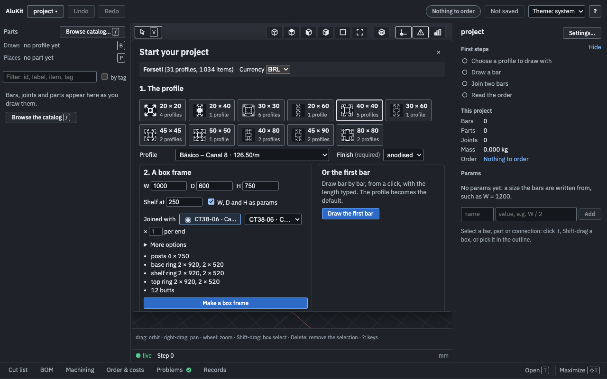
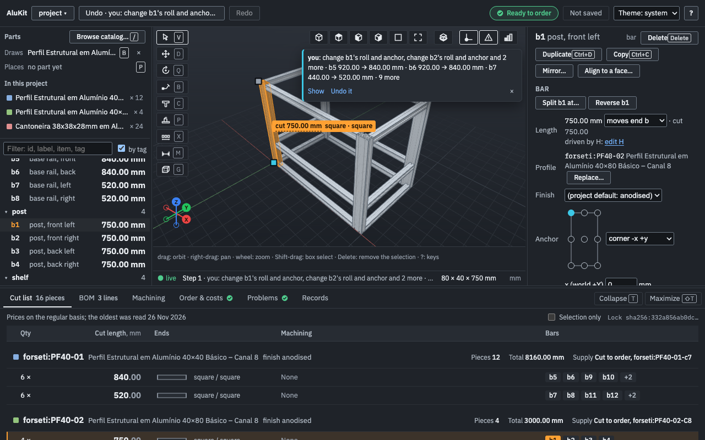
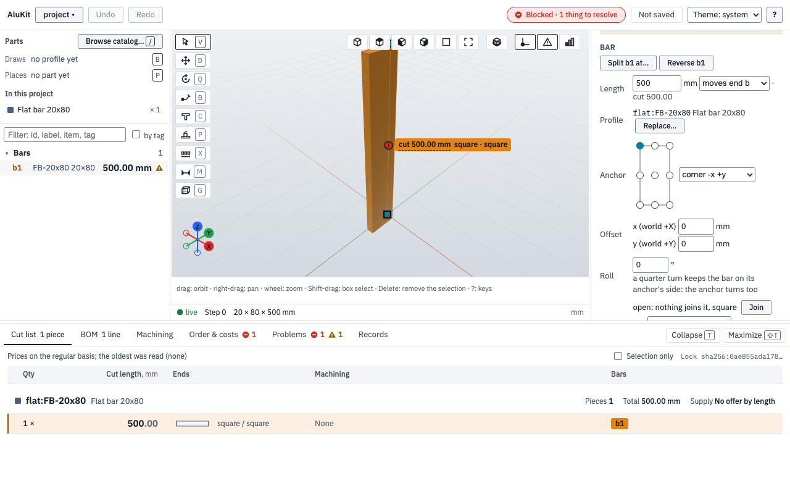
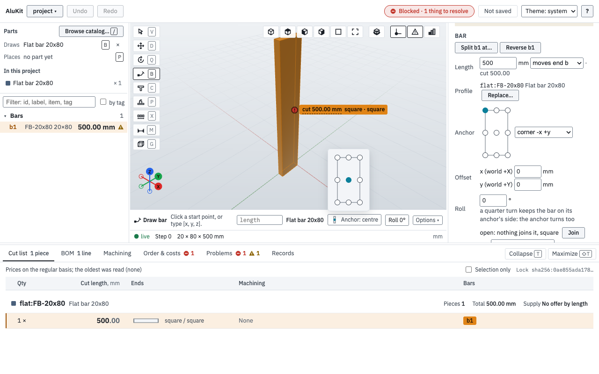
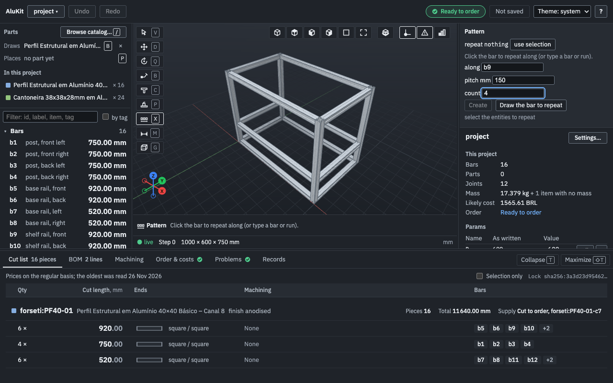
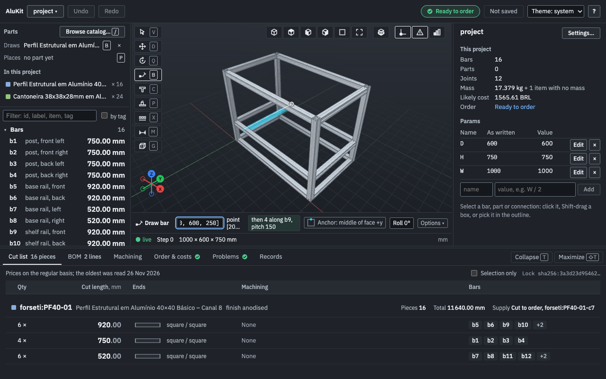
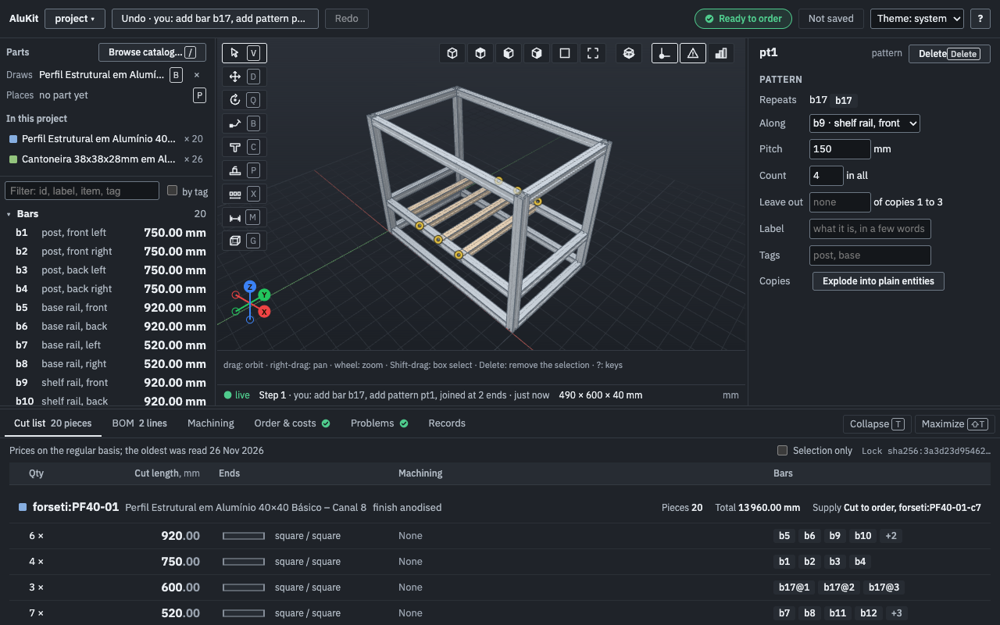

# AluKit editing polish, the app side

*2026-11-27. After the editing round's [integration pass](integration-editing.md) ("ie") timed the
[editing audit](editing-audit.md)'s §12 scenarios: three missed their targets (A1, A4, A8) and the
anchor dots could not all be pressed on a 40 × 80 (ie's defect 3). This pass brings the three
within their targets and fixes the dots, in the app only: no command, schema or CLI path changes,
so CLI parity is the existing commands' (design §7.5's rule). Decisions are cited as "pu n" (the app's polish; "pe" is the core's); the
design's calls are 115–119. Labels as in the stream notes: **measured** (a test or a run says
so), **read** (from the code or the page cited), **inferred**.*

## Done

| # | Scenario | Before | After | Where | Test | Failed first |
|---|---|---|---|---|---|---|
| 1 | A4: four legs to 40 × 80, the 80 along X (§12: ≤ 2 steps, the legs in ≤ 2 clicks) | 6 steps, 20 clicks | **2 steps**, 8 clicks (the legs in 2) | `src/ui/edit/roll.ts` (`rollSet`), `inspector/many.ts` (`rollBatch`), `inspector/BarFields.tsx` (`RollRow`), `tools/state.ts` (`rollDrawn`), `tools/wire/draw.ts`, `tools/CommandBar.tsx` | `editing.spec` A4: one roll for the four, each anchor turned to a different corner, the CLI's cut list (840 and 520 by hand); `roll.test.ts` against derive's own placement; `many.test.ts` | yes |
| 2 | The anchor dots on any section (ie's defect 3) | dots 6.5 px apart on a 40 × 80, a press on `-x+y` taken by `+y` | **every dot a 24 × 24 px target, none overlapping**, on a 40 × 80 and a 20 × 80 | `src/ui/common/AnchorDots.tsx` (`anchorLayout`), `inspector/ManyFields.tsx` (the dots for several), `tools/CommandBar.tsx` (the picker opens above the bar), `styles/tools.css` | `anchor-dots.spec`: every dot of a 40 × 80 and of a 20 × 80 pressed in the inspector, and in the draw tool's picker, the targets measured; `anchordots.test.ts` | yes |
| 3 | A1: the table frame (§12: ≤ 8 clicks, ≤ 20 keys, 1 step) | 10 clicks | **8 clicks**, 13 keys, 1 step | `tools/forms/FrameForm.tsx`, `tools/commands.ts` (`suggestedJoint`), `shell/StartCard.tsx` and `styles/shell.css` (the ways' widths, the profile row), `styles/tools.css` | `editing.spec` A1: the counts asserted; the cut list `alukit add frame --shelf 250 --params`'s, byte for byte; `commands.test.ts` | yes |
| 4 | A8: four evenly spaced slats (§12: 1 step), then five (1 step) | 2 steps, then 1 (2 clicks) | **1 step**, then 1 (1 click) | `tools/ToolForm.tsx` (Pattern's "Draw the bar to repeat"), `tools/commands.ts` (`patternRepeat`, `repeatBatch`), `tools/wire/draw.ts`, `tools/state.ts` (`drawRepeat`), `tools/wiring.ts` | `editing.spec` A8: one step for the slat and its pattern, the CLI's same batch; five by the count; `commands.test.ts` | yes |

The counts are **measured** (`editing.spec`'s `[editing]` lines; the integration table's rows for
A1, A4, A5 and A8 are updated). The scripts of A1, A4 and A8 now assert §12's targets, so they
failed before this pass (**measured**: the shelf field was under More options, the anchors stayed,
and Pattern had no way to make its template) and pass after.

## 1. A roll keeps the bar on its anchor's side (A4)

A 40 × 80 standing up has its 80 along its section's y, world Y. A roll turns the section about
the bar's line, and the anchor, a point of the section, stays on the line (design §4.4), so a
roll alone swings the body round that point: a leg anchored on its outer corner and rolled a
quarter turn leaves the corner it filled (**measured**, `roll.test.ts`: the front-left post's
footprint goes from x 0 to 40, y 0 to 80, to x −80 to 0, y 0 to 40, outside the frame). Each leg
then needed its anchor
turned with it, a different corner per leg: one step for the roll, four for the anchors.

**What others do (read).**

| Tool | Orienting a rectangular member | What AluKit takes |
|---|---|---|
| Inventor's Frame Generator, [Change][inv-change] | One dialog sets the profile, a rotation angle and the placement (a grid of radio buttons over the profile's thumbnail); the rotation turns about the selected point, or about the source geometry, and Flip reverses the member | Orientation and placement are one decision, and one dialog sets both; but one placement point for the members changed, so four legs at four corners would be four changes (**inferred**: the page lets several members be selected and does not say they may take different points) |
| Revit's structural framing, [justification][rvt-just] | The cross-section rotation turns about the location line, and the y and z justification move with it; [a forum thread][rvt-forum] asks how to keep the position from changing, and the answer is to set the justification again after rotating | The pain is A4's: a rotation that moves the member off the place its justification gave it |
| Tekla's [part position][tekla-plane] | "On plane" (left, middle, right) and "at depth" (front, middle, behind) say where the part lies relative to its reference line on the work plane, and [rotation][tekla-rot] is a separate property | A position stated relative to the line, which a rotation does not undo (whether Tekla re-applies it after a rotation is not stated on those pages: **inferred**) |

**Decision.** A roll by whole quarter turns that the app sends also turns the anchor and the
offset back by as much, so the body stays on the same side of its line: a corner anchor keeps the
same corner of the bar's place, a face anchor the same face, and a 40 × 80 trades its long side
for its short one in place. §4.4 already asks this of any change of a roll: "changing it is an
edit that rewrites those references, as `reverseBar` does". A roll by another angle has no named
point to turn the anchor to, so it rolls about the anchor, as the field says; a datum (`mount`,
`heel`) is the section's own point and stays. The inspector's Roll (one bar, and several, one
`setBar` each, each bar's anchor turned from its own) and the draw tool's R and Roll button follow
the one rule (`rollSet`, `turnedAnchor`), and the Roll rows say so under the field ("a quarter
turn keeps the bar on its anchor's side: the anchor turns too").

**Why here and not elsewhere.**

- **Not in `setBar`.** The core's `setBar { roll_deg }` writes the roll alone, as scripts and
  goldens expect; changing what it means would change what every one of them builds. The app
  sends `roll_deg`, `anchor` and `off_mm` together, which `alukit do setBar` sends as well, so the
  CLI does the same edit with the same command (A4's oracle).
- **Not "80 along X / along Y" in Replace.** It would fix a roll made together with a Replace and
  nothing else: an existing 40 × 80 turned later would still take a roll and one anchor per bar,
  and Replace would answer two questions (which part, which way) where it answers one.
- **The oracle is derive's.** `roll.test.ts` places the section with `barFrame` and
  `anchorPoint`, §4.4's rule: after any quarter turn a square's footprint is exactly where it was,
  and a 40 × 80's lies on the same side of its line along both axes, for every one of the nine
  box points. Call 115.

## 2. Every anchor dot can be pressed (ie's defect 3)

The pad drew the section's box 26 px on its long side whatever the section, so a 40 × 80's narrow
face put its corner and middle dots 6.5 px apart, and the middle dot's press area (its 12 px dot
with 6 px more around it) covered the corner's centre: a press on `-x+y` went to `+y` (ie,
**measured**). Even a square's neighbours were 13 px apart, so their 24 px press areas overlapped.

**Decision.** Each dot is a **24 × 24 px button**, WCAG 2.2's minimum target ([2.5.8][wcag-258]),
its 12 px dot drawn inside; and the box is laid out so neighbours never overlap: its **short side
is drawn 48 px**, so the three dots along it sit one target apart and their targets touch without
overlapping. The long side keeps the section's proportions up to **2 : 1** (a 40 × 80 is drawn to
scale, its long side the way the section's y runs) and is drawn 2 : 1 beyond (a 20 × 80), so the
pad stays a size the inspector and a popover hold (72 × 72 px for a square, 72 × 120 at most).
A datum is a named button beside the box, its point marked in it, since it may fall on a box
point (a rail's `mount` on `-y`). The layout is a pure function (`anchorLayout`), and
`anchordots.test.ts` checks that no two targets overlap on nine sections from 1 × 400 to 80 × 20.
Call 116.

**Where the pad shows.**

- **The inspector's anchor row**, as before, beside its list; and now **for several bars** that
  share one section too, the shared anchor filled and none while they vary (e4 8: the anchor row
  shows the section's dots).
- **The draw tool's command bar.** A pad whose three rows of dots can each be pressed is 72 px
  tall at least; the bar is one 44 px row (polish 7). So the bar's Anchor is a disclosure, as its
  Options are (review M5): its summary names the anchor and draws it small (a 20 px glyph, not
  pressable), and it opens above the bar on the full pad; a pick closes it and gives the focus back
  to the summary, so typing goes on. `A` still cycles the anchors without a click. A5's brace and
  A8's slat take one click more for their anchor (A5: 1 click to 2). Call 117.

Rejected: a fixed 3 × 3 grid of dots whatever the section, as a reference-point locator draws it.
The dots would no longer sit on the box's corners and faces, and the box's proportions, which tell
a 40 × 80's long side from its short one, are why the pad is drawn as the section at all.

## 3. The table frame in 8 clicks (A1)

A1 took 10 clicks: the shelf and "as params" were under More options (one click to open), and the
corners' joint was a select (two). Its keys and time were within the target.

**Decision.**

- **The shelf and "W, D and H as params" are up front**, on one row under W, D and H. A1 asks for
  both, and params are what make a frame widen by one field (A2 (i)). More options keeps the
  corner, the rings and the corner rule, which a table frame leaves as they are.
- **The common bracket is one click beside the full list.** While the project names no default
  butt connector, "Joined with" offers, before its select, a chip for the bracket that fits the
  most systems among those that fit the frame's bar (`suggestedJoint`; Forseti's 40 × 40: CT38-06,
  made for the 30, 40, 45 and 50 series; **measured**, `editing.spec` A1). It is offered, never
  chosen: review B1's rule that the corners' joint is the person's choice holds, and the select
  still lists every connector that fits, then Nothing. The rank is review M8's for profiles turned
  round: what is made for the most of the catalog is the common piece; a bracket because it holds
  a corner from outside with no machining asked. With a project default there is no chip: the
  select already reads "the project's default", no click at all.

- **The card keeps its height.** A row more in the form, and a Joined with of two rows (the chip
  and the select did not fit the frame's half of the card), made the start card scroll at
  1280 × 800 with a profile chosen: 623 px of content in 572 (**measured**), the example way out
  of sight again, which polish m5 had fixed. So the box frame's way takes three parts of the
  card's width to the first bar's two (it is the fuller way; they still wrap on a narrow card),
  which puts Joined with on one row, and the profile and its finish share a row when they fit.
  The card is 561 px with a profile chosen and does not scroll (**measured**); filled in, with the
  frame's cut lengths listed, it scrolls as it did before.

A1: the size chip, W, D, H, shelf, params, the bracket, Make: 8 clicks, 13 keys, one step
(**measured**). This changes polish m5 ("corner, rings, shelf, corners and params under More
options"): the shelf and params move up. D-UX-6 (the card's three ways in, side by side) and
D-UX-8 (one `addFrame`, a params switch) are unchanged. Call 118.

## 4. Four slats in one step (A8)

Four evenly spaced slats took two steps: a slat drawn, then its pattern; §12 counts one.

**What others do (read).** SketchUp makes the copies in the Move that made the first one: after a
copy, typing `x4` in the [Measurements box][su-vcb] amends it into an array. Fusion and Onshape
pattern what exists, a feature of its own. Neither fits as it is: amending a step after it commits
is what D-UX-16 left out (it races with agents' steps), and a pattern of what exists is the two
steps A8 found.

**Decision.** Pattern (`X`) can make its template: with along, pitch and count filled, **Draw the
bar to repeat** switches to Draw with the repeat pending (the command bar says "then 4 along b9,
pitch 150"), and the bar drawn commits with its pattern as one step: `addBar`, its `autoConnect`s,
then `addPattern` of that bar. The batch names the bar it makes by the id the document gives next
(`nextIdNumber`), as a pivot's batch names its connection, and goes strict, so a step made by
anyone first refuses it rather than repeating another bar. After it the app is in Select with the
pattern selected, its fields in the inspector: five is one field (A8's second part, 2 clicks to
1). Leaving Draw drops the repeat.

- Rejected: a repeat option in the draw tool's command bar. Draw is the commonest tool and its
  bar keeps to one row (review M5); repetition is Pattern's, and Pattern's form already holds
  along, pitch and count.
- Rejected: patterning the bar just drawn into the same step after it commits (D-UX-16).
- A8: 6 clicks, 1 step; then 1 click, 1 step (**measured**). Call 119.
- **Found, not changed: the copies are not joined as the slat is.** The template is the bar alone,
  as Pattern's selection was before (the same document as the two steps made), so the slat is
  butted between the shelf rails, cut 520, and its three copies, which carry no joint (§4.7: only
  references inside the template are remapped), stay 600 long, their ends in the rails; derive
  and `alukit problems` say nothing of it (**measured**, `alukit cutlist` on the CLI's batch). The
  template would need the joints `autoConnect` makes, whose ids a batch cannot know before it
  runs (it may add the end to a butt that exists); left for the designer review and the core.
  *Since fixed* (the review's B1; [review-fixes-joins-decisions.md](review-fixes-joins-decisions.md)
  1–3): a pattern's template carries its bars' own joints in derive, listed or not, so the same
  batch now gives four slats of 520, each joined, with no names to predict. (`autoConnect` always
  makes a butt of its own, **read**: `connectAt`; it never adds an end to one that exists.)

## 5. Across the pass

- **No product rule moved for a test, and no guarded test changed.** `draw.spec` presses R and A
  until the tool shows the roll and the anchor it wants, so R's turning the anchor changes no step
  of it; `view.spec`'s zero shader links and `live.spec` pass unchanged (**measured**, the gate).
- **A5 and A15 open the draw tool's anchor picker** before they press a dot (pu 2); A5 counts the
  click.
- **The command bar still keeps to one row at 1440 px** (review N3, `recheck.spec`): the
  Anchor's summary, a bordered control with its glyph, first overflowed it by its caret, so it has
  none; the glyph says it opens (**measured**: N3 failed with the caret, passes without).
- The CSS stays in the token system; the new controls' text is `--text-1` on `--bg-panel` or
  `--info-wash`, pairs `tokens.test.ts` holds at AA in both themes, and a dot's ring is `--text-2`
  on the panel, its fill `--tool`.

## Screenshots

1280 × 800; dark unless named.

| | |
|---|---|
|  |  |
| A1's form (pu 3) | A4 after one roll (pu 1, 2) |
|  |  |
| A 20 × 80's dots (pu 2) | The draw tool's picker (pu 2) |
|  |  |
| Pattern's form (pu 4) | The repeat pending (pu 4) |
|  | |
| One step, the pattern selected (pu 4) | |

[inv-change]: https://help.autodesk.com/cloudhelp/2026/ENU/Inventor-Help/files/GUID-D1044A45-A5F0-4D36-9BE2-E515A51C4407.htm
[rvt-just]: https://help.autodesk.com/cloudhelp/2016/ENU/Revit-Model/files/GUID-8F25C1C8-E309-420B-8636-3B979C0B47AA.htm
[rvt-forum]: https://forums.autodesk.com/t5/revit-api-forum/structural-framing-justification-position-changes-with-cross/m-p/10762415
[tekla-plane]: https://support.tekla.com/doc/tekla-structures/2025/mod_position_on_the_work_plane
[tekla-rot]: https://support.tekla.com/doc/tekla-structures/2026/mod_rotation
[wcag-258]: https://www.w3.org/WAI/WCAG22/Understanding/target-size-minimum.html
[su-vcb]: https://help.sketchup.com/en/using-measurements-box
