# AluKit editing review: the 3D view as an editing tool, as a user meets it

*2026-11-27. An independent product-design review of the editing round (selection verbs, the
menu, hide and isolate, Move, Rotate, Mirror, Duplicate and arrays, Copy and Paste, Align, end
handles and editable ends, Split, Holes, the inspector's fields) on the running app at `514d961`.
It judges whether someone who designs extrusion frames could do their real work in it, against
the [editing audit](editing-audit.md)'s §4 (what such a person expects) and §12 (the acceptance
scenarios). It changes no product code.*

*Labels: **measured** means seen in the running app (Playwright) or printed by the CLI. **Read**
means read in the code at `514d961`, cited by file. **Inferred** means a judgement. Every finding
below was checked twice, by two runs or by a run and the code.*

*Not repeated here, because they are known and being fixed: the stretch with a crossing box,
mirror re-homing a part, A4's six steps, the overlapping anchor dots, Move's arrow keys before a
move, A1's ten clicks, A8's two steps, and the log without arguments
([integration-editing.md](integration-editing.md), "What the scenarios found").*

## Contents

1. [Verdict](#1-verdict)
2. [Method](#2-method)
3. [The §12 scenarios, as a first-time user met them](#3-the-12-scenarios-as-a-first-time-user-met-them)
4. [Findings, ranked](#4-findings-ranked)
5. [Beyond §12, by theme](#5-beyond-12-by-theme)
6. [What works, and must be kept](#6-what-works-and-must-be-kept)
7. [Notes on the record](#7-notes-on-the-record)
8. [Sources](#8-sources)

## 1. Verdict

**Not yet for real work, though close.** The verbs are all there, they are easy to find, and most
of them say what they will do before they do it. A Move that would break a joint says so and
offers Alt; a Duplicate says "joins b1 (c15) · joins b2 (c16) · cut 840" before the click; Delete
lists what else changes; every step has a named Undo. That says more before a click than
SketchUp or Fusion do (**inferred**).

What stops a frame designer is not a missing verb. Three common gestures produce bars that are
not joined, or not cut, and **nothing says so**: the cut list, the BOM and the order go wrong
while Problems stays green.

1. **Pattern copies leave the template's joints behind** (B1). Four slats across a shelf, made
   as the guide says, give one slat cut 520 and joined, and three cut 600 running through both
   rails, joined to nothing.
2. **Mirror leaves the copy unjoined** (B2). A brace mirrored across the frame's middle is
   cut 1141.27 instead of 958.67, overlapping both posts.
3. **A rail drawn by clicking one post's face, then the other's, is not joined** (B3). No joint,
   no bracket in the BOM, and the order reads **Ready to order**.

*All three since fixed, 2026-11-27 ([review-fixes-joins-decisions.md](review-fixes-joins-decisions.md));
each blocker below says how.*

Each has a fix inside what the core already does (section 4). With those three fixed, and the
seven majors after them, a designer could build and change a small-to-medium frame in the app
and trust what it orders. Until then they must check every copy and every clicked rail by hand,
which is the work AluKit exists to remove.

**Counts:** 3 blockers, 7 majors, 14 minors, 5 nits. *(Corrected 2026-11-27: the minors' table lists 15, m1–m15; the count said 14.)*

## 2. Method

- **Build:** `514d961`, `pnpm install --frozen-lockfile --offline`, `pnpm build`, then
  `alukit serve` on scratch copies, each on its own port:
  - an empty project, `alukit new --catalog forseti --currency BRL`, on which §12 ran as one
    session, each scenario following the one before;
  - the same box frame made by the CLI without params, for the clicked rail and the holes;
  - `tests/fixtures/cart` with a T-nut plate added by the CLI, for A12 (as `editing.spec` does);
  - a 1,008-bar lattice (84 box frames of 500 mm, one `addFrame` batch, 672 butts), as the
    [drag-ends notes](drag-ends-decisions.md) built it: there is no fixture for it.
- **Driving:** one long-lived Playwright client in headless Chromium (SwiftShader), driven step
  by step, at 1440 × 900 and 1000 × 700, dark and light. The steps used the guide and what the
  screen said; the hook (`window.__alukit`) was read for the screen position of a world point, the
  selection and what the tool reports, never to act. The CLI (`derive`, `cutlist`, `problems`,
  `order`, `log`, `do --dry-run`) was the oracle. The scripts were throwaway and are not
  committed.
- **Not driven:** the scripted `editing.spec` was not read beyond its setup of A12, so the paths
  below are a first-time user's, not the test's.
- **Load:** the machine was shared, load average 38 to 45 during the timings. Times are upper
  bounds; the comparisons in M6 were made under the same load, back to back.

## 3. The §12 scenarios, as a first-time user met them

| # | Path taken, from the screen and the guide | Where it hesitated or failed | Result |
|---|---|---|---|
| A1 | Start card: **40 × 40**, W, D, H, **Joined with**, More options, **shelf at** 250, **as params**, Make a box frame | Which of 33 connectors in Portuguese makes a corner (m13) | Pass, 1 step (the cut list's byte check is the spec's, not re-run) |
| A2 (i) | Project panel, **Edit** beside W, type 1100, Enter | Typing after Edit did nothing: the field opens but keeps no focus (m1). A click in the field, then it worked; the toast listed "b5 920.00 → 1020.00 mm · 3 more" | Pass, 1 step |
| A2 (ii) | Not re-run | Known gap 1 | |
| A3 | Tick **by tag**, click **shelf**, `D`, `0, 0, 150`, Enter | None. The preview said "nothing else moves" | Pass, 1 step |
| A4 | **post** heading, **Replace…**, Find `40x80`, **Replace 4 bars**, Roll 90, then each anchor | Known (six steps, the dots) | Pass, 6 steps |
| A5 | First by pointer: `B`, click the back-left post's face at 100, click the back-right post's face at 650. Then the guide's typed path | The pointer path made a brace joined to nothing, square-cut, with no warning (B3). The typed path joined both ends at 28.81°, and then the order turned **Blocked** under a false title (M1) | Typed path passes, 1 step |
| A6 | `/`, `bracket`, then `CT38-06`, its card, **Use for placing**, `300`, click the leg's face | None; the tip said "b1 -y face at 200 · 300 mm from end a of b1" before the click. The mirror is known gap 2 | Placement passes, 1 step |
| A7 | Click b13, **Duplicate**, `0, 0, -300`, Enter | None: "makes b18 · joins b1 (c15) · joins b2 (c16) · cut 840" before Enter. The copy kept the label "top rail, front" and the tag `top` (m2) | Pass, 1 step |
| A8 | Draw a slat (typed, dot `+y`), `X`, click b9, count 4, **Create**; then `pt1`, Count 5 | Nothing previews the copies (m8). The copies are cut 600 and unjoined; the template is 520 and joined (B1). The guide says **Apply**; the button says **Create** | Count edit passes; the slats are wrong |
| A9 | Select the bracket, drag its arrow; then Distance 450 in the inspector | The drag gave 427, not a round value (m15). The field worked | Pass, 1 step |
| A10 | Click b14, `Delete`, **Delete all 1**, then `Ctrl/Cmd+Z` | The dialog's button wording (n1) | Pass, 1 step; Undo brings it back |
| A11 | Right-click a top rail, **Select tagged top**, `H`; click a corner marker, `Shift+H`; `Alt+H` | `H` also hid the duplicated rail, which carries the copied tag (m2) | Pass, no step, document unchanged |
| A12 | Click the plate, look for its bolts; then the outline filter, `plate`, `c36`, **at** `100, 200, 300`, **Apply** | Nothing on the plate leads to its joint; its ends say "open: nothing joins it" with a **Join** that is refused (M7) | Pass, 1 step, 3 screws and 3 T-nuts |
| A13 | `Ctrl/Cmd+Z` until **Nothing to undo** | None: 16 presses, each named ("Undo step 23, you: add pattern pt1") | Pass; `alukit diff` against a new project finds nothing |
| A14 | A3 by mouse: the **shelf** heading, **Move** on the rail, type, click in the view | None | Pass, 3 clicks |
| A15 | Not run | Known (the log) | |

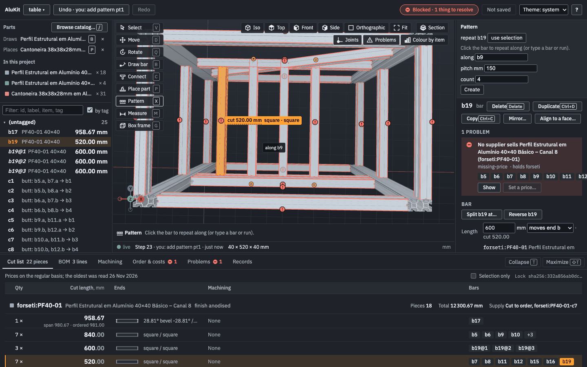

*A8 at 1440 × 900, dark: three slats of 600 and one of 520 in the cut list.*

## 4. Findings, ranked

### Blockers: a frame designer cannot trust what the app builds

**B1. Pattern copies leave the template's joints behind; the copies are uncut, unjoined, and
nothing warns.** (A8)

- *Measured:* the slat b19, drawn between the shelf rails, butts on b9 and b10 (c17, c18), cut
  520. The Pattern tool takes the selection as the template, `["b19"]`. The copies b19@1–b19@3 are
  cut 600 with both ends `default`: they run through both rails. The joint markers show six open
  rings, but Problems says "0 warnings" and the order is not held. The 40 mm overlaps are ordered.
- *Read:* the tool builds `addPattern` from the selection's bars only (`tools/commands.ts`,
  `template = s.template.filter(...)`). Design §4.7: "References inside the template are remapped
  in each copy; references outside it are kept", so the joints have to be in the template.
- *Fix:* the Pattern tool adds to the template every connection whose claimed ends all belong to
  the template's bars (a butt's through bar outside the template is kept, as §4.7 says).
  *Measured* on a scratch copy: `setPattern pt1 { template: [b19, c17, c18] }` gives four slats of
  520, each joined by `c17@k` and `c18@k`, 0 warnings, six brackets more in the BOM. A check for a
  free bar end lying inside another bar would have caught it too (see B3).
- **Fixed** (2026-11-27; [review-fixes-joins-decisions.md](review-fixes-joins-decisions.md) 1–3,
  11): in the core, not the tool. A pattern's template carries its bars' own joints in derive,
  listed or not, so the same one-step batch gives four slats of 520, each joined by `c17@k` and
  `c18@k`; `explodePattern` and `array` copy them too. `editing.spec`'s A8 now asserts every
  slat's cut and that no slat end is unjoined.

**B2. Mirror copies a bar without joining it.** (Mirror, any joined bar)

- *Measured:* the brace b17 (joined at both ends, cut 958.67, both ends at 28.81°) mirrored across
  x = 500 gives b20: cut 1141.27, both ends `default`, overlapping each post by 91 mm. The preview
  said only "makes b20". Problems: no new warning.
- *Read:* the design's table of what each edit sends (§8) gives Duplicate and Paste "`array`, then
  `autoConnect` at each new bar's end", and Mirror "`mirror`" alone. E3's decision 6 does not
  mention joins.
- *Fix:* make Mirror's step `mirror` followed by `autoConnect { optional }` at each new bar's end,
  as Duplicate does, and have its preview say what joins ("makes b20 · joins b4 (c…) · joins b3
  (c…)"), or what stays open. One rule for every copying verb.
- **Fixed** (2026-11-27; [review-fixes-joins-decisions.md](review-fixes-joins-decisions.md) 4–6):
  the core's `mirror` carries the bar's own joints, landed on the posts at their images, so
  `alukit do mirror` alone gives the brace's image cut as the brace and butted on both posts; the
  app's step then joins each image's end, as Duplicate's does, and its preview says what joins or
  stays open. `editing.spec` "A6 on a bar" drives it.

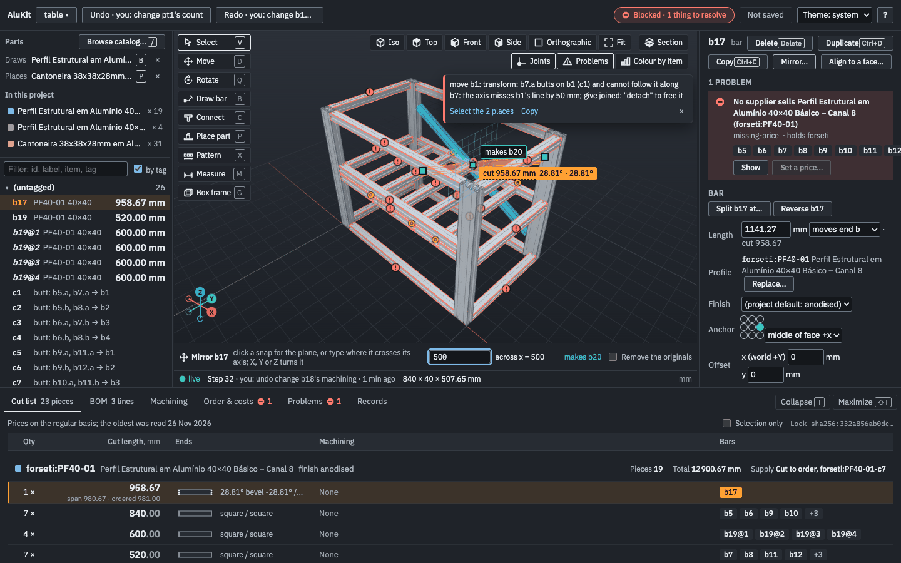

**B3. A rail drawn by clicking one post's face, then another's, is joined to nothing.**

- *Measured,* twice: on the table frame (the brace by pointer, A5) and on a plain 40 × 40 frame (a
  horizontal rail at z = 560 between the back posts' inner faces). The snap reads "b3 +x face at
  560"; the preview says nothing about a joint; the step is "add bar b17" with no join. The bar's
  ends say "open: nothing joins it"; **Join** is refused: "only b17 meets at that point: nothing
  butts on it". Problems: no errors or warnings; the top bar: **Ready to order**, without the
  rail's brackets.
- *Measured:* a butt through b3 claiming b17.a dry-runs clean (`addConnection`, 0 errors, 0
  warnings). The joint is valid; only the rule that finds it misses it.
- *Read:* `autoConnect` looks for ends and bars meeting at a point (design §4.5, "Default
  connection"); an end written `on: { bar, face }` stands on a face, not on the bar's line. The
  `unconnected` check groups ends at one point (`check/check.ts`), so an end on a face is never
  "open".
- *Fix:* `autoConnect` butts an end written on a bar's face on that bar when its centre line
  enters it, so the draw tool's preview says "will butt on b3" before the click; the end handles,
  Move and Duplicate inherit it. Then extend `unconnected` to a free end touching or inside another
  bar, with the same "Join with the default butt". Vention connects a part as it is inserted, and
  MISUMI FRAMES places brackets where two bars join (audit §4.5).
- **Fixed** (2026-11-27; [review-fixes-joins-decisions.md](review-fixes-joins-decisions.md)
  7–10): `autoConnect` butts an end lying on a bar's face, or inside it, on that bar where the
  butt would bear, and the draw tool's preview says "will butt on b3" before the click. The check
  calls such an end open ("b17.a lies on b3's +x face with no connection") with a Join that
  works, and the new order rule `unconnected` makes the order warn of every open end, so it no
  longer reads a plain Ready. `editing.spec` "A5 by pointer" drives the clicks.

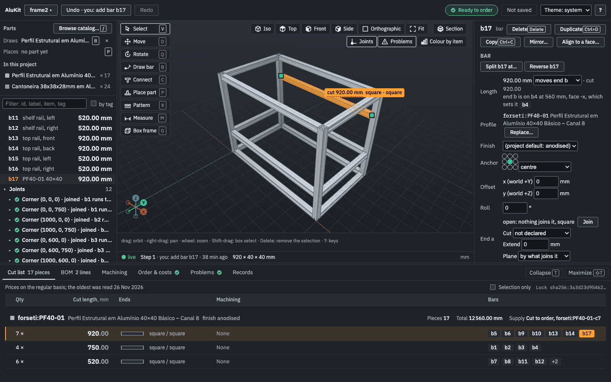

### Majors

**M1. A hole, or an angled brace, blocks the order under a false title.**

- *Measured:* after one hole (or the A5 brace's two angled cuts), Problems says "No supplier sells
  Perfil Estrutural em Alumínio 40×40 … No catalog offers it, so it has no price and no supplier
  to order from", names every bar of that profile, and offers **Set a price…**, disabled ("A
  catalog item's price comes from its catalog"). The order's own reason is "no price for 1
  machining service; cover them with a cost line".
- *Read:* `core/problems/problems.ts`, `missing-price`: a message that is neither "no price", "no
  offer sells it by length" nor an exchange rate falls through to "No supplier sells". The order
  rule itself is by design (services are priced by a covering cost line;
  [design-vs-built](../notes/design-vs-built.md) 14).
- *Fix:* a branch for the machining message: "n machining services on PF40-01 have no price"
  (the holes, the angled cuts), naming the bars that carry them, with the fix the app can give
  (the cost line's CLI form, since costs have no app path yet, design §8). A fix that is always
  disabled is no fix.
- *Fixed* ([rm](review-fixes-machining-decisions.md) 1, 2): "2 machining services on Profile 40x40
  have no price", on the bars that carry them, the `addCost` cost line in its detail, no fix
  button; "Set a price…" only for a project's own item, and no fix shown disabled.

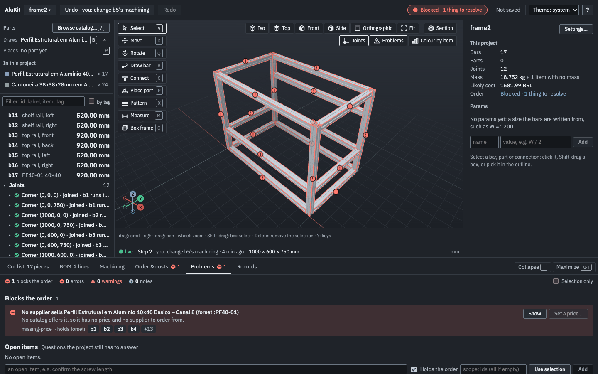

**M2. The hole form takes the focus back on every keystroke.**

- *Measured,* twice: in the form that **Add a hole…** opens, a click in **at** and typing `20`
  gives at = 2 and size = 0; typing `M6` in size then gives "0M6". The hole is stored at 2 mm.
- *Read:* `inspector/Holes.tsx:204`, `ref={(el) => el?.focus()}` on the size field: a callback ref
  that runs on every render, so the first keystroke anywhere in the form moves the focus to size.
  The e2e uses `fill`, which sets the value without keystrokes, so it never sees it.
- *Fix:* focus once when the form opens (an effect with no dependencies, or `autoFocus`), on the
  field the menu entry named (the distance it offered). Test it by typing, not `fill`.
- **Fixed** (2026-11-27, [review fixes, app](review-fixes-app-decisions.md) 1): the form focuses and selects the distance once, when it
  opens; `edit.spec` types 20 and M6 and stores them so.

**M3. A hole's distance means two things.**

- *Measured:* the menu offers "Add a hole on b18's face +y, 274 mm from end a…"; the cut list
  then says "1 × Ø7, face +y, from a, at 194". On a rail cut back at its ends (every rail of a box
  frame), "20 mm from end a" is stored as 20 from the design end and the cut list prints "Ø7.00
  hole -60.00 mm from end a": off the piece, and `alukit check` reports nothing.
- *Read:* the hole row counts from the design end; the cut list from the cut. The part inspector
  already offers "end a's cut" as an origin; the hole form offers only "end a" and "end b".
- *Fix:* count a hole from the cut end by default (what the cut list, the shop and the guide's
  "20 mm from end a" mean), say which in the row ("194 mm from end a's cut"), and make a hole off
  the piece an error, as design §4.8 already does for a plate's hole a shop could not make.
- *Fixed* ([rm](review-fixes-machining-decisions.md) 3–8): `ops` take `"from": "a.cut"` or
  `"b.cut"`, which the form, the menu, the guide and the skill write; the row says "… mm from end
  a's cut", the menu offers the cut list's number, and a hole reaching past a cut is a
  `machining` error. An absent `from` stays design point a, so no existing hole moves.

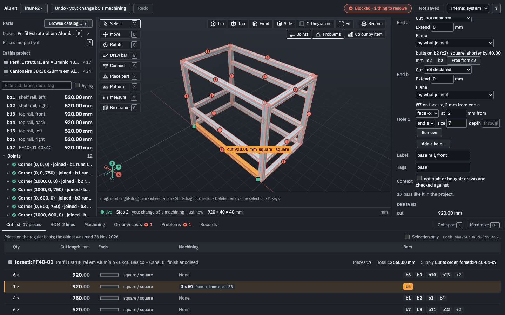

**M4. Esc does not cancel an end drag once a value is typed; the release commits it.**

- *Measured,* twice: drag a free end handle, type `500`, press Esc (the prompt says "Esc
  cancels"), release: a step "shorten b13 at end a to 810 mm, freed from c9" is made, at the
  dragged length. With nothing typed, Esc does cancel.
- *Read:* Esc steps back one level (guide: "what is typed, the last pick, the gesture"), so the
  first Esc only clears the digits.
- *Fix:* during a drag, Esc ends the gesture whatever is typed; Backspace clears digits. Blender
  and Fusion cancel a transform on Esc. Keep the levels for the click-click gestures.
- **Fixed** (2026-11-27, [review fixes, app](review-fixes-app-decisions.md) 2): Esc ends a held drag whatever is typed; a click-move
  gesture keeps its levels; `ends.spec` holds it.

**M5. In the light theme the tools' labels in the view are unreadable.**

- *Measured:* the joint preview and the Move, Duplicate and Paste readouts by the pointer draw
  `rgb(26, 31, 38)` on `rgba(15, 18, 22, 0.88)`: about 1.2:1. The dark theme draws `#e8ecf0` on
  the same background.
- *Read:* `styles/tools.css:455–459` sets `.view-label[data-label="joint"]` to `var(--text-1)`;
  `tokens.css` says the tip is "dark in both themes, its text is `--tip-ink`".
- *Fix:* `color: var(--tip-ink)`. WCAG 2.2 1.4.3 asks 4.5:1; the project's own rule is AA in both
  themes. A test that reads every overlay label's contrast in both themes would hold it.
- **Fixed** (2026-11-27, [review fixes, app](review-fixes-app-decisions.md) 3): every view label draws `--tip-ink`, the gizmo's letters the
  ink their disc needs; `labels.spec` reads every label and tip in both themes, ≥ 4.5:1.

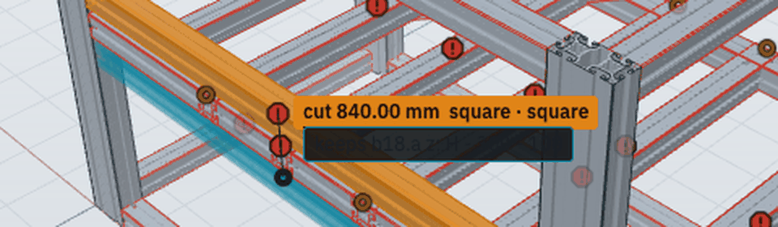

**M6. On a large project every Move waits about 2 s for its preview and 2 s for its step.**

- *Measured* on the 1,008-bar lattice, one 12-bar frame moved by `0, -800, 0`: the preview's
  reading came 3.2 s after the last key and the step 2.2 s after Enter, of which the server took
  1.9 s each; the rest is drawing under SwiftShader (Undo's server time was 0.1 s). The app's dry
  run, replayed five times, took 1.9–2.4 s at the server. The same `transform` alone took 0.27–0.39 s; with
  1, 6, 12 and 24 of the app's `autoConnect` calls, 0.34, 0.69–1.0, 1.2 and 2.0–2.2 s: about
  75 ms each. The app sends one per moved bar end, 24 for a frame whose ends all stay joined.
  Click picking (41 ms) and hover (1.5 ms a pick) stayed fast.
- *Record:* E-UX-20 cites 144–167 ms per dry run at 1,008 bars (S5); the drag-ends notes measured
  `transform` of one frame at 45 ms in-process. Both are kept; the cost is the joins.
- *Fix:* send `autoConnect` only for the ends the transform freed or moved off their joint (its
  answer lists what followed and what was freed), or let `autoConnect` take a list of ends and
  derive once. Then time it in `move.spec` on the lattice.
- *Fixed* ([rm](review-fixes-machining-decisions.md) 9–14): the cost was a derive per command, not
  the joins' rule. A batch now derives each state once, and Move asks for a join only at an end
  that can take one, so a frame moved whole is one `transform`: at the server, about 130 ms for
  the dry run and 140 ms for the step, against 840 and 880 on main under the same load.
  `move.spec` holds both under 500 ms on the lattice, built by commands.

**M7. A face joint cannot be reached from the bars it holds, and their ends claim to be open.**
(A12)

- *Measured:* a click on the T-nut plate shows a bar inspector whose two ends read "open: nothing
  joins it, square" with **Join**; Join is refused ("only b36 meets at that point: nothing butts
  on it"). Its menu has no **Edit c36…**. The joint is found only by filtering the outline or
  opening its Joints group.
- *Fix:* list the joints a bar takes part in, face joints included, in its inspector ("held by
  c36, T-nut plate, 3 stations") with **Edit c36…** in its menu, as a joint marker's menu has; say
  "held by c36 (face joint)" on the ends rather than "open"; offer Join only where it would
  succeed (the `unconnected` problem already checks that, e1 9). Tekla edits a connection from its
  symbol (audit §4.5); here the bar is what a person clicks.
- **Fixed** (2026-11-27, [review fixes, app](review-fixes-app-decisions.md) 4): the ends say "held by c36 (face joint)", "open" only by the
  check, Join only where the problem list joins (else its reason); a **Joints** row lists the
  bar's joints with Edit, and the menu has **Edit c36…**; `bar-joints.spec` holds both.

### Minors

| # | Finding | Evidence | Fix |
|---|---|---|---|
| m1 | **Edit** on a param opens its field without focusing it: typing goes nowhere (A2 (i), whose guide line says "Edit beside W, type 1100") | *Measured* twice: the focus stays on "Edit W" | Focus and select the field on Edit, as the inspector's own fields do — **Fixed** ([review fixes, app](review-fixes-app-decisions.md) 5) |
| m2 | Duplicate copies the label and tags: the rail 300 below the top reads "top rail, front" and is tagged `top`, so **Select tagged top** and `H` take it | *Measured*: b18's label and tags | Keep the tags but number the copy's label ("top rail, front 2"), as CAD tools number copied instances (**inferred**) — **Left for the core**: the copy is the core's `array` command, and the CLI's copy must number it the same way ([review fixes, app](review-fixes-app-decisions.md)) |
| m3 | A refused Move speaks the API: "give joined: \"detach\" to free it"; and Enter sends a step the preview already knew was refused (HTTP 422) | *Measured* | Say "hold Alt to detach it"; keep the gesture open and say it in the bar instead of posting — **Fixed** ([review fixes, app](review-fixes-app-decisions.md) 6) |
| m4 | Every gesture's field is named "Draw bar: value" for a screen reader (Move, Duplicate, Mirror, Align, an end drag) | *Measured* (accessibility tree); *read* `tools/CommandBar.tsx:455` passes `tool="draw"` | Name it by the gesture: "Move: offset", "Mirror: plane at" — **Fixed** ([review fixes, app](review-fixes-app-decisions.md) 7) |
| m5 | Key caps say Ctrl on macOS (menu "Ctrl+D", inspector "Ctrl+C", help "Ctrl Z"), Alt for Option | *Measured* on a Mac user agent; *read* `actions/registry.ts:122` `mod: "Ctrl"` | ⌘ and ⌥ on macOS (Apple HIG, keyboards) — **Fixed** ([review fixes, app](review-fixes-app-decisions.md) 8) |
| m6 | The selection's length label and the tool's readout collide: on top of each other at 1000 × 700, touching at 1440 | *Measured* (label rectangles, screenshots) | Put the selection label in the labels' `avoid` list (`viewer/labels.ts`), or show one combined label while a gesture runs — **Fixed**, by the avoid list ([review fixes, app](review-fixes-app-decisions.md) 9) |
| m7 | At 1000 × 700 the orientation gizmo lies under the tool rail; its axis buttons are covered | *Measured*: gizmo at (284, 252) 72 × 72, rail down to y = 321 | Anchor the gizmo below the rail's measured height, or bottom-right — **Fixed**, beside the rail when it reaches the gizmo ([review fixes, app](review-fixes-app-decisions.md) 10) |
| m8 | Pattern previews nothing before **Create**, and its prompt stays "Click the bar to repeat along" after along, pitch and count are set | *Measured* twice | Ghost copies and a dry-run reading, as Duplicate's `4x` has; a prompt that moves on — **Fixed** ([review fixes, app](review-fixes-app-decisions.md) 11) |
| m9 | Faces are named in section axes only: on a rolled 40 × 80 leg the face that looks +X is "-y" in the snap tip, the menu, and the hole and part face selects; the Offset rows already say "(world +Y)" | *Measured*: b3 rolled 90° has section y along world −X | Add the world direction everywhere a face is named: "face −y (+X)" — **Fixed**, written "face −y (world +X)" ([review fixes, app](review-fixes-app-decisions.md) 12) |
| m10 | The menu's **Show**, beside Hide, zooms to the bar and opens a callout that says only "b5 / b5"; it reads as un-hide, and **Fit to the selection** is right above it | *Measured* | Drop it from a visible entity's menu, or name it for what it does — **Fixed**: Show draws a hidden selection again, offered only then ([review fixes, app](review-fixes-app-decisions.md) 13) |
| m11 | The menu's letter jump takes `D` to **Delete**, not Duplicate (whose key is Ctrl+D); the dialog then focuses "Delete all n", so a typed space deletes | *Measured*: Shift+F10, D, Enter, then typing an offset deleted b18 and its two joints | Give each entry its own access key (Duplicate D, Delete L), as menu access keys do — **Fixed**, and Delete's dialog focuses Cancel ([review fixes, app](review-fixes-app-decisions.md) 14) |
| m12 | **Join** on an end that cannot be joined is offered and then refused (the plate, a face-drawn rail) | *Measured* | Offer Join only where `autoConnect` would make it, as the `unconnected` problem already decides (e1 9) — **Fixed** with M7 ([review fixes, app](review-fixes-app-decisions.md) 4) |
| m13 | The start card's **Joined with** lists all 33 connectors that fit the profile, with no default, including a 180° extender, a latch plate and an X plate that cannot make a corner | *Measured* | Corner brackets first, one preselected, the rest under "other connectors"; MISUMI offers a bracket only where two bars join (audit §4.5) — **Fixed** in part: corner joints first, the rest after, the 180° extender classed a splice and no longer offered; **declined**: one preselected, since call 118 and review B1 keep the corners' joint the person's choice ([review fixes, app](review-fixes-app-decisions.md) 15) |
| m14 | In the outline, Shift + arrow does not extend the selection | *Measured*; *read* `outline/Outline.tsx` handles Ctrl and Meta only | WAI-ARIA APG tree view, multi-select: Shift + arrow extends — **Fixed** ([review fixes, app](review-fixes-app-decisions.md) 16) |
| m15 | A part dragged along its bar lands on any millimetre (427 for a drag toward 450), while drawing snaps to a 10 mm grid | *Measured* | Snap the slide to the grid and to other stations; Shift for free — **Fixed** ([review fixes, app](review-fixes-app-decisions.md) 17) |

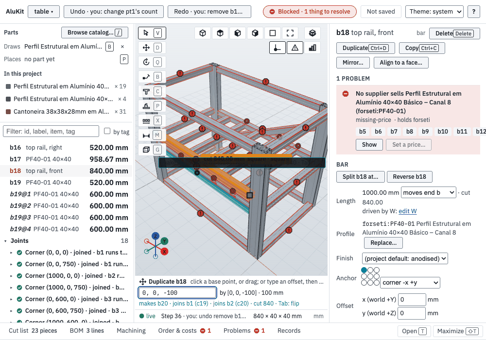

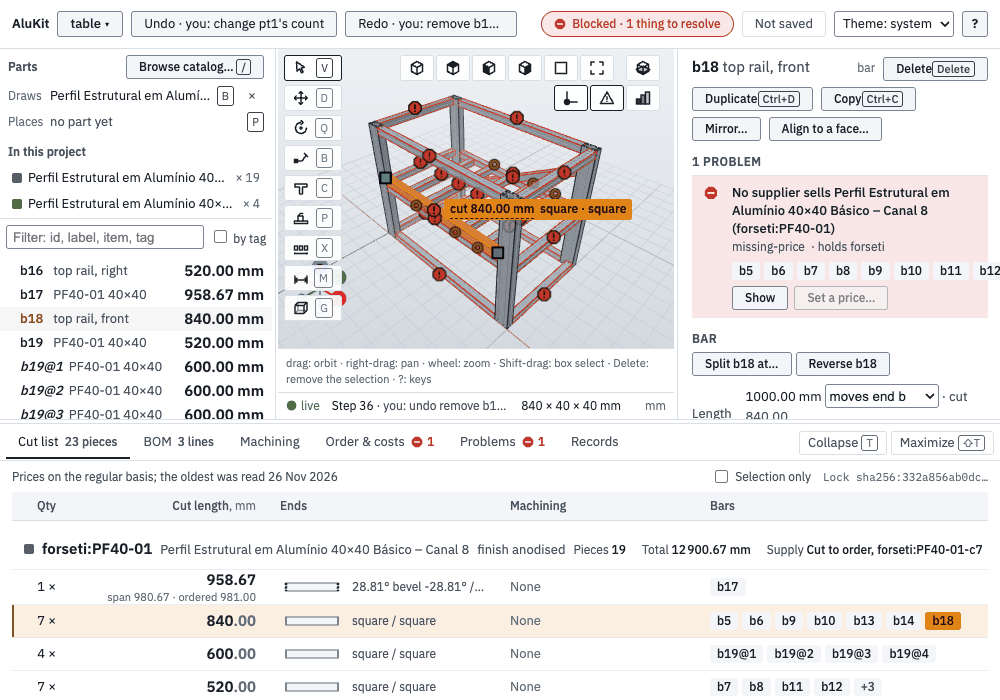

### Nits

| # | Finding | Fix |
|---|---|---|
| n1 | The delete dialog: "Delete 1 thing?" and **Delete all 1** | "Delete b14?" and **Delete** (all n only when n > 1) — **Fixed** ([review fixes, app](review-fixes-app-decisions.md) 14) |
| n2 | Undo names repeat the verb: "change b1's roll, change b2's roll and 2 more" | "change the roll of b1, b2, b3 and b4" — **Left for the core**: the undo names are the core's (`core/commands/words.ts`) ([review fixes, app](review-fixes-app-decisions.md)) |
| n3 | Move's label "keeps b18.a z: H - 300 - 100" reads as "unchanged" and leaves the sum unsimplified | "writes z = H − 400" — **Fixed** in part: "writes"; folding the sum is the core's ([review fixes, app](review-fixes-app-decisions.md) 18) |
| n4 | The inspector's verbs disabled under another tool say "in Select or Move", where Delete says "press Esc first" | One wording: "press Esc first" — **Fixed** ([review fixes, app](review-fixes-app-decisions.md) 18) |
| n5 | The hover tip stays up during a drag, over the readout | Hide it while a gesture runs — **Fixed** ([review fixes, app](review-fixes-app-decisions.md) 18) |

## 5. Beyond §12, by theme

**Discoverability.** Every verb was found without the guide, except the face joint (M7) and the
pattern's own fields (found by its outline row). The menu is the strongest part: it names the
station under the pointer ("Split b18 here, 376 mm from end a", "Add a hole on b18's face +y, 274
mm from end a…"), greys what cannot run with the reason ("b13.a butts on b1 (c9), square, shorter
by 80.00 mm"), and the inspector's header carries the same verbs with their keys. Paste appears
once something is copied. The tool rail shows each key on its cap.

**Feedback before commit.** Move, Rotate, Duplicate, Paste, Align and the end handles all dry-run
and say what follows, joins, frees or is refused, by the pointer and in the command bar. Rotate
refused a turn of a joined brace before Enter ("the centre line of b17 misses b3 … Alt: detach");
Align said "p1 is on b1: it moves along b1 only"; a locked end's handle said "b18.b's x is W:
driven by W; edit it instead" with a link. The gaps are Mirror (B2), Pattern (m8) and the draw
tool's face-to-face rail (B3), where the preview is silent because the core finds nothing to say.

**Undo.** Every gesture was one step, and each Undo named its step, with who made it. Undoing
the whole A1–A12 session took 16 presses and left a document `alukit diff` cannot tell from a new
one. The one wrong step is the cancelled drag that commits (M4).

**Errors and refusals.** Most say why and what to do, in words ("this move would break a joint:
… Alt: detach"). The exceptions: M1 (a false reason and a dead fix), m3 (API syntax), m12 (a
Join that is offered and refused).

**Keyboard and screen readers.** Shift+F10 opens the menu with the first entry focused; arrows,
letters, Enter and Esc work, and Esc returns the focus to the outline row. Tools, views, the
splitters and the inspector are all reachable by Tab, and the inspector's fields have names
("Offset along the section's x, world +Y, mm", "Roll, degrees about the bar's line"). The hole
form's fields are named only by their wrapping labels ("at mm from", "size", "depth"), terser than
the rest, and the gesture field's name is wrong (m4). The focus is left on `body` after a step commits, which a
screen-reader user hears as nothing; the global keys still work.

**Visual clarity.** The gizmos are clear: Rotate's three rings, a part's single arrow along its
bar, the end handles as squares with their state in the hover tip. The selection is a strong
orange with its cut on a label. Light theme labels (M5) and the label collisions (m6) are the
weak points. At 1000 × 700 with the sheets open the view is 396 × 299 px, still workable, and the
menu (642 px) just fits.

**Consistency across tools.** Duplicate and Paste re-join; Mirror and Pattern do not (B1, B2).
The part inspector counts from "end a's cut"; the hole form cannot (M3). Faces are "+y" in some
places and "x (world +Y)" in others (m9). The menu says "Replace profile…" where the inspector
says "Replace…"; the rest of their wording matches.

**The large project.** On the 1,008-bar lattice, picking and hovering stay instant and the
selection verbs answer at once ("Select the whole assembly" gave the 12 bars). Every Move costs
about 2 s twice (M6). Rendering times under SwiftShader (a select-all Move drew 11 frames in 22 s)
say nothing about a real GPU and are not reported as findings.

**The review's own questions (§12).**

- *What a person tried first and did not find:* clicking two faces to draw a rail (B3); clicking
  the plate to change its bolts (M7); typing right after Edit (m1); undoing a drag with Esc (M4).
- *The menu's wording against the inspector's:* the same verbs and words, but for "Replace
  profile…" and "Replace…".
- *Did `W + 100` surprise?* No. The duplicated rail was written `H - 300`, which keeps it 300
  under the top if H changes: what a designer wants. The Move label's wording is a nit (n3).
- *The trackpad mode:* not judged; it needs a real trackpad, and this review ran headless.

## 6. What works, and must be kept

- **Previews that say the consequence in words** ("makes b18 · joins b1 (c15) · joins b2 (c16) ·
  cut 840"; "b7.a … cannot follow it along b7 … Alt: detach"). Few CAD tools say this much before
  a click.
- **The menu that names the station and greys with a reason.**
- **Delete's dialog** listing what goes and what changes, with "One step: Undo brings it all
  back".
- **Named, per-step Undo**, and toasts that list the cuts a step moved ("b5 920.00 → 1020.00 mm").
- **Hide and isolate as view state** with a status-bar count and **Show all**; isolating a corner
  marker shows its three bars and the corner inspector's arrangements side by side.
- **The locked end's tip** that says what drives it and links to the param.
- **The typed values** everywhere (offsets, `[x, y, z]`, params), and the box frame's parametric
  writes (`H - 300`).

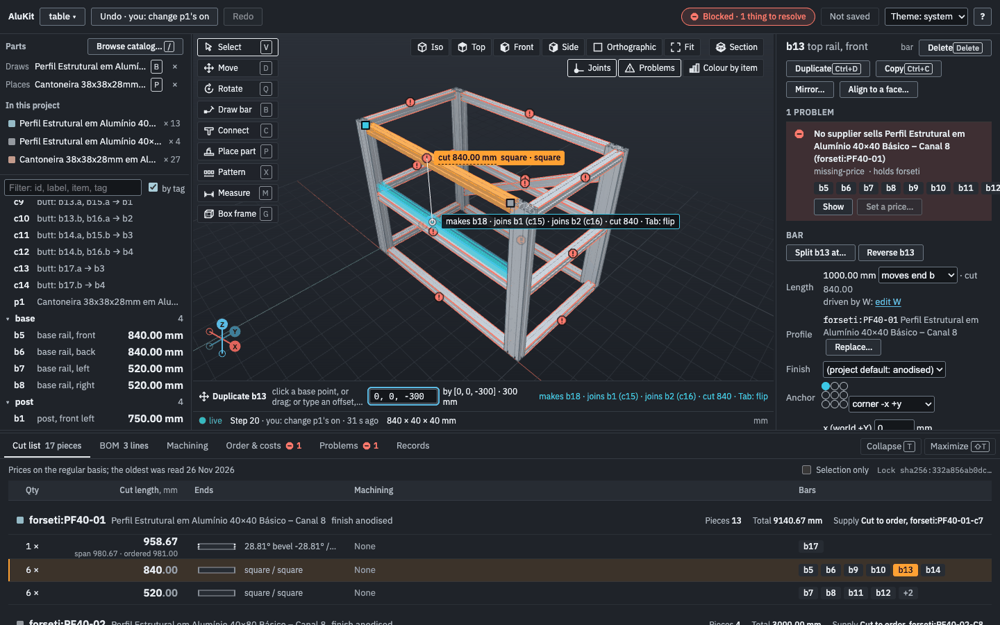

## 7. Notes on the record

- [integration-editing.md](integration-editing.md) gives A8 a pass: "spacing equal within
  0.01 mm, the count follows, the CLI's project". The CLI project was built with the same
  commands, so it has the same unjoined copies, and the check cannot see B1. A8's check should
  add: every slat's cut equals the template's, and no corner is open. *Added*, with the same
  checks in A5 and A6 ([review-fixes-joins-decisions.md](review-fixes-joins-decisions.md) 11).
- The same document gives A5 a pass by the typed path, which joins. The pointer path a first-time
  user tries first does not (B3); neither the scenario nor the guide says so.
- The guide's A8 line said **Apply**; the Pattern form's button says **Create**. Corrected in
  the guide with this review.
- E-UX-20's 144–167 ms per dry run at 1,008 bars is a draw's dry run (S5); a Move's dry run on
  the same lattice is about ten times that, because of its joins (M6). The audit's risk note
  (§9) asked for this time test; the drag-ends notes measured `transform` alone.

## 8. Sources

- In this repository: [editing-audit.md](editing-audit.md) §4, §9, §12;
  [integration-editing.md](integration-editing.md); [guide](../guide.md); [design](../design.md)
  §4.5, §4.7, §4.8, §8; [drag-ends-decisions.md](drag-ends-decisions.md);
  [e1-decisions.md](e1-decisions.md); [e3-decisions.md](e3-decisions.md);
  [review-phase4.md](review-phase4.md) for the form.
- Code read: `src/ui/inspector/Holes.tsx`, `src/ui/tools/CommandBar.tsx`,
  `src/ui/tools/commands.ts`, `src/ui/styles/tools.css`, `src/ui/styles/tokens.css`,
  `src/ui/actions/registry.ts`, `src/ui/outline/Outline.tsx`, `src/core/problems/problems.ts`,
  `src/core/check/check.ts`, `src/viewer/labels.ts`.
- Guidelines: [WCAG 2.2](https://www.w3.org/TR/WCAG22/) 1.4.3 (contrast) and 2.4.3 (focus order);
  [WAI-ARIA APG tree view](https://www.w3.org/WAI/ARIA/apg/patterns/treeview/) and
  [menu](https://www.w3.org/WAI/ARIA/apg/patterns/menubar/) patterns;
  [Apple HIG, keyboards](https://developer.apple.com/design/human-interface-guidelines/keyboards).
- Tools compared: as cited in the audit's §4 (Fusion, Onshape, SketchUp, Blender, Tekla, MISUMI
  FRAMES, Vention).

### More screenshots

| | |
|---|---|
| 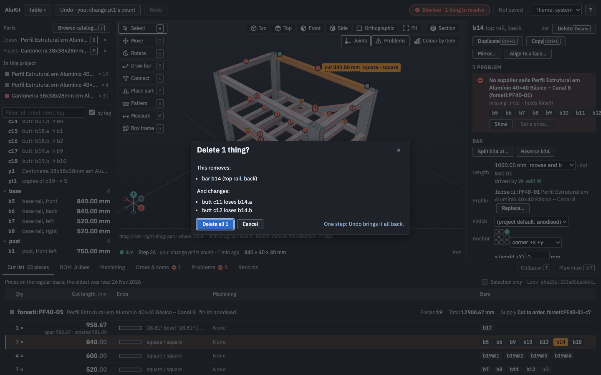 | 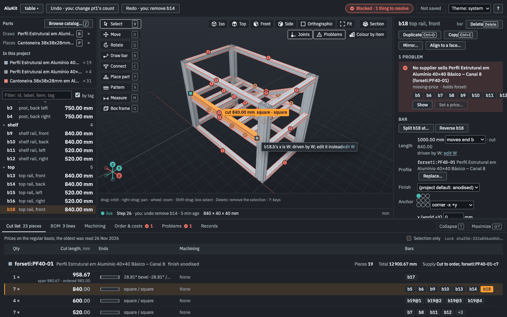 |
| Delete, 1440 dark | A locked end handle, 1440 dark |
| 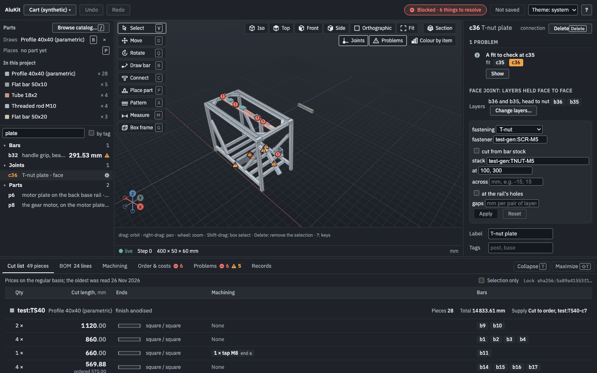 | 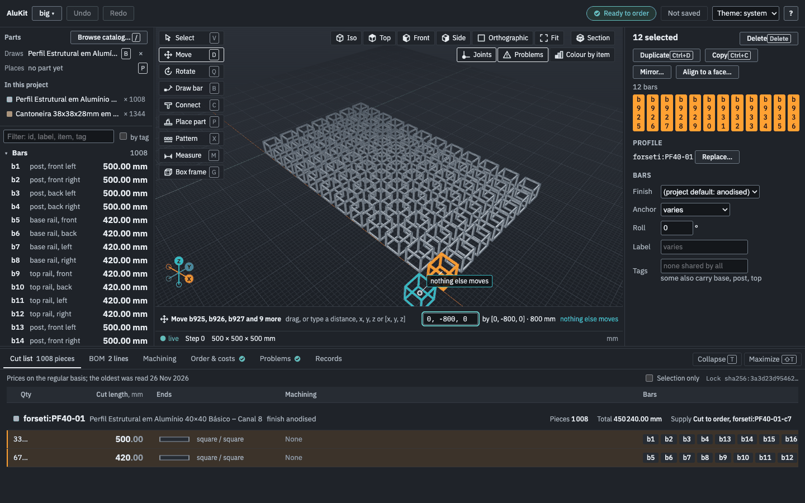 |
| A12's form, 1440 dark | The lattice, 1440 dark |
| 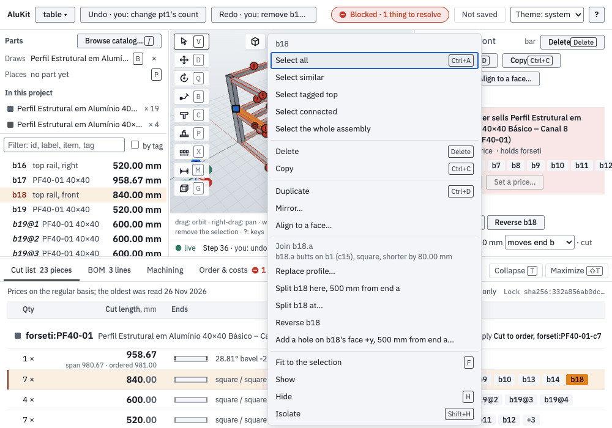 | 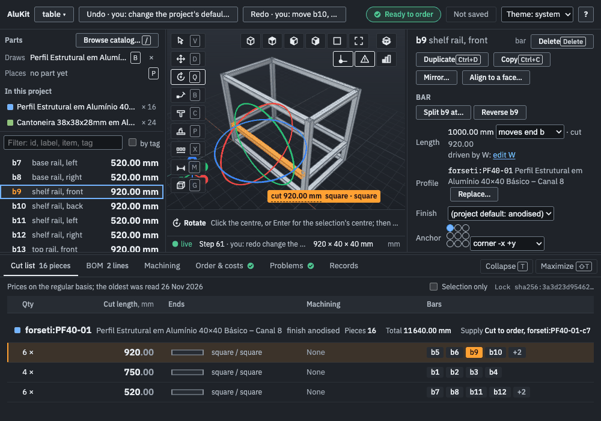 |
| The menu, 1000 light | Rotate, 1000 dark |
| 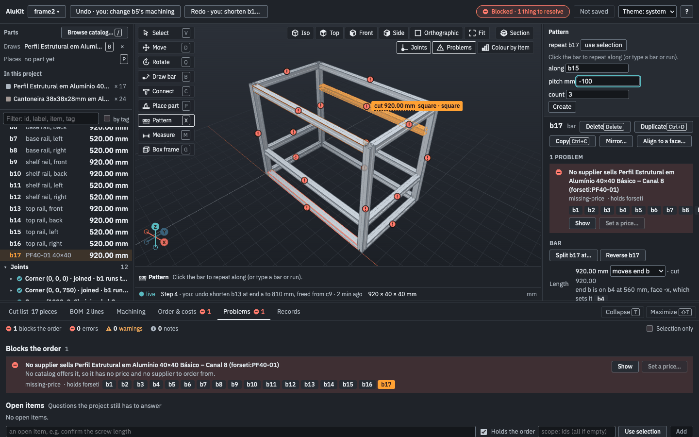 | 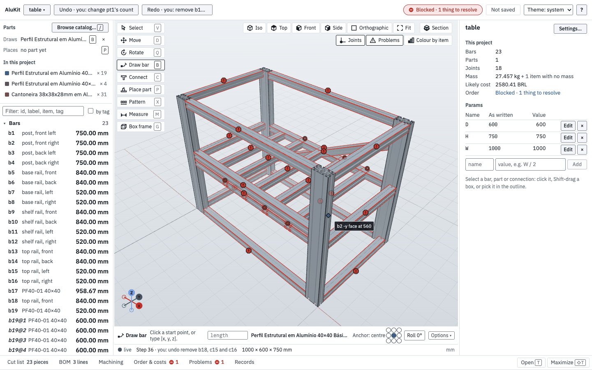 |
| Pattern before Create, 1440 dark | Draw bar, 1440 light |
