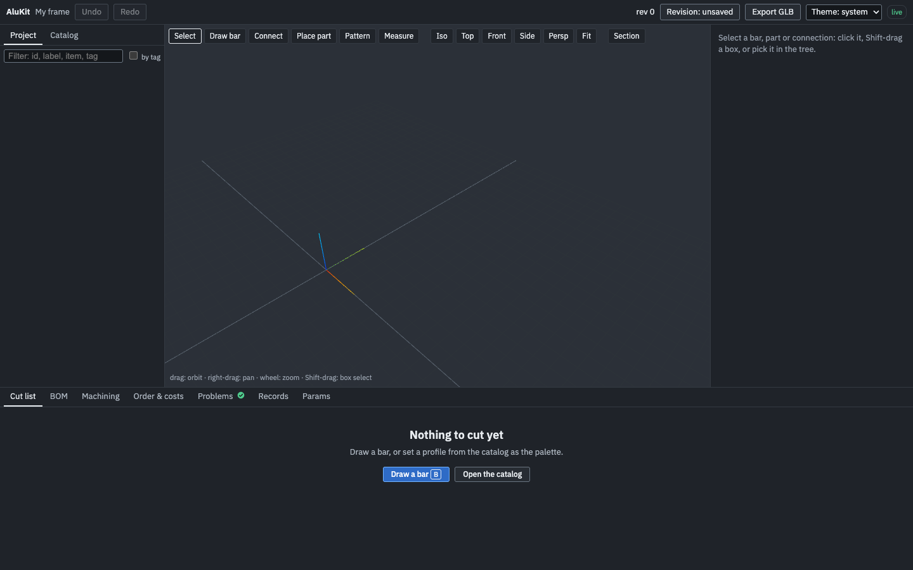
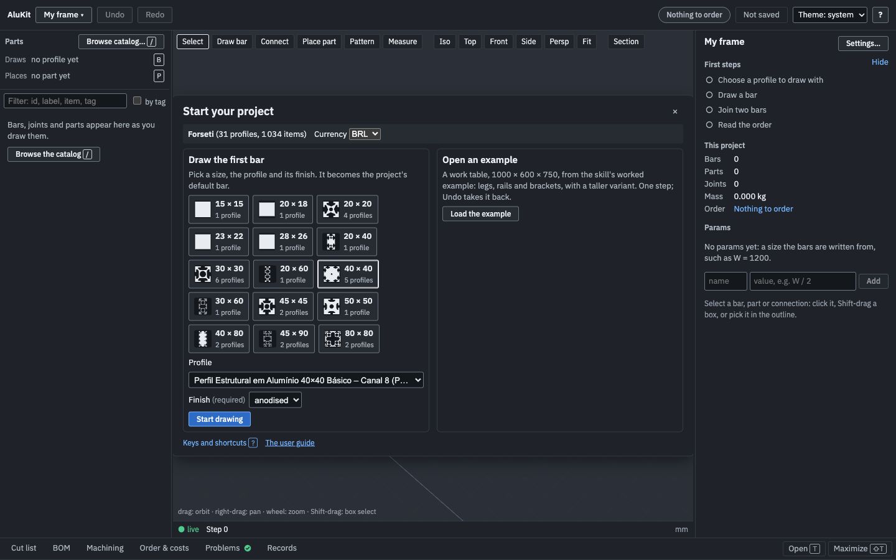
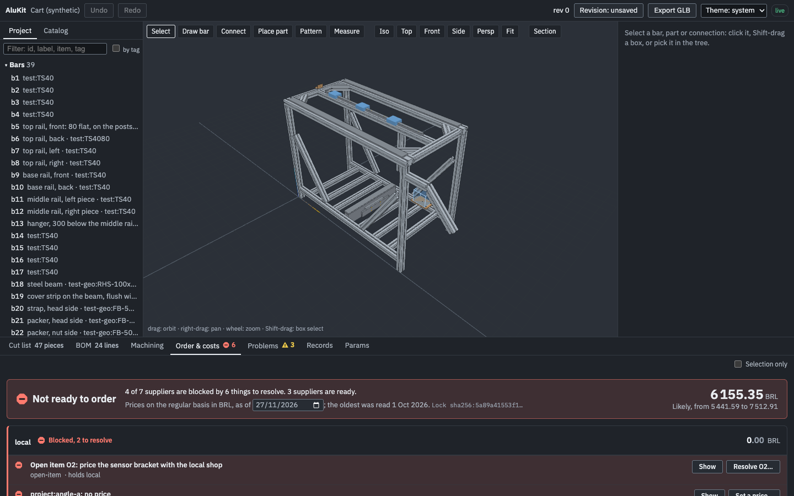
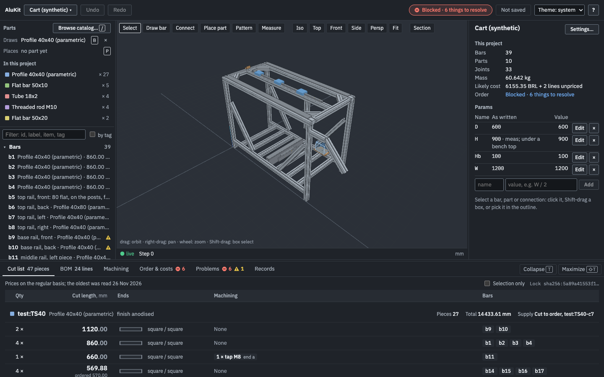
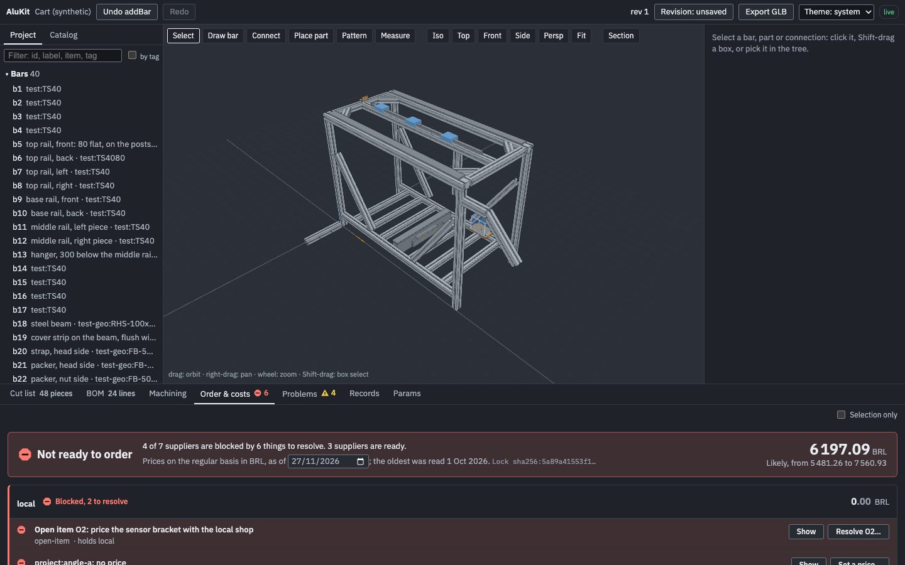
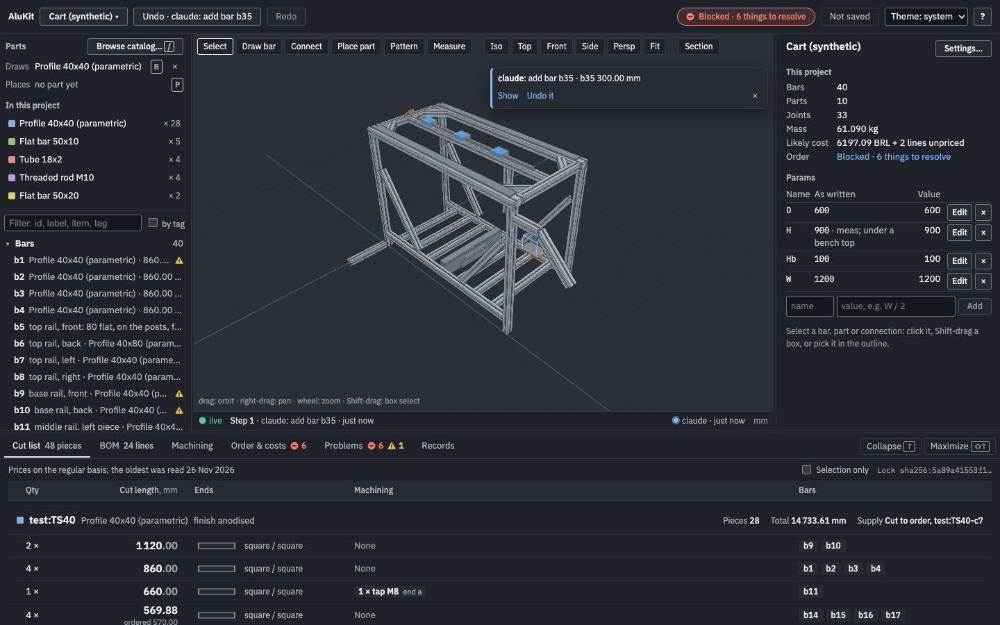
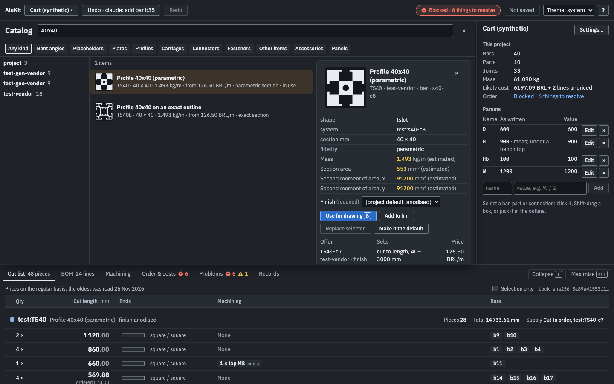

# AluKit UX, stream S2: the app shell and its information architecture

*S2 of the [UX plan](plan.md) (§5.6): the layout, the sheets' container, the parts bin and the
catalog, the outline, the top bar, the status bar, presence, Show, the start card, project
settings, the project panel, help, read-only, refusals and the accessibility shell. Labels:
**measured** (a test or a run says so), **read** (from the code), **inferred**. Interfaces it
changed are in [contracts.md](contracts.md) ("S2 changes"). The plan names this note
`docs/notes/ux-s2-decisions.md`; the stream's brief put it here, beside the plan.*

## Done

| Id | What | Where |
|---|---|---|
| S2.1 | The layout: left column (parts bin over the outline), the canvas (viewport, status bar under it), the right column (tool form over the inspector), splitters with their widths kept per browser, the catalog over the left column and the canvas | `App.tsx`, `shell/Splitter.tsx`, `styles/shell.css` |
| S2.2 | The sheets' container: a tablist rail with each sheet's badge; collapse, split, maximize (buttons, `T`, `Shift+T`); the height kept per browser; an empty project's sheets collapsed, opening once on the cut list at the first output | `sheets/{registry.ts,Sheets.tsx}` |
| S2.3 | The parts bin (armed, in this project, pinned, lately) and the wide catalog (`/`): search, a kind row that follows the tool (`prefer`), facets, rows with the whole name, size, kg/m and the `from` price; the card in words; Use for drawing, Add to bin, Replace selected, Make it the default. `options.ts` (U2) | `catalog/`, `options.ts` |
| S2.4 | The palette starts from `defaults.bar` and is kept for the tab's session | `catalog/state.ts` |
| S2.5 | The outline: rows in words, groups by kind or tag, Joints by corner, problem marks, one tree with roving tabindex and the arrow keys, reveal on Show | `outline/` |
| S2.6 | The top bar: the readiness pill, Undo and Redo as "who: what" with the cross-source question, "Saved as …" / "Not saved", the Project menu, the variant strip; `store.problems` filled each revision | `TopBar.tsx`, `shell/{Undo.tsx,readiness.ts}`, `store.ts` |
| S2.7 | The status bar: connection, "Step n · who: what · when", Show's progress, the tool's prompt, presence, units, a polite live region | `shell/StatusBar.tsx` |
| S2.8 | Presence and the step summary: a toast for every other source's step (and for the person's own when it moved a cut or removed something), the scene's pulse, "new · claude" marks in the outline, a presence chip | `steps.ts`, `shell/{presence.ts,Toasts.tsx}` |
| S2.9 | Show: the status bar's "Showing … · Esc to leave", the outline's reveal, Esc leaves Show first, a maximized sheet steps back to the split | `focus.ts`, `outline/Outline.tsx`, `sheets/Sheets.tsx` |
| S2.10 | The start card and the coach strip; the example | `shell/{StartCard.tsx,start.ts,example.ts}` |
| S2.11 | Project settings, one `setProject` step | `shell/Settings.tsx` |
| S2.12 | The project panel: First steps, the summary, the params | `shell/ProjectPanel.tsx`, `records/Params.tsx` |
| S2.13 | Help (`?`): every key, the snap legend, the guide, the start card, the single-key switch | `shell/Help.tsx`, `keys.ts` |
| S2.14 | Read-only and restore: the list always, entity and field, did-you-mean; the last-good label; restore asks and names the kept copy; disabled controls say why | `shell/{ReadOnly.tsx,didYouMean.ts}` |
| S2.15 | Refusals in a toast with the whole text, Show all, Copy, "Select the n places"; popovers close on an outside click and on Esc | `shell/Toasts.tsx`, `TopBar.tsx` |
| S2.16 | Landmarks and a skip link; tablist/tabpanel on the sheets; every button named; 24 px targets | throughout |
| S2.17 | The README Quickstart and `docs/guide.md` | `README.md`, `docs/guide.md` |

## Decisions

| # | Decision | Why |
|---|---|---|
| 1 | **The status bar sits in the canvas column, under the viewport**, not in the viewport's `bottom` slot | In the slot it would cover the scene's bottom edge, where the command bar (S5) also goes; under it, it never covers the model. A contract change (contracts.md) |
| 2 | **The connection reads lowercase `live`**, a dot before it | `view.spec` and `dev.spec` read the word; the dot adds the shape, the word stays |
| 3 | **The sheets collapse on an empty project and open by themselves once**, on the cut list, when the first output exists and the tool is Select; that opening is not remembered, a person's own collapse or opening is | Opening mid-gesture would shrink the canvas under the pointer (plan §8); `draw.spec` draws every bar without the canvas moving (measured: it passes byte for byte) |
| 4 | **Maximized sheets cover the main area; the canvas keeps its size under them**, and Show steps back to the split | Resizing the canvas would move the camera's framing; Show points at the scene |
| 5 | **Collapse is a button and `T`**, not a click on the active tab | A R16: a click on a tab that hides the tab's content surprised |
| 6 | **The catalog is an overlay over the left column and the canvas**, the inspector still visible beside it | The card's Replace selected acts on the selection the inspector shows |
| 7 | **The first bar is chosen as a size, then a profile of that size, then its finish** | Forseti alone has 31 bars in 15 sizes, five of them 40 × 40 (light, basic, V-slot…), and its linear guides are bars too (measured: the start card on `alukit new --catalog forseti`); twelve chips in code order showed guides and 20 mm profiles first. Size first is how a person names a profile |
| 8 | **Start drawing arms the palette with no options of its own** once `setProject` wrote `defaults.bar`, so the bars drawn follow the default; on a refusal nothing is armed and the card shows why | One place holds the finish, as the skill writes a project; and no bar is drawn that the order then refuses (first-run.spec: no `option-not-sold`) |
| 9 | **The example is the skill's worked example, parsed by its own test's parser**, sent as one strict step, with a `setProject` first when the project lacks the catalog or currency the example's `alukit new` names; it is offered only on a project whose bar and connection counters are at zero and that has no variants | The example names its ids (b1, c1): on a project whose counters moved on, its butts would point at the wrong bars |
| 10 | **The box frame way waits for S5.7**: `start.ts` exports `frameWay`, which S5's module sets to its `FrameForm`; until then the card shows two ways | The plan gives the form to S5.7; a second form here would drift from the tool |
| 11 | **Built-in catalogs cannot be offered by name yet**: the server lists none. The card says when no catalog sells a profile and opens Project settings, which takes a built-in id or a folder | `/api/catalog` lists only the project's catalogs; naming one vendor in the app would be the product call D-UX-7 declines. Requested from S1 (contracts.md) |
| 12 | **Undo and Redo read "Undo · claude: add bar b35"**; another source's step asks once, with "don't ask again in this tab"; the question undoes only the step it asked about, and says so when another came first; a toast's "Undo it" does not ask | D-UX-14. The toast names its step; the question protects the button, whose step may have changed |
| 13 | **A refusal shows where it happened**: `sendCommands(…, { inline: true })` for a form that shows it under itself (params, settings, the start card, the catalog card); any other refusal is a toast that stays until dismissed or the person's next step | U30. S4's and S5's forms still toast as well as showing their own: theirs to switch |
| 14 | **The person's own step gets a toast only when it changed more than it made** (a cut moved, something removed); another source's always | Auto-connect's 800 → 820 said out loud (U4) without a toast for every bar drawn |
| 15 | **"Step n"** everywhere in the app; "Saved as Quote 1" / "Not saved" for revisions; the CLI and every JSON field keep `rev` | D-UX-20 |
| 16 | **The readiness pill reads the problems answer** (`order.status`, `order.blocks`), dimmed while the answer for a newer revision is on its way, and opens Order & costs in the split | One signal for the order (D-UX-3); maximizing on a click took the scene away |
| 17 | **The variant strip shows when the person picked a variant**, not for the document's default | The default is what every edit is judged in; the strip warns only when what is shown is not that |
| 18 | **Params moved to the project panel**; a problem's param fix clears the selection and opens the param's row (`pointParam`) | D-UX-4. Show would frame nothing in the scene for a param |
| 19 | **First steps tick on the project and the tab**: a profile armed, a bar, a joint, the order's sheet opened; they show on a project that was empty when the tab first drew it, until done or hidden | B §4.3's four steps, each on a real event |
| 20 | **Single-key shortcuts can be turned off** (help's switch, kept per browser): app-scope keys that are one printable character with no Ctrl, Cmd or Alt are then ignored; Esc, chords and a tool's own gesture keys (typed lengths) still work | WCAG 2.1.4; the draw gesture's digits are typed into a tool, not shortcuts |
| 21 | **Keys are described where they are bound** (`describeKeys`); help lists the sections in order. Help describes the tools', drawing's and view's keys itself until S5 and S3 describe theirs under the same section ids | No list of keys to drift from the handlers |
| 22 | **Esc closes the start card first** (an overlay-scope key, below the catalog's and the dialogs'); Esc leaves Show before it clears the selection | D-UX-18's one level per Esc; plan §5.10 for `draw.spec` |
| 23 | **Restore asks first and names what it keeps**: S1's `kept` is a list (the document's copy, and the lock's when it differed) | D-UX-15; s1-decisions 24 |
| 24 | **Did-you-mean** looks up the schema's own keys (an entity's, or the top level's) for a field the schema does not know, within two edits; the schema is loaded only then | U34. The schema is large; a hand edit with an unknown field is rare |
| 25 | **Preferences live in the browser** (`shell/prefs.ts`): column widths, sheet height and state, the single-key switch in local storage; the palette, recent items, the start card's dismissal, First steps and "don't ask again" for the tab's session | None of them is the project's; the plan keeps pins out of the document (§7) |
| 26 | **Esc typed in a text field still closes the overlay it is in** (the catalog's search, a dialog's field): the router offers it to overlay-scope handlers only; every other key typed in a field stays the field's | WAI-ARIA's dialog pattern. Before, the text-entry guard swallowed it, and the catalog stayed open with its search focused (measured: `layout.spec` failed on it) |

## Measured

- **The first run's cost** (`first-run.spec`, on `alukit new --catalog forseti --currency
  BRL`): from the opened tab to an armed, sold profile that is the project's default, two clicks
  and one choice in a list (40 × 40, then PF40-01; anodised is preselected, sold) and no key;
  A F1 estimated about four clicks and two keys. Before S2 it was the Catalog tab, a search, a
  card, a finish to pick (the default offered was not sold) and Set as palette, and the bars drawn
  were then refused by the order (U2).
- **No horizontal scroll** at 1280 × 800 and 1440 × 900, with the catalog open or closed
  (`layout.spec`).
- **`draw.spec`**, the byte-for-byte oracle, passes with the start card closed by Esc and the
  sheets collapsed on the empty project: the canvas never resized between bars.

## Waits on another stream

- **S3**: the camera check in `show.spec` (it skips while the hook has no `camera()` and `box()`);
  corners in the outline's Joints group come from `cornersOf`, empty until S3.4 merges; the pulse
  on another source's step is `viewer.pulse`, a no-op until S3.
- **S5**: the box frame way (`frameWay`, decision 10); the command bar in the `bottom` slot; the
  tools', drawing's and view's key sections (decision 21); S5's forms passing `inline`.
- **S1** (merged): a list of built-in catalogs on `/api/catalog`, for one-click adding (decision 11).

## Tests

- New: `layout.spec` (no horizontal scroll at 1280 and 1440, the tools in one row, the sheets'
  states and their size over a reload, the empty project's first opening, Tab to the tools through
  the skip link, the outline's keys, help and the single-key switch); `first-run.spec` (on `alukit
  new --catalog forseti --currency BRL`: the catalog line, a sold profile as the default in one
  step, a bar drawn, no `option-not-sold`; the example as one step; Esc and help; settings as one
  step); `presence.spec` (an agent's toast with Show in two tabs, the outline's mark, "Undo ·
  claude: add bar b35", the question, both tabs following; Ctrl+Z asks too); `show.spec` (c35's
  problem: selected, revealed in the outline, "Esc to leave", Esc).
- Unit: `options`, `steps`, `outline/rows`, `keys` (the switch, the help registry), the sheets'
  registry, `shell/example`, `shell/didYouMean`, `shell/settings`.
- Changed, what each proves unchanged: `live` (Step 1; Undo names the CLI's step; the toast; the
  undo asks first, then both tabs follow), `readonly` (Restore asks; the kept copy holds the
  rejected text), `topbar` (Not saved / Saved as; export in the Project menu; the notice a
  toast), `draw` (Esc closes the start card first), `tools` (no `left-project`), `problems` (the
  empty project's cut list opened from the rail; Enter on a problem selects its targets, as
  `alukit problems --json` lists them, now that the app reads the server's problems; the badge
  check runs, since `alukit problems` exits 1 when the order is blocked and only a missing JSON
  means it is absent), `records` (the params in the project panel; Undo in words), `connect`
  (Undo in words), `dev` (the tab is "Order & costs": "Order" also named the Problems tab, whose
  badge says what blocks the order). Undo's words are read from `alukit log --json`, so the
  app's words are checked against the CLI's.

## Cross-edits in files another stream owns

| File | Owner | Change |
|---|---|---|
| `src/ui/problems/Fixes.tsx` | S4 | A param fix calls `pointParam(name)` instead of opening the Params sheet, which is gone (decision 18) |
| `tests/e2e/{tools,problems,records,connect,draw}.spec.ts` | S5, S4 | The selector and wording changes plan §5.10 lists, and `problems`' two (above) |

## Screenshots

Before (the main branch before S2) and after, 1280 × 800, dark:

| | Before | After |
|---|---|---|
| The README's empty project |  |  |
| The cart |  |  |
| An agent's step |  |  |
| The catalog | |  |
