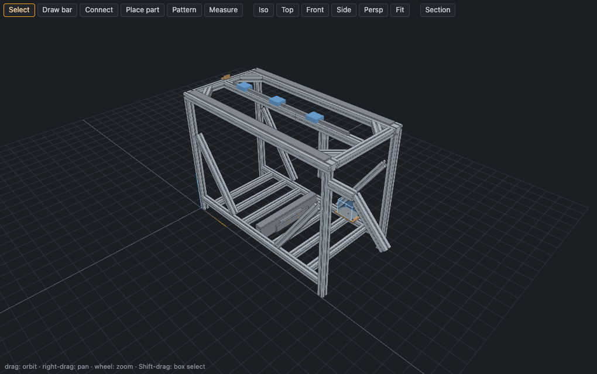
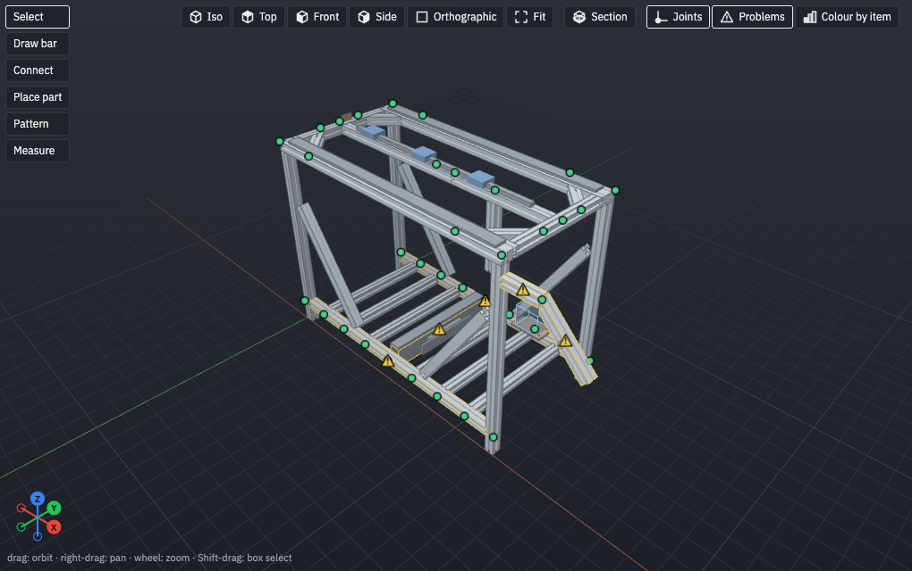
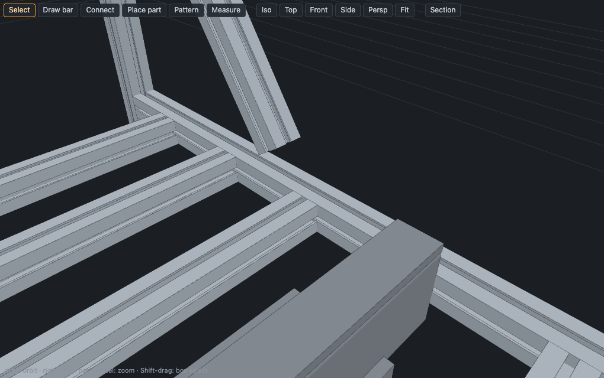
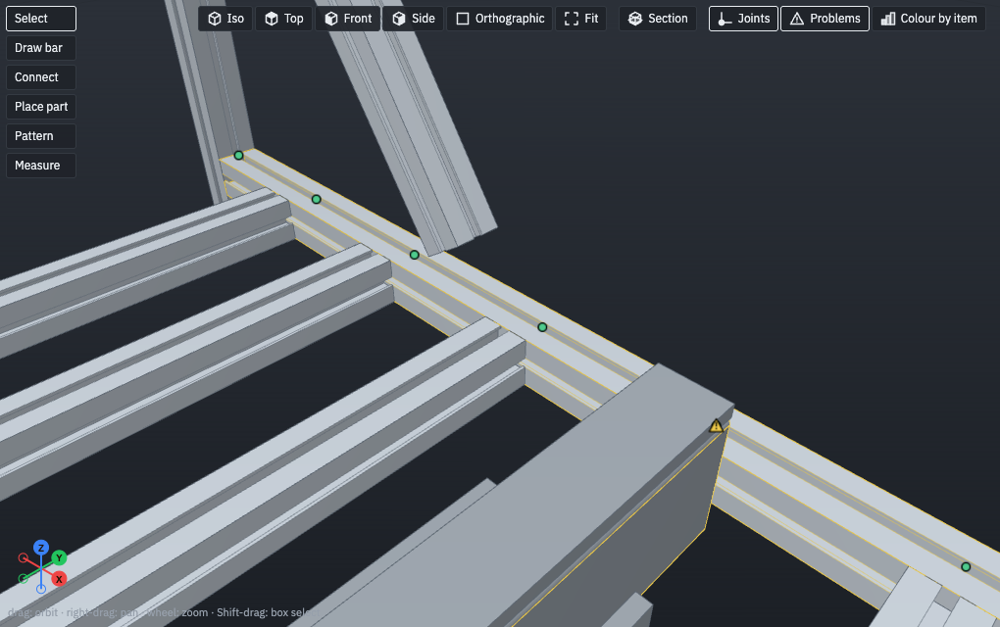
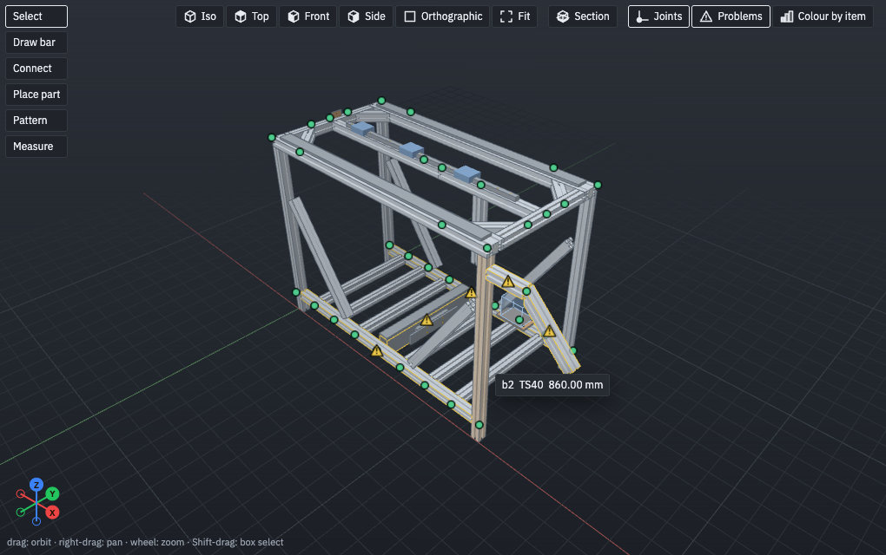
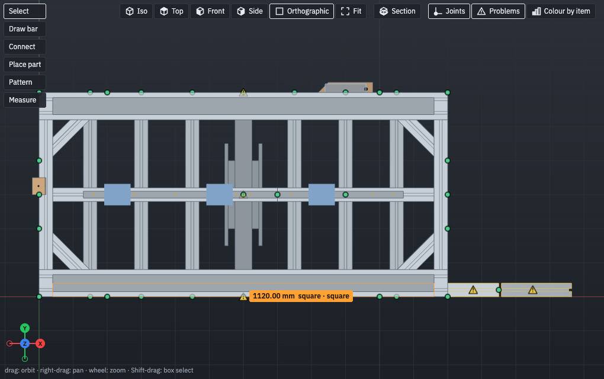
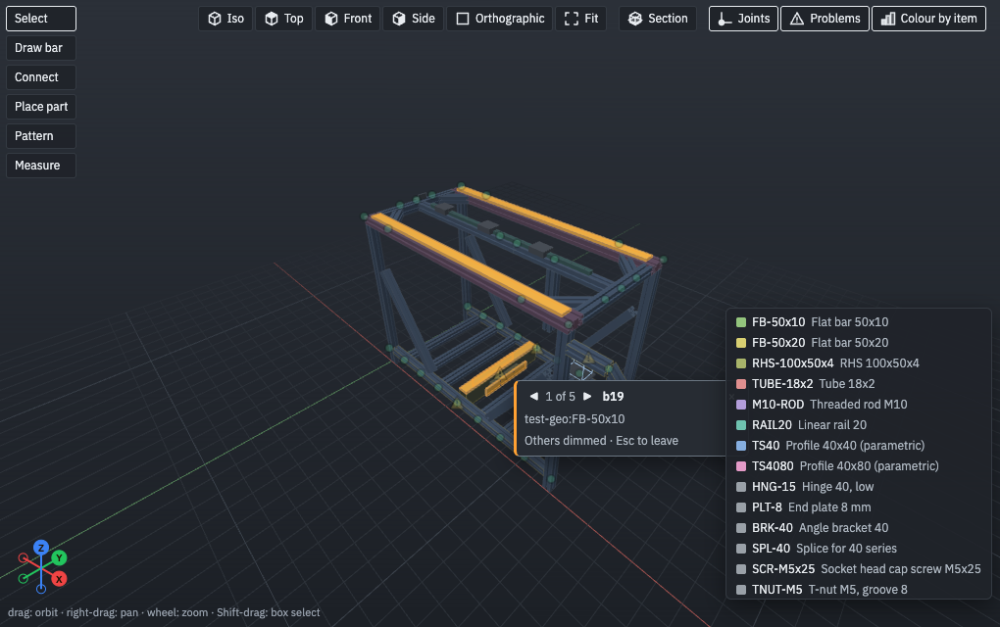
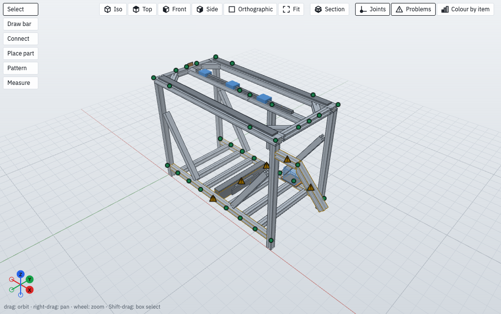

# AluKit UX: S3's decisions (the 3D view)

*S3 of the [UX plan](plan.md) (§5.7): the 3D view, built against the [contracts](contracts.md)
and C's [rendering spec](visual-design.md#5-the-3d-view-rendering-spec). Labels as in the plan:
**measured** (run), **read** (from the code that runs), **inferred**.*

## Done

| Task | What | Where |
|---|---|---|
| S3.1 | `polygonOffset` on every body; the selection tint that keeps shading, its outline and x-ray; sky and key lights, low ambient, fog, the gradient background; edge colour by body lightness | `src/viewer/{look,scene}.ts` |
| S3.2 | Hover in Select (one pick per frame, the pale tint, a label by the pointer); `setHover` from rows and chips; a selected bar's label | `scene.ts`, `viewport/{Overlays.tsx,words.ts}` |
| S3.3 | Outline and detail edges, the zoom ramp, orthographic keeps the detail; cut faces' own material; `angledGeometry` keeps its groups | `src/mesh/bars.ts`, `scene.ts` |
| S3.4 | Corners (first batch) | `src/ui/corners.ts` |
| S3.5 | Joint markers; hover and click name `corner:<key>`; the Joints toggle | `src/viewer/markers.ts`, `scene.ts` |
| S3.6 | Targets; Show frames, pulses, ghosts, and its callout steps through the targets | `src/ui/targets.ts`, `Overlays.tsx` |
| S3.7 | Problem badges and the Problems toggle | `markers.ts`, `words.ts` |
| S3.8 | Snap glyph shapes, the cyan preview and picks, `setLabel` | `src/viewer/{overlay,labels}.ts` |
| S3.9 | The ground sized to the model, the axes across it, the gizmo | `src/viewer/ground.ts`, `Overlays.tsx` |
| S3.10 | Colour by item and its legend | `scene.ts`, `Overlays.tsx` |
| S3.11 | The view controls' three groups with S4's icons; the tool rail | `viewport/{ViewControls,Viewport}.tsx`, `viewport.css` |
| S3.12 | The light theme in the viewport | `tokens.ts` (S4's values), `look.ts` |
| S3.13 | Measurements, `docs/images/cart-iso.png`, screenshots, this note | below |

## Corners (S3.4)

1. **A corner follows the check's rules, so a marker and the `unconnected` warning agree.** Ends
   meet when their design points lie within the core's length tolerance (`TOL.len`, 0.01 mm),
   grouped as `unconnectedEnds` groups them. An unclaimed end (`by: "default"`) still counts as
   joined when it is the through member of a butt an end there bears on: a through bar left with
   `through_end: "none"`, or the bar end an end plate bears on (the cart's b31.b under c33). The
   through members come from the derived butts' `on` (`b5 -x`, `b31.b`), which cover pattern
   copies; the written connections do not.
2. **A T counts, a bar along the line does not.** D-UX-10 adds an end on another bar's line to
   the check's ends that meet. The line bar must cross the end's bar: the cart's linear rail b33
   lies along the profile b11, so its free end is no corner. A corner of a T is therefore a case
   the check does not warn about when it is open (one unclaimed end on a bar's line); the markers
   show it, and the problem model (S1.6) may choose to list it. An end 20 mm off a bar's line
   (the cart's b31.a, butted into b2 through c32) makes no corner: c32 is one of the outline's
   "Other connections", with the pivots and the face joints.
3. **Failed wins over open.** An end with two providers falls back to the default, unclaimed,
   with an error on the end that names both connections in its `refs`. A corner is failed when an
   error names one of its ends or connections (entity or refs), and the providers an error names
   join the corner's connections. Warnings (the cart's overhanging butts c21, c22) do not fail it.
4. **The key is the point,** `x,y,z` to 0.01 mm with no trailing zeros (`0,0,900`). It stays the
   same while the bars there do not move, as when Flip changes which bar runs through (the design
   points stay put). `through` is the butts' through bar there, when it is a bar (not a bar end).
5. **Measured on the cart:** 36 corners, all joined, every one checked against the fixture's
   coordinates. Grouping and the line test index points and bars in 250 mm cells, so a 1,000-bar
   model is not quadratic.

## Rendering (S3.1, S3.3, S3.12)

6. **C's values, in the tokens.** Every number of C §5.1 to §5.3 is a `ViewTheme` field with its
   value in `tokens.ts`; the viewer holds only the mixing shares (`MIX` in `look.ts`: selected 78 %,
   hover 45 %, ghost 72 %) and the ghost's edge opacities. The background is one gradient texture
   (no pass); the fog is linear, near = d − 0.6 r, far = near + 4 r, in a colour between the
   background's stops (a unit test holds that), so the back of the frame recedes into the
   background rather than into a different grey.
7. **Outline and detail edges come from the section, once per section.** `sectionEdgeSets` keeps
   as outline the end rings and the lines along the bar at the convex hull's vertices that are
   creases (over 30°) or where a flat outer face ends on the section's box; every other crease
   (slot lips, the core's chamber, holes) is detail. A rounded box therefore gets its eight
   silhouette lines, a T-slot profile its four corners. **Measured** on the cart: 2,462 outline
   and 2,990 detail segments of 5,452. Detail fades in from 0 to 0.5 as a 40 mm face grows from
   24 to 64 px (one uniform a frame); orthographic views keep it at 0.6, today's look, as C's
   Ortho row asks until R13.
8. **A dark body gets light edges.** A body under 15 % relative luminance (black anodised) takes
   `edge.onDark` (`#9AA3AD`); others the mid-tone. **Measured** in view.spec: a black b9's
   underside edge stands at 3:1 or more against the background below it, from the front, in
   orthographic.
9. **Colours change in place.** Each bar's edges are a range of its section's merged buffer, with
   RGBA vertex colours, so selection, hover, ghosting and colour by item rewrite only the changed
   bars' ranges (`addUpdateRange`); past 64 changed bars a paint uploads the whole buffer. Bodies
   keep their instanced colours. Nothing is rebuilt for a state.
10. **The export does not move.** The GLB writer keeps `src/mesh/style.ts`'s palette and ignores
    the geometry groups `angledGeometry` now keeps. **Measured**: the cart's GLB from main and
    from this branch have the same SHA-256 (`aa969a01…`, 206,736 bytes); `glb.test` passes.
11. **The light theme** uses S4's light values (bodies, edges, the overlay) with S3's new roles
    beside them: a light fog `#E2E6EA`, a white sky over a warm grey ground, metre lines
    `#ADB5BE` on S4's `#C9D0D8` lines. On the light ground a black profile's body carries its
    silhouette, so the 3:1 rule there is checked on the body or its edge, whichever stands out
    more (`theme.test.ts`).

## Selection, hover and Show (S3.1, S3.2, S3.6)

12. **A selection cannot hide.** Its bodies lerp 78 % toward `sel` (shading kept), its outline
    edges turn `#8A4A00`, and the same outline is drawn again in `sel` at 45 % with the depth test
    off. **Measured** in view.spec: from the top, b9 under the top rail shows over 200 amber
    pixels inside its box once selected and none before, while the middle of the bar on top
    stays unselected.
13. **Hover picks once a frame, markers first.** The last pointer position is picked in the next
    frame, not on every event: joint markers within 9 px of the pointer win (they sit inside
    bars), then bodies by the raycast. The result is reported only when it changes, so
    `focus.hover` does not churn. A tool armed or a button down clears it. Rows and chips hover
    through `focus.hover`; the viewport tints the bodies their refs stand for
    (`resolveTargets`), so an item's row lights every bar of that item.
14. **Show keeps the direction.** `fitBox` moves the target and the distance only; the camera's
    direction is the same to three decimals (view.spec). It pulses the targets three times in a
    second, and ghosts the rest 72 % toward the fog with their edges at 18 % and 12 %, the joint
    markers and badges fading with them, when it shows a problem (B §5.3: "others dimmed" until
    Esc) or its caller asks (`isolate`: the legend). A Show without either (a toast's, a chip's)
    frames and pulses only. The callout sits at the first target's point, steps "◀ n of m ▶"
    through the targets (each step frames and pulses its own), and Esc or × leaves it. It carries
    the problem's row (S4's compact `ProblemRow`, with its fixes) when S4's `problemList` holds
    the problem; until S2.6 serves the problems that list is the check's, so a Show from an order
    reason (O1) names its refs instead of the row. **Measured** in view.spec: Show on O1 puts the
    camera's target in c35's box, and leaving it brightens over 2,000 pixels while almost none
    darken.
15. **Words.** The hover label reads `b2  TS40  860.00 mm` (cut length as `format.ts`'s `mm`
    writes it, two decimals, where C's example shows one); a connection gives its glyph and type
    (`c23  ⊕ face`), a corner its connections, its through bar and its state. The selection label
    reads `153.14 mm  45.00° · 45.00°`. The hover label shows only for what the 3D view hovers,
    not for a row.
16. **What a ref names and what draws it are two lists.** `resolveTargets` gives `ids`, the
    entities the refs name, and `bodies`, what draws them. Show selects the ids, so a Show on a
    connection selects the connection (S2's show.spec: "Show on c35's reason selects c35") and
    the inspector can point at its field (B §5.3, step 5), while the scene frames, pulses and
    keeps from the ghost its fasteners and bars, and badges its bars. With one list, the
    selection took the bars too: S4's Problems sheet then showed "3 selected" for c21, and its
    selection filter kept a connection's problem for any of its bars (**measured**: both S4
    specs failed until the split).

## Markers and badges (S3.5, S3.7, S3.8)

17. **Markers are screen-sized points, lifted toward the eye.** A corner lies inside the bars
    that meet there, so a depth-tested marker would be hidden by its own bars. Each glyph is drawn
    twice: faint (28 %) with no depth test, so a corner behind the frame still shows where it is,
    and whole, depth-tested after moving toward the eye by the largest section's diagonal plus
    10 mm (at least 40 mm). In perspective the shader scales the point toward the eye, which
    keeps its place on the screen; in orthographic it moves along the view axis. The textures are
    drawn once into a canvas, 64 px, white where the point's colour tints them, with the dark ring.
18. **Glyphs by meaning, colours by state.** Joints: joined a filled disc (`ready`), open a ring
    (`warn`), failed a cross (`blocked`). Badges: the most severe problem per body, an octagon for
    blocks and errors, a triangle for warnings; notes draw none; the body's outline takes the
    badge's colour. They read S4's `problemList`: the served problems once S2.6 fills them, the
    check's diagnostics until then (on the cart, the warnings on c21, c22 and c33 badge b9, b10,
    b18 and the handle's b31 and b32: `words.test.ts`). Snap markers have C's shapes (square,
    triangle, diamond, cross, ring, ⊕, dot); the line, pick and preview markers are the tool's
    cyan, never amber (U42).
19. **Hover and click on a marker name the corner** (`corner:<key>`), which the selection, the
    outline (S2.5) and the corner inspector (S5.5) share.

## Ground and gizmo (S3.9)

20. **The ground fits the model**: 2.6 × the larger footprint side, rounded up to a metre (at
    least a metre), 100 mm and 1 m lines on world multiples, fogged; the minor spacing grows
    tenfold past 400 lines a side. World X and Y run across it at 70 %.
21. **The gizmo is HTML over the canvas, not a second WebGL viewport**: no extra render pass, crisp
    at any pixel ratio, and its six ends are real buttons (keyboard, a test's `getByRole`). It turns
    with the camera each frame, the nearest end on top. Snapshot mode leaves it out with every
    other overlay.

## Colour by item, view controls (S3.10, S3.11)

22. **Colour by item takes S4's swatches** (`swatches`, `ItemSwatch`): one table, so a profile has
    the same colour in the BOM and the frame. A body whose item has no swatch takes
    `body.neutral`. The legend lists the BOM's items in the BOM's order; an entry Shows what uses
    the item with the rest dimmed. **Measured** in view.spec: the legend's entries equal the
    BOM's items, and RHS-100x50x4 frames b18 with a slat beside it darker by more than a fifth.
23. **The view controls** are three groups (view: four views, Orthographic, Fit; section; show:
    Joints, Problems, Colour by item), each button S4's icon with its word beside it from
    1440 px; the word is its label and its title says more. The projection is a toggle named for
    what it turns on, pressed in orthographic (U58). The tool buttons are a column down the left
    edge, so the bar is one row at 1280 px (**measured**, screenshot). S4's icon set had none for
    the joints: S3 added `joints` (two bars and the filled marker).

## Measurements (S3.13)

24. **How measured.** Headless Chromium at 1280 × 800 serves each build on the same project;
    the script orbits the camera with the mouse for two seconds (twice) and then sweeps the
    pointer across the model without a button, recording `requestAnimationFrame` intervals (a
    slow frame delays the next callback). Before is the build before S3 (S0's), after is this
    branch, run back to back, three rounds on SwiftShader and two on the GPU; the figures are the
    medians of the runs' mean intervals. The machine was loaded by other agents (load average 13
    to 26 on 10 cores during the SwiftShader runs), so the SwiftShader figures are relative.
    `__alukit.frames()` gives the after build's CPU time inside `renderer.render` and in hover
    picks. The 1,000-bar model is a lattice of 992 bars on a 400 mm node grid plus 8 rails, with
    no connections (384 open corners).

| Frame interval, ms (mean; p90) | Cart, before | Cart, after | 1,000 bars, before | 1,000 bars, after |
|---|---|---|---|---|
| SwiftShader, orbit | 18.5; 25.0 | 20.6; 33.3 | 273; 367 | 250; 308 |
| SwiftShader, hover sweep | 16.7; 16.7 | 16.9; 16.7 | 20.8; 16.7 | 77.6; 250 |
| GPU (Apple M1 Max, Metal), orbit | 16.7; 16.7 | 16.9; 16.7 | 16.7; 16.7 | 16.7; 16.7 |
| GPU, hover sweep | 16.7; 16.7 | 16.7; 16.7 | 16.7; 16.7 | 16.7; 16.7 |

25. **What the numbers say.** On the cart the new look costs about 2 ms more a frame on
    SwiftShader (18.5 to 20.6 ms; inferred: the gradient, the two edge buffers, the markers), so
    a frame there now often misses 60 Hz while orbiting, as one already did at p90 before. On
    1,000 bars orbiting is faster than before (250 against 273 ms): zoomed out, the detail edges
    (96,000 of 172,000 segments) fade to nothing and are not drawn (read). The hover pick
    itself is cheap: **0.14 ms** on the cart and **0.43 ms** on 1,000 bars (CPU, per pick, one a
    frame at most). What a hover costs on SwiftShader at 1,000 bars is the frame it redraws when
    the bar under the pointer changes (~250 ms there); between changes nothing is drawn. CPU time
    in `renderer.render` is 2 to 4 ms a frame in both models. On the GPU every case holds 60 Hz
    (16.7 ms, the display's interval) before and after, the 1,000 bars included; the after build
    spends 0.25 to 1.9 ms of CPU a frame in `renderer.render` and 0.2 to 0.6 ms a hover pick.
26. **The bundle** grows by 36 kB (964.7 kB on main, 1,000.9 kB here; gzip 257.3 to 270.5 kB),
    which crosses Vite's 1,000 kB advice; the build still passes. Splitting the viewer's code into
    its own chunk is a later change, not S3's.

## Tests

- view.spec adds seven tests: hover (b2 sets `hovered()`, tints, names its cut, clears), x-ray,
  the black profile's edge contrast, the unconnected rectangle (4 open markers, `corners()` equal
  to `cornersOf` of the served model, none drawn with Joints off, a hovered corner), Show on the
  order's O1 (c35: the camera's target in its box, the direction kept, the rest dimmed until
  Esc), colour by item (the legend equals the BOM's items; an entry frames b18 and dims the
  rest), and the gizmo. The pixel tests turn the problem badges off, whose warning tint is near
  the selection's amber and the open ring's yellow. The projection is checked by
  `aria-pressed`; the section test moves the pointer off the viewport before its last picture.
- **The tests wait for the camera to rest, not to look still.** The old wait (the camera in the
  same place twice, 120 ms apart) could pass before a move's first frame when frames are slow:
  **measured**, the first full gate failed the black profile test with a contrast of 1.01 (the
  pixels read were background) and a repeat failed "looks from standard views" once. The viewer
  now says `moving` in `camera()` from the call that starts a move until camera-controls marks
  it rested, and view.spec waits for `moving` to be false. Twenty runs of view.spec then passed
  at a load average of 30 to 41.
- The background is a gradient, so "the cart draws its bars" and `png.ts`'s `coverage`
  (snapshot.spec) count a pixel as drawn when it differs from its row's commonest colour; the
  assertions are the same.
- Unit tests: `theme.test.ts` (the export's palette, contrast, fog), `words.test.ts` (labels,
  legend, badges with the problem fixture), the edge sets in `mesh.test.ts`, the cart's targets.

## Not in this round

- C's R13 (a screen-space outline pass), as the brief says; orthographic views keep today's
  detail edges meanwhile (C §5.2).
- Section caps (stencil caps with a hatch), the placeholder's hatch and dashed outline, and the
  footprint shadow: C's spec rows that no S3 task lists.
- The tools still send `point` for every snap; S5 maps stations to `face` and `datum`.

## Cross-edits in files another stream owns

- `src/ui/theme/tokens.ts` (S4): the view's values and roles (contracts.md, S3 changes).
- `src/ui/theme/tokens.test.ts` (S4): drops the assertion that the dark view's bodies are the
  export's; `theme.test.ts` holds the export's palette instead.
- `src/ui/icons/Icons.tsx` (S4): adds `joints`.
- `tests/e2e/png.ts` (shared): `coverage` by row.

## Screenshots

The cart at 1600 × 1000, SwiftShader, the viewport only. Before is main before S3 (S0's look);
the others are this branch.

| | |
|---|---|
|  |  |
| Before: flat ground, a fixed sun, one edge colour, a 4 m grid | After: the same view; the yellow bars are the check's three warnings |
|  |  |
| Before: a close-up | After: the slots' detail edges fade in with zoom |
|  |  |
| Hover: what a click would select, named | A selection shows through what covers it |
|  |  |
| Show from the legend: framed, the rest dimmed | The light theme (S3.12) |
