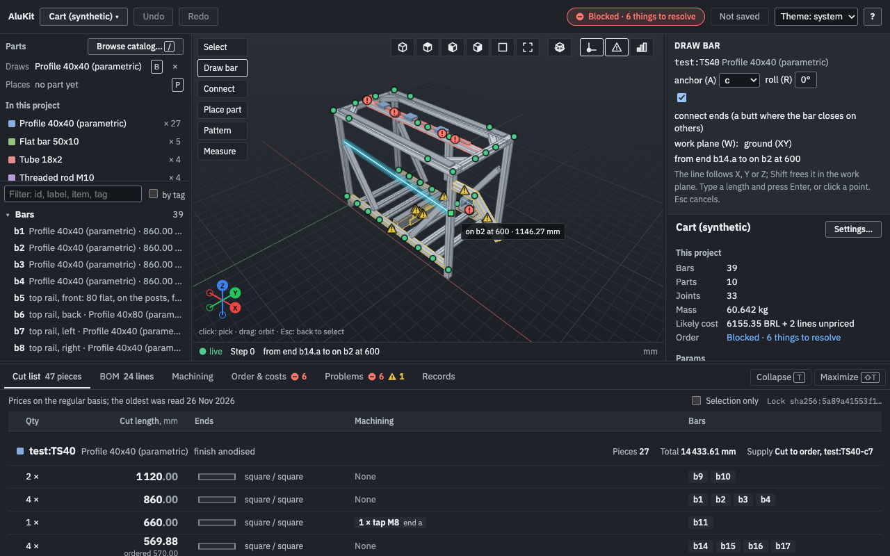
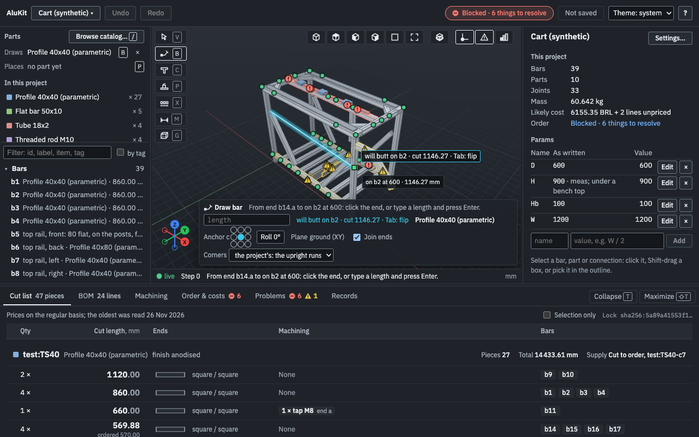
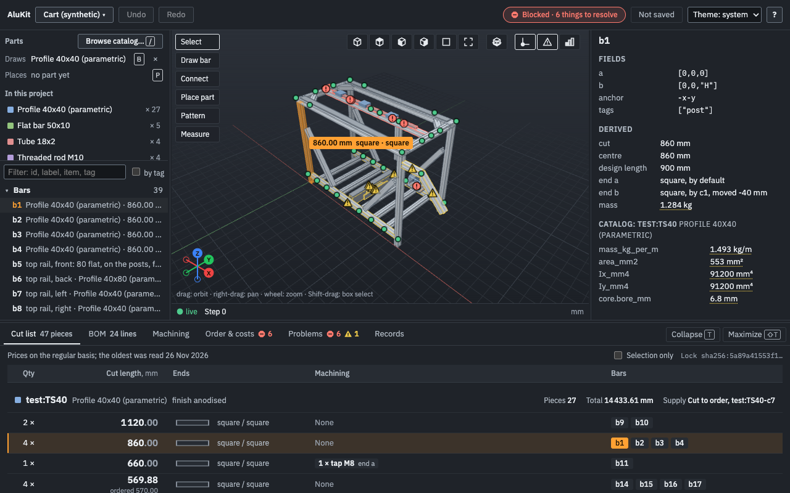
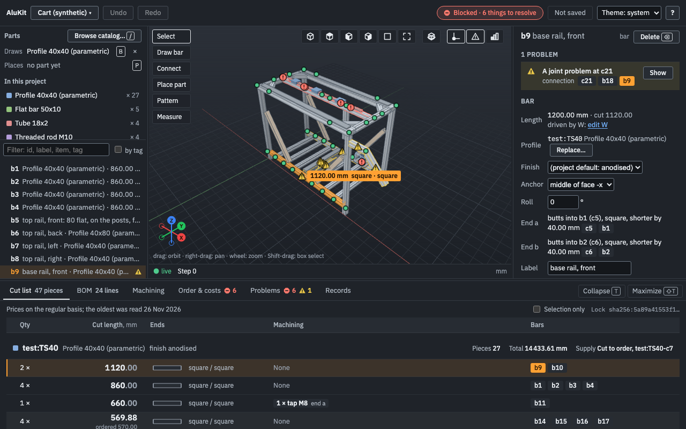
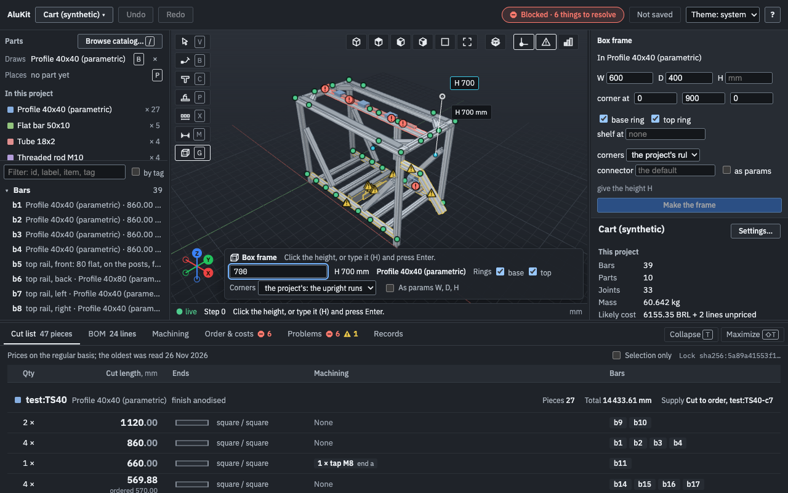
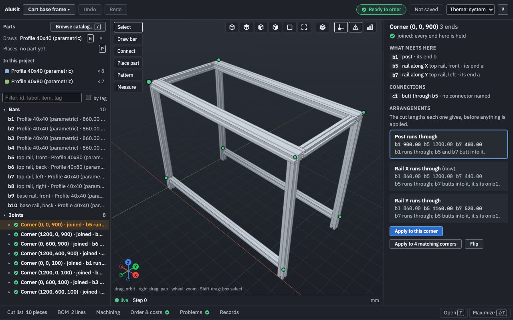

# AluKit UX, stream S5: editing and tools

*S5 of the [UX plan](plan.md) (§5.9): the command bar, typed values, the keys, the joint
preview, the box frame tool, place on the click, Connect's checks, the tool rail, and the
inspector with Delete and the corner inspector. Labels: **measured** (a test or a run says so),
**read** (from the code), **inferred**. Interfaces it changed are in
[contracts.md](contracts.md) ("S5 changes"). The plan names this note
`docs/notes/ux-s5-decisions.md`; the stream's brief put it here, beside the plan.*

## Done

| Id | What | Where |
|---|---|---|
| S5.1 | Keys: a value's letters stay in the value; Esc steps back one level; `X` Pattern, `G` Box frame; `→ ← ↑` lock the axis | `tools/wiring.ts` |
| S5.2 | The command bar: the tool, its prompt, the typed value and what it comes to, the options; `Space` chains; `[x, y, z]` starts a bar from the keyboard; Enter at a selected corner or point starts there | `tools/{CommandBar.tsx,typed.ts,wiring.ts}`, `viewer/draw.ts` |
| S5.3 | The inspector: fields edited in place | `inspector/` (INSPECTOR) |
| S5.4 | Delete with its cascade list | `inspector/` (INSPECTOR) |
| S5.5 | The corner inspector | `inspector/` (INSPECTOR) |
| S5.6 | The joint preview, from dry runs; `Tab` flips it; the result chip | `tools/{joint.ts,wiring.ts,CommandBar.tsx}` |
| S5.7 | The box frame tool `G` and `FrameForm`, also the start card's first way in | `tools/{wiring.ts,commands.ts,forms/FrameForm.tsx}` |
| S5.8 | Place on the click; a typed distance from the nearer end; a pattern copy's hover names the template | `tools/{wiring.ts,commands.ts}` |
| S5.9 | Connect: every new diagnostic, the connection's first; picks checked against the type; fasteners, stacks and hinges from the bin | `tools/{ToolForm.tsx,commands.ts}`, `Feedback.tsx` |
| S5.10 | The tool rail: S4's icons, key caps, disabled tools say why | `tools/ToolRail.tsx`, `icons/Icons.tsx` (`frame`) |
| S5.11 | This note; the keys and tools text for the guide (below) | — |

## Decisions

| # | Decision | Why |
|---|---|---|
| 1 | **The command bar's value is a real text field**, and a value-starting key pressed over the view (a digit, `.`, a sign, `(`, `[`, `=`) moves the keyboard into it with that character. From then on every key is the field's: `1.2m` keeps its `m`, `W/2` its `W`. Enter, Esc and Tab in the field go to the tool | U20's root cause was that the draw tool passed letters on to the tool keys while digits were typed. A field also gives a screen reader and the keyboard a real control (U26), and the browser's own editing (caret, selection, paste) |
| 2 | **`=` starts a value that begins with a param**: with nothing typed, `W` is still the work plane's key and `B` the draw tool's | A letter cannot both start a value and pick a tool. Spreadsheets start a formula with `=`; once a value has begun, letters are the value's (decision 1) |
| 3 | **A typed value is the document's grammar** (`#core/expr.ts`), with `mm`, `cm` or `m` after a number turned into millimetres before parsing. A value that reads no param is written as the number it comes to (`2 * 300` writes `600`, `1.2m` writes `1200`); one that reads a param is written as typed (unit-converted), so the param keeps driving it | D-UX-17. A plain number stays a number, so draw.spec's document is unchanged (**measured**: draw.spec passes byte for byte) |
| 4 | **An expression goes into the coordinate along the axis**: from `[0, 0, 1200]` along +X, `W/2+20` writes `["W/2+20", 0, 1200]`; from a node or another bar's end, the start's coordinates with the expression added (`"100 + W"`). Along a free direction (Shift) the end is written as the coordinates it comes to | Only an axial offset can be written as one expression per coordinate; the end still follows the param in every case the axes cover |
| 5 | **A click while a value is typed commits the typed value**, along the direction under the pointer, not the point clicked | The preview shows the typed length; committing something else on a click surprised (read: before, the click committed the pointer's end while the preview showed the typed one) |
| 6 | **The arrow keys lock the axis until pressed again (or `↓`) or the gesture ends**; a snap under the pointer then gives its station on the axis ("+x 730 level with end b1.b"), unless it is level with the start, when the pointer's ray decides | SketchUp's arrow-key locks. A snap on the bar the line starts from would give a zero length (**measured**: keys.spec failed so until the rule was added) |
| 7 | **Space chains** two ways: with a bar previewed it commits it and starts the next from its end; with nothing started it starts from the last bar's end. The chained start is written as the last end was | U29. One key for both, as each is the only thing Space can mean in that state |
| 8 | **Enter with nothing started starts at the selection**: a corner (`corner:<key>`), a node, or a bar end (`b1.b`); a typed `[x, y, z]` starts at that point | S5.2's "Enter at the selected end"; a bar alone has two ends, so a bar is not a start |
| 9 | **Esc steps back one level**: what is typed, then the tool's last pick or stage (Connect drops the last pick, not all; Measure the second point, then the first; the box frame the height, then the size, then the corner; Draw the picked plane, then the gesture with its lock), then the tool, then the selection | D-UX-18, U59 |
| 10 | **The joint preview dry-runs the whole gesture**, as it would commit, 60 ms after the end snaps onto something or 250 ms after the gesture last changed, and only when the commands differ from the last asked; an answer that comes back for a gesture that has moved on is dropped. Nothing is shown in open space (nothing joins, no cut moves) | S1 measured a dry run at 144–167 ms on 1,008 bars: never per pointer move (S5.6's rule). Asking with the exact batch keeps §4.5's rule in the core (D-UX-11) |
| 11 | **The preview's words say who runs through and what moves**: "will butt on b1 · cut 580 · b1 800 → 820", or "b1 will butt on it · cut 620 · b1 800 → 780"; the new bar's ends claimed say it butts, other bars' ends claimed say they butt on it | U4: auto-connect's 800 → 820 said before the click. The words come from the dry run's `claimed`, `added` and `cuts` (`joint.ts`) |
| 12 | **Tab flips to the next corner rule that gives another arrangement**, trying each in order (`vertical`, `x`, `y`, `first`) by dry run and skipping those whose effects are the same; the rule chosen holds for that gesture only. The command bar's "Corners" select sets a rule for every bar drawn until changed | D-UX-9. Rules often agree at a corner; a flip that changed nothing would look broken |
| 13 | **The result chip** shows the step's words from its `rev` event ("add a box frame of 12 bars and 8 butts"), or the refusal, in the command bar | A R10; U30: a refusal shows where it happened. Draw, place and the frame send `inline` |
| 14 | **The box frame** asks the corner (click, or `[x, y, z]`), then W and D (click the far corner, or `1000, 600` Enter), then H (click, or `800` Enter), and sends one `addFrame` when the three are there. A far corner left of or below the first moves the frame's corner to the least x and y. W, D and H take expressions, sent as the numbers they come to (`addFrame` takes numbers; its `params` writes W, D and H itself). The bars are the armed bar, else the project's default (left out, so `addFrame` reads it); defaults are left out of the command (rings both, no corner rule) | D-UX-8, BE-6. Leaving defaults out makes the step `alukit add frame` with the same arguments (**measured**: frame.spec, byte for byte) |
| 15 | **One draft, two ways in**: the gesture and `FrameForm` edit the same `frameDraft`; the form also stands alone (corner defaulting to the origin), in the tool's panel and as the start card's first way in. Its numbers come from a dry run 300 ms after the last change: posts and each ring's cut lengths from `addFrame`'s `info` and the dry run's `added` | S2 left the form to S5 (`frameWay`). S1 measured an `addFrame` dry run at 389–395 ms on 1,008 bars: after a pause, not per keystroke |
| 16 | **Place commits on the click**; a distance typed first counts from the end nearer the pointer (`from: "b"` when that is b), and Enter commits there too. Without a typed value the station's own distance from end a is written, as before | D-UX-16. "This far from the end I am near" reads as a person measures; no amend-after (§7) |
| 17 | **A pattern copy takes no part**: hovering one says "copies take no parts: use b26, the template" and the click does nothing; Pattern says the same for a copy as its bar | U37 |
| 18 | **Connect shows every diagnostic the step added**, those naming the new connection first (`stepDiagnostics`) | U6: the step that made c7 broke b1.b's end and the panel hid it (**measured**: connect.spec's new test). The face connection test now meets an info note that names c36 beside c35; it still finds no warning or error (decision note in the spec) |
| 19 | **Connect checks a pick against the type before taking it**: a second through bar for a butt, a bar for a miter, splice or pivot, a third end for a miter, an end for a face joint are left out, and the tip by the pointer says why ("bar b5: a butt has one through bar: drop the other first"). A second click on a pick still drops it | U38 |
| 20 | **Fasteners, stacks and hinges are picked from the bin** by a list on their fields: the project's items (bars aside), then what was armed and pinned in the tab | S5.9; the fields still take any id typed |
| 21 | **The rail**: each tool S4's icon, its word from 1440 px, its key on a cap (hidden while single-key shortcuts are off); a tool that cannot be used is disabled with the reason in its title and accessible name | U44, U22, U33 |
| 22 | **The snap markers' shapes**: a station on a face's centre and a part's face centre are triangles, a part's origin or datum ⊕ | S3 left the mapping to S5 (s3-decisions, "Not in this round") |
| 23 | **The command bar sits clear of the gizmo** (left 86 px) over the canvas foot; it shows only while a tool other than Select is active, and Select keeps its one-line help | D-UX-5. S2 moved the status bar out of the viewport so the bar is alone there |
| 24 | **The tools describe their own keys** for help (`tools`, `drawing`); S2's `Help.tsx` drops its stand-ins | S2 decision 21 |

### The inspector, Delete and the corner inspector (S5.3–S5.5)

| # | Decision | Why |
|---|---|---|
| 25 | **A new length moves end b only, along the bar**: the coordinates that change are written as numbers, the others stay as written. A coordinate along the bar written with a param says "driven by H: edit H" and is never overwritten; one reading another bar (`len(b3)`) says "set by its expression"; a free end writes `len_mm`. An end at a reference (a node, another bar's end, a station, a pivot) is read-only, saying what sets it | An edit in place must not silently break what the document says drives the bar (D-UX-17's rule: a param keeps driving it) |
| 26 | **"All like it" is the same item and the same derived options**, one cut-list and BOM line; a pattern copy counts as its template | It is what the person sees as "the same bar" in the tables |
| 27 | **Replace** is a catalog search for bars, prefilled with the item's size (`40x40`), its options through `OptionSelects`, the scope this bar, these selected, or all like it: one batch | §5.9 S5.3; one step to undo |
| 28 | **Finish** is its own select over the item's option fields, starting at "not chosen" when nothing sets it | `OptionSelects`' preselection would show an unset option as set |
| 29 | **Delete goes at once only when the dry run removes exactly the selection and changes nothing else**; otherwise the dialog lists what else goes and what changes ("butt c1 loses b7.a") | D-UX-13: a plain delete stays one key; a cascade is shown before it happens |
| 30 | **Delete is sent `strict: true`**, at once or from the dialog. A refusal plans again: at once falls back to the dialog after one refused send; the dialog re-runs the dry run and shows the new list with a note | The document may have moved between the dry run and the send (a CLI edit, another tab) |
| 31 | **Delete's order**: patterns, parts, connections, runs, bars, nodes, project items, newer ids first within a kind; a command refused as missing its own id (already removed by the cascade) is dropped and the dry run asked again | Removing dependents first keeps every command valid in one batch |
| 32 | **Delete on a pattern copy** opens the dialog with "Leave this copy out", listing everything in that copy; a mixed selection is one batch; Delete on a corner, an end or an item does nothing and says why in a short toast | U37's copies are made by the pattern, not drawn |
| 33 | **The own step's toast offers "Undo it"** (S2's `Toasts.tsx`: the `!t.own` condition dropped) | D-UX-13 asks for an Undo toast after a delete; S2's toasts offered Undo only for others' steps |
| 34 | **Each corner arrangement keeps the corner's first butt's connector and quantity**; fields `autoConnect` does not write back (label, spacer, stack, `through_end`, `held_by`) are named as "not carried over" before Apply | Nothing the person set is lost without being told |
| 35 | **Arrangements are deduplicated on through bar, butting ends and cut lengths together**; "now" marks the one whose through bar is the corner's and whose dry run moves no cut | Rules often agree (decision 12) |
| 36 | **Names at a corner**: Post, Rail X, Rail Y, else Bar `<id>` (the id when two share an axis); the line names ids ("b3 runs through; b2 butts into it", "stands on it", "it sits on b1") | D-UX-9: plain words a builder uses |
| 37 | **Matching corners** have the same set of bar lines meeting the same way (an end, or a passing bar), so an L never matches a T; corners already running that way are left out; Apply-to-all uses the direction's rule (vertical, x, y) and is disabled for an arrangement only `first` gives; open matching corners are included | One click fixes a frame's eight corners without touching the odd one |
| 38 | **No arrangements, with the reason**, where a pattern copy's connection or a splice, miter or pivot holds an end. Join open corners sends one `autoConnect {at, optional: true}` per corner by the project's rule. Apply, Flip and Join are `strict` | Only butts are rearranged by the rules |
| 39 | **Stale answers are dropped**: the corner's dry runs go out on selection and again when the drawn revision moves; an answer for another revision is not shown | The same rule as the joint preview's (decision 10) |
| 40 | **A Show's pointed field lights its row only when the Show named the entity in the inspector** | S3's `pointedField` otherwise lit a row on an unrelated entity |

**The corner inspector's cost** (**measured** by the inspector's scratch script, load 100–170): one
rule's dry run 192–584 ms on 1,008 bars; the four rules 0.9–2.5 s, since the server runs them one
after another; deleting a bar 210 ms warm, 1,421 ms cold. A single server call for the alternatives
would cut the four to about one (for the integration pass, or S1).

## Measured

**The joint preview's dry runs** (a scratch Playwright script, not committed; SwiftShader,
1280 × 800; the machine's load average was 108–173 throughout, so absolute times are high and
noisy). A rail typed from `[-600, 0, 800]`, a 61-move pointer sweep through open space 16 ms
apart, then a rest on the post's end `b1.b`, then five Tabs.

| Project | Dry runs in the sweep | First preview's dry run (`tool().jointMs`) | Dry runs in all |
|---|---|---|---|
| 1 post (base frame, empty) | 8, then 2 | 1,326 ms, then 221 ms | 19, then 12 |
| 1,009 bars (84 box frames + the post) | 3, then 3 | 349 ms, then 517 ms | 13, then 13 |

- Never one per move: 2–8 for 61 moves. A sweep asks again only when the pointer rests 250 ms
  (under this load, Playwright's moves themselves were often more than 250 ms apart, which is why
  the first run asked 8 times); a snap asks after 60 ms.
- The time is the dry run's round trip from the browser, the server's undo-free apply plus derive.
  S1 measured 144–167 ms server-side on 1,008 bars on a quiet machine; these are the same order once
  the load is allowed for. Each Tab costs one dry run per rule it tries (at most three).
- The preview draws only DOM labels (`setLabel`) and S3's overlay: no material is made or changed,
  and `view.spec`'s count of links per revision stays zero (**measured**: view.spec passes).

## Tests

- New: `keys.spec` (`1.2m` while drawing is a 1,200 mm bar and the tool stays Draw; Space chains
  from `end b1.b`; `→` locks X; `=` then `W/2+20` with W = 1200 writes `"W/2+20"` and a 620 mm
  bar; Esc steps back a level at a time; `X` opens Pattern, `G` the box frame; with single keys
  off `B` does nothing and the rail still works), `frame.spec` (`G`, a click at the origin,
  `1000,600` Enter, `800` Enter: 12 bars, 8 butts, no `unconnected-end`, and the cut list equals
  `alukit add frame --at 0,0,0 --size 1000,600,800 --item test:TS40` on a scratch copy, byte for
  byte; the start card's form, with H typed as `W - 400`, makes the same frame), `edit.spec`
  (base-frame/cli's b1 ends at `[0, 0, "H"]`, so its length says "driven by H": the test edits H
  through "edit H" and checks the cut list against `alukit cutlist`; it types 950 into an added
  bar written as numbers, then undoes; Delete lists the cascade, and the own step's toast offers
  Undo) and `corners.spec` (a corner of base-frame/cli: three arrangements, the cut lengths each
  gives, "Apply to 4 matching corners").
- `inspector.spec`: wording only. The cut reads with two decimals through `format.ts`, so the
  assertion uses `numberText(cut.toFixed(2))`; it still compares the value with derive's.
- `connect.spec` gains the U6 regression (a butt that gives b1.b a second provider shows
  "b1.b has 2 providers (c1, c7)" in the panel) and the U38 check (a second through bar is left out,
  saying why). `tools.spec`: Place commits on the click (no `place-apply`), and checks the part's
  distance; a new test draws a rail onto a post's top, reads the preview's numbers, flips them with
  Tab, and checks derive's cut lengths are the flipped preview's.
- `draw.spec` is unchanged and passes byte for byte.
- Unit: `typed.test.ts` (units, params, lists, points, words), `joint.test.ts`, `commands.test.ts`
  (pick checks, place from the nearer end, `addFrame`'s command and what it lacks),
  `interaction.test.ts` (expressions along an axis, the locked axis); `client.test.ts` for the
  dry run's added fields.

## Cross-edits in files another stream owns

| File | Owner | Change |
|---|---|---|
| `src/ui/client/dryrun.ts`, `client.test.ts` | S1 | `results` and `failed` on the answer (additive; contracts.md) |
| `src/ui/shell/Help.tsx` | S2 | Drops the `tools` and `drawing` sections the tools now describe |
| `src/ui/icons/Icons.tsx` | S4 | Adds `frame` |
| `src/ui/shell/Toasts.tsx` | S2 | The own step's toast offers "Undo it" (decision 33) |
| `src/ui/testing.ts` | S0 | `hostOf(dir)`: dry runs on a scratch project, for unit tests |
| `src/ui/App.tsx`, `catalog/{CatalogOverlay.tsx,state.ts}`, `common/EmptyState.tsx`, `icons/icons.test.ts`, `records/Params.tsx`, `sheets/Sheets.tsx`, `shell/{StartCard,StatusBar}.tsx` | S2, S4 | Import paths only (the move of §5.4) |

## For the guide (S2.17's README and `docs/guide.md`)

**Tools and their keys.** `V` Select, `B` Draw bar, `G` Box frame, `C` Connect, `P` Place part,
`X` Pattern, `M` Measure. `Esc` steps back one level: what is typed, the last pick, the gesture,
the tool, then the selection. `Delete` or `Backspace` in Select deletes the selection, listing
first what else goes.

**The command bar** at the foot of the 3D view shows the tool, what it asks next, the value you
type and what it comes to, and the tool's options. Start typing a number (or `[`, `(`, a sign) and
it goes there; start with `=` to begin with a param. A value is an expression of the project's
params with `mm`, `cm` or `m`: `1.2m`, `W / 2 + 20`, `-300`. A value that reads a param is written
as the expression, so the param keeps driving it.

**Drawing a bar.** Click a start point (or type `[x, y, z]` and Enter, or select a corner and press
Enter), then click the end or type a length and Enter. `→ ← ↑` lock the line to X, Y or Z; Shift
frees it in the work plane; `R` rolls, `A` cycles the anchor (or click a dot on the section in the
command bar); `W` picks a face as the work plane. `Space` draws the next bar from the last one's end.
With "Join ends" on, when the end closes on another bar the preview says what the joint will do
("will butt on b1 · cut 580 · b1 800 → 820"); `Tab` flips which bar runs through.

**A box frame.** `G`, click the corner, type `1000, 600` Enter (or click the far corner), type the
height and Enter: four posts, a base and a top ring, every corner butted, as one step. The form
beside the inspector (and on the start card) sets rings, a shelf, the corner rule, the connector,
and whether W, D and H become params; it shows the cut lengths before you make it.

**Placing a part.** Click a face or a groove: the part goes there, one step. Type a distance first
to place it that far from the nearer end.

## Screenshots

1280 × 800, dark, the cart unless said.

| Before | After |
|---|---|
|  |  |
|  |  |
| |  |
| |  |

## Left for the integration pass

- **The four corner arrangements are four dry runs, one after another** (up to 2.5 s on 1,008
  bars under load). One server call that answers every rule at once would make it one.
  *Done: `GET /api/arrangements` ([integration-decisions.md](integration-decisions.md) 13–17).*
- **The joint preview asks in open space too**: a pause asks even when nothing can join (the
  answer is then not shown). Asking only when an end is on something would save those
  calls, at the cost of missing an end that lands on a bar's end without snapping to it.
  *Done, by geometry rather than by snap, so such an end still asks (integration 18).*
- **Help's text and the guide**: S2.17 takes the section above.
  *Done (integration 24).*
- **The plan names this note `docs/notes/ux-s5-decisions.md`**: kept beside the plan as the brief
  asked; the integration pass may move every stream's note at once.
  *Kept here (integration 25).*
