# Visual design: the 3D view and the tables

*2026-11-27. A proposal, one of three (task flows and IA, heuristics and first run, and this one:
visual design). It covers how the 3D view reads and how the tables read, and gives tokens, a
rendering spec, a table spec and a ranked list of changes. No product code changes here.*

Evidence came from the built app serving a copy of the cart fixture, driven by Playwright in
Chromium with SwiftShader at 1600 × 1000 and 1280 × 800: every drawer tab, a selection, the
section plane, the orthographic views, the catalog, the draw tool. Rendering ideas were tried in a
throwaway copy of the viewer and screenshot the same way; the "proposed" 3D images below are those
renders, the "proposed" table images are HTML mockups filled with the cart's real numbers.
Claims carry a label: **measured** (run or computed, with how), **read** (from the code that
runs), **inferred**.

## 1. The direction in one page

**The model is the brightest thing on screen, and every colour means one thing.** The workspace
is a calm graphite instrument; the frame sits on a lit ground with a shadow; amber means "selected"
and nothing else; cyan means "a tool is building this"; red, green and yellow are statuses and
always come with a shape and a word. The tables read like a fabricator's cut sheet: fixed columns,
the cut length as each row's figure, ends drawn as well as written, numbers aligned and grouped.

The one device that ties it together is the **item swatch**: each catalog item gets a stable
colour that appears in the tree, the cut list, the BOM and the order, and on the bodies themselves
when the view is coloured by item. A profile in the table and the same profile in the frame are
then visibly the same thing.

Headline values (full tokens in §4):

| Role | Dark (default) | Light |
|---|---|---|
| Panel / raised / app | `#1F2329` / `#272C33` / `#181B20` | `#FFFFFF` / `#F3F5F8` / `#EDF0F3` |
| Text 1 / 2 / 3 on panel | `#E8ECF0` 13.3:1 / `#AEB7C1` 7.8:1 / `#8C96A1` 5.3:1 | `#1A1F26` 16.6:1 / `#48515C` 8.1:1 / `#626C77` 5.3:1 |
| Selection | `#FFA133` | `#E08417` fill, `#9A4F00` text (6.0:1) |
| Ready / blocked / warning | `#4FCB8D` / `#FF7A6E` / `#EBC84A` | `#1B7A4B` / `#C2362B` / `#8A6200` |
| Tool feedback / links | `#3CC8E6` / `#74B4FF` | `#0B7F9A` / `#1F63C6` |
| Type | IBM Plex Sans 13/18 body, 12/16 heads and units, 15/20 row figures, 18/24 and 24/28 totals; Plex Mono 12 for document literals only | same |
| Viewport | gradient `#2B3038` → `#1C2026`, anodised bars `#C4CBD2` | gradient `#EEF1F4` → `#D3D9DF` |

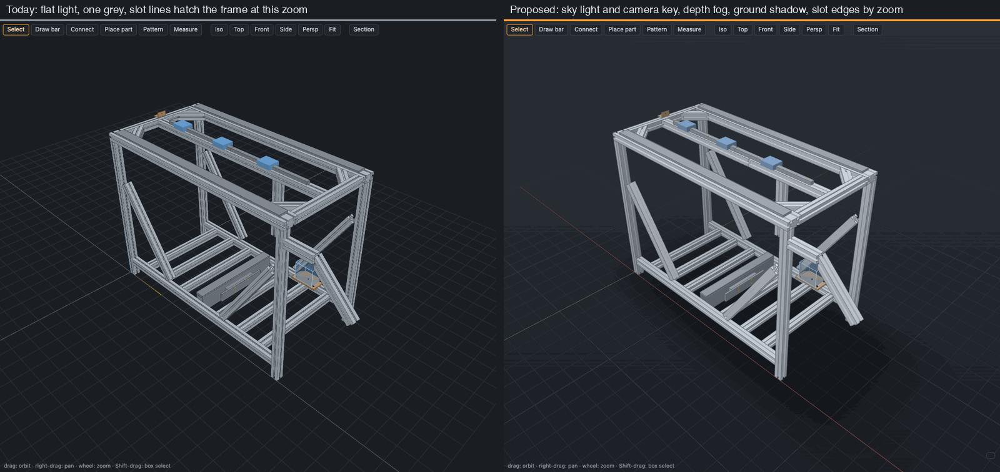

## 2. What the screens show today

### 2.1 The 3D view

1. **One grey, one light.** Every profile, flat bar and steel section is a near-identical light
   grey under a fixed ambient 0.9 + sun 1.8 + fill 0.6 (**read**: `src/viewer/scene.ts`,
   `src/mesh/style.ts`). A TS40 and a TS4080, or an aluminium profile and an RHS, are told apart
   only by size. The lights are fixed in the world, so every face that points the same way gets
   the same tone, and an orthographic view, which sees one face of each bar, is a flat silhouette
   (**measured**: `03-ortho-front.png`).
2. **Slot edges hatch the frame at the zoom people use most.** Edges are every crease over 30°
   (**read**: `EDGE_ANGLE_DEG` in `src/mesh/bars.ts`), drawn at one opacity whatever the zoom.
   Fitted to the whole cart, a 40 mm bar is 10 to 15 px wide and carries its slot lips as parallel
   lines inside that width, which read as texture, not shape (seen in `01-iso-before-after.png`,
   left). At
   the same time a rounded-corner profile has **no line on its outer silhouette**: its corner arcs
   are tessellated finer than 30°, so the only long lines are the slot lips (**read**:
   `sectionEdges`; **measured** in the prototype, where adding the flat-face end lines brought the
   silhouette back).
3. **A black profile disappears.** Black anodised `#3A3F46` on the background `#1B1F24` is
   1.56:1, and its edges are drawn darker still (`#15181C`) (**measured**: WCAG luminance ratio).
4. **The selection can hide, and its edges flicker.** A selected bar behind another is simply
   hidden; nothing shows where it continues. Edge lines sit exactly on the faces with no polygon
   offset, so they z-fight into dashes (**measured**: `02-selection-before-after.png`, left;
   **read**: no `polygonOffset` on any material).
5. **No hover, no labels.** Moving the pointer over a bar does nothing until a click (**read**:
   `onMove` in `scene.ts` only feeds tools and the box). Cut length and end angles are only in the
   properties panel and the cut list.
6. **Colour is overloaded.** Orange `#FF9F1C` marks the selection, the active tool, the active
   tab, the tool panel's heading, the section slider and primary buttons; the draw tool's preview
   bar is `#FFB454`, close enough to read as a selection; cyan `#38BDF8` is at once tool picks,
   line snaps and the section outline, beside a link blue `#6CB6FF` (**read**: `style.css`,
   `style.ts`, `overlay.ts`). Snap markers differ only by colour: all are the same square point
   (**read**: `Overlay`, `PointsMaterial`).
7. **The ground is a fixed 4 m sheet.** `GridHelper(4000, 40)` whatever the model's size, and the
   300 mm `AxesHelper` sits at the origin inside the cart's base, where it is mostly hidden
   (**read**; seen in every iso shot). There is no orientation gizmo.
8. **A section shows hollow bars.** The clipping plane leaves cut profiles open, so the eye looks
   into the extrusion instead of at a cut face (**measured**: section along X).

### 2.2 The UI and the tables

9. **No type scale.** 13 px system-ui for nearly everything; headings are 15, 13 and 12 px, two of
   them letter-spaced capitals; monospace appears for field values and lock hashes (**read**).
10. **Tables do not line up.** Every group (cut list) and every supplier (order) is its own
    auto-layout table, so the same column moves from one table to the next: "unit price" sits at
    a different x under `local` and under `test-fab` (**measured**: `09-order-before-after.png`).
    Headers are lowercase, dim and the same size as the cells; "centre mm" wraps to two lines;
    "square / square" wraps; the machining column holds a 200-character sentence.
11. **Numbers are not grouped and units wander.** `4226.90`, `14433.61`; money prints with no
    grouping (**read**: `money()` in `src/core/order/format.ts`); the unit price cell says
    `85.00 BRL` while its neighbours say `85.00`.
12. **BLOCKED is a word in a sentence.** The order's verdict is an 11 px outlined pill followed by
    "Prices on the regular basis in BRL…"; reasons read `BLOCK open-item O2: …` in 11 px capitals;
    a READY supplier takes as much room as a blocked one, so what needs attention does not stand
    out. The word is there, so it is not colour-only, but it is the smallest thing on the tab.
13. **Empty and idle states are blank.** Checks with nothing to report says "0 errors, 0 warnings,
    0 notes" over an empty pane; the 320 px properties column holds one sentence whenever nothing
    is selected, which is most of the time (**measured**: `11-states-before-after.png`).
14. **The tool bar is thirteen identical text buttons** and wraps to two rows at 1280 px
    (**measured**: 1280 × 800 shot). Tools, views and the section plane differ only by a 10 px gap.

## 3. How good viewers do it

- **Shaded with edges, hidden edges removed** is the default working style in CAD viewers:
  Onshape's render options list it ([Onshape help](https://cad.onshape.com/help/Content/View/hidden_edges_visible_and_removed.htm)),
  Fusion calls it "Shaded with visible edges only" (community threads only; no official page
  found, [example](https://forums.autodesk.com/t5/fusion-support-forum/visual-style-shaded-with-visible-edges-only-does-not-work-always/td-p/11281304)).
  A community reply there says Fusion drops to plain shading while orbiting and restores the
  edges after (**inferred** from a forum post, not documented): effects on settle, not per frame.
- **Profiles and depth cue**: SketchUp's edge styles thicken silhouette ("profile") lines and
  thin far lines ([SketchUp edge styles](https://help.sketchup.com/en/sketchup/edge-styles)).
  Our cheap equivalents are the outline/detail split and the fog in §5.
- **Silhouette and crease lines in three.js**: `EdgesGeometry` draws creases only; view-dependent
  "conditional" lines (the LDraw approach) add true silhouettes of curved surfaces
  ([three.js forum](https://discourse.threejs.org/t/ldraw-like-edges/17100)); a depth-and-normal
  edge pass draws every discontinuity in screen space
  ([outline post-process tutorial](https://discourse.threejs.org/t/how-to-render-full-outlines-as-a-post-process-tutorial/22674)).
  [`OutlinePass`](https://threejs.org/docs/pages/OutlinePass.html) outlines chosen objects but
  costs several passes and works on triangles only.
- **Ambient occlusion**: [`GTAOPass`](https://threejs.org/docs/pages/GTAOPass.html) is better than
  `SSAOPass` and dearer; [N8AO](https://github.com/N8python/n8ao) has a half-resolution mode its
  author puts at 2 to 4 times faster. Neither belongs in SwiftShader runs.
- **Grounding**: the [contact-shadow example](https://threejs.org/examples/webgl_shadow_contact.html)
  renders the model from below into a blurred texture; a frame that does not move needs it once
  per revision, not per frame.
- **Section caps**: the [stencil clipping example](https://threejs.org/examples/webgl_clipping_stencil.html)
  fills cut faces using the stencil buffer.
- **Orientation**: three's [`ViewHelper`](https://threejs.org/docs/pages/ViewHelper.html) draws a
  clickable axes gizmo; forum reports say its click animation assumes Y up
  ([thread](https://discourse.threejs.org/t/viewhelper-gizmo-never-exits-animating-mode/60882)),
  so ours would draw it and route clicks to our own `setView`.
- **Snap markers** change shape with the snap type in AutoCAD's AutoSnap
  ([Autodesk help](https://help.autodesk.com/cloudhelp/2018/ENU/AutoCAD-LT/files/GUID-9882004A-97FA-446A-84AB-13E061965034.htm));
  the triangle for a midpoint is the one shape the sources confirmed.
- **Contrast**: WCAG 2.2 asks 4.5:1 for text, 3:1 for large text and for the parts of controls
  and graphics needed to understand them, and no meaning carried by colour alone
  ([WCAG 2.2](https://www.w3.org/TR/WCAG22/), 1.4.1, 1.4.3, 1.4.11).
- **Numbers**: digits may be grouped in threes by a space, never by a point or a comma, and the
  decimal marker is the point or the comma customary in the context
  ([CGPM 2003, Resolution 10](https://www.bipm.org/en/-/resolution-cgpm-22-10);
  [NIST guide](https://www.nist.gov/document/j-032-writing-si) recommends a thin space).

## 4. Tokens

### 4.1 Colour

Dark is the default (the app is dark today); light follows `prefers-color-scheme` with a manual
switch remembered per browser. Contrast is against `bg-panel`, computed with the WCAG 2 formula for
every pair (**measured**).

| Token | Dark | Ratio | Light | Ratio | Meaning |
|---|---|---|---|---|---|
| `bg-app` | `#181B20` | | `#EDF0F3` | | top bar, tab rails, behind panels |
| `bg-panel` | `#1F2329` | | `#FFFFFF` | | tree, properties, drawer |
| `bg-raised` | `#272C33` | | `#F3F5F8` | | table heads, chips, popovers |
| `bg-well` | `#14171B` | | `#FFFFFF` | | inputs |
| `line` | `#343A42` | 1.4 | `#DADFE5` | 1.3 | hairlines (decoration) |
| `line-strong` | `#4B545E` | 2.1 | `#B4BDC7` | 1.9 | input borders, separators that matter |
| `text-1` | `#E8ECF0` | 13.3 | `#1A1F26` | 16.6 | values, names |
| `text-2` | `#AEB7C1` | 7.8 | `#48515C` | 8.1 | labels, column heads |
| `text-3` | `#8C96A1` | 5.3 | `#626C77` | 5.3 | units, dimmed decimals, hints (4.7 / 4.9 on raised) |
| `sel` | `#FFA133` | 7.8 | `#E08417` | 2.8, fill only | the selection: 3D, tree, rows, chips |
| `sel-text` | `#FFA133` | 7.8 | `#9A4F00` | 6.0 | selection as text or border |
| `sel-ink` | `#201304` | 9.0 on `sel` | `#201304` | 6.5 on `sel` | text on a selection fill |
| `act` | `#74B4FF` | 7.3 | `#1F63C6` | 5.7 | links, focus ring, primary actions |
| `act-fill` | `#2E6BC6` | white 5.2 | `#1F63C6` | white 5.7 | primary button |
| `tool` | `#3CC8E6` | 8.0 | `#0B7F9A` | 4.7 | what a tool is building: preview, picks, guides, section outline |
| `ready` | `#4FCB8D` | 7.7 | `#1B7A4B` | 5.3 | READY, checks pass |
| `blocked` | `#FF7A6E` | 6.2 | `#C2362B` | 5.5 | BLOCKED, errors |
| `warn` | `#EBC84A` | 9.7 | `#8A6200` | 5.5 | warnings, estimates, stale prices |
| `info` | `#8DB8F2` | 7.7 | `#2A62B5` | 6.0 | notes |

Rules: amber is only ever the selection (the active tool and tab move to a white underline and a
raised fill); a status is always glyph + word + colour, with four distinct shapes (circle and tick,
octagon, triangle, circle and i), so it survives greyscale and red-green colour blindness; the
warning's yellow and the selection's amber differ in hue and never share a shape. Washes for rows
and banners are the status colour at 12 to 14 % over the panel.

**Item swatches** (colour by item, and the tables' swatches): `#86AEE0 #93C47D #E08F8F #B39DDB
#D8CF72 #6FC2B0 #E39AC7 #A9B46A`, then neutral `#9AA1A8` for every item past the eighth. Hues are
assigned by count, most used first, so the commonest items get the clearest hues; none sits in the
selection's amber or the tool cyan. Light-theme swatches are the same hues darker (in the mockup).

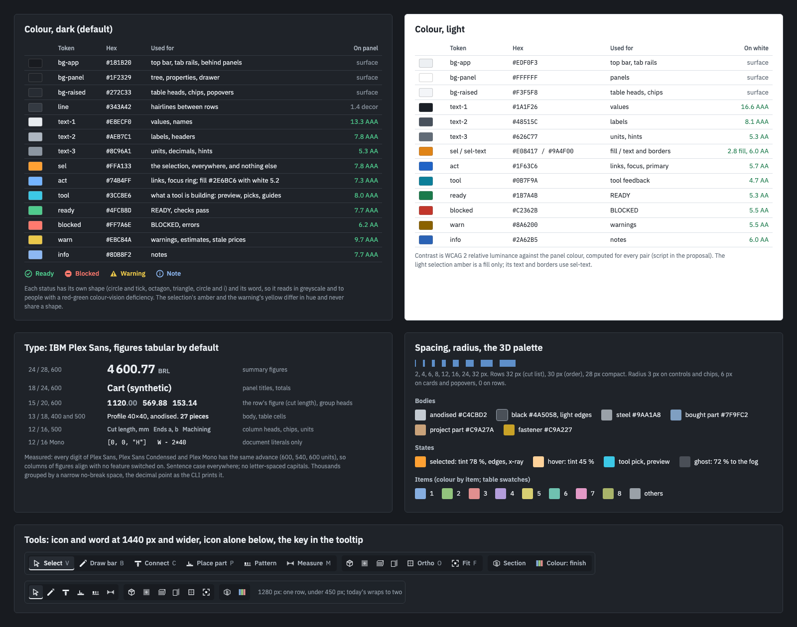

### 4.2 Type

**IBM Plex Sans** for the interface and every number; **IBM Plex Mono** only for text the document
holds literally (expressions, `[0, 0, "H"]`, hashes in the revision panel). Plex is open source
(OFL), its Sans, Condensed and Mono cuts are designed as one family, and it ships as self-hosted
WOFF2 packages ([`@fontsource/ibm-plex-sans`](https://fontsource.org/fonts/ibm-plex-sans)), which
suits an app that runs offline behind a CSP that allows only its own origin. **Measured**: in the Latin subsets
every digit of Plex Sans, Plex Sans Condensed and Plex Mono has one advance (600, 540 and 600
units), so figures align in columns with no OpenType feature; the subsets carry no `tnum` or
`zero` feature, so a slashed zero would need the full IBM package. Keep `font-variant-numeric:
tabular-nums` on numeric cells anyway, for the system-font fallback.

| Step | Size / line, weight | Use |
|---|---|---|
| Display | 24 / 28, 600 | summary figures (order lines likely, total cost) |
| Title | 18 / 24, 600 | panel titles, totals rows |
| Figure | 15 / 20, 600 | a row's main figure (cut length), group heads, the selection's name |
| Body | 13 / 18, 400 and 500 | cells, prose, buttons |
| Small | 12 / 16, 400 and 500 | column heads, chips, units, hints |
| Mono | 12 / 16, 400 | document literals |

Sentence case everywhere, no letter-spaced capitals (the properties panel's `FIELDS`, `DERIVED`,
the tool panel's `DRAW BAR` become sentence-case 12/16 500 in `text-2`). 11 px appears only as
the second line under a row's figure (centre or ordered length), never for anything that stands
alone.

### 4.3 Spacing, radius, elevation

- Spacing on a 2 / 4 / 6 / 8 / 12 / 16 / 24 / 32 px scale. Panels pad 12 px (16 px in the drawer).
- Row heights: cut list 32 px (it has a 15 px figure), order 30 px, BOM, costs and log 28 px; a
  compact density at 24 px for all.
- Radius by role, not one value for everything: 3 px controls and chips, 6 px cards and popovers,
  0 on rows and panels.
- Shadow only on what floats over the canvas (popovers, the hover label, the legend):
  `0 8px 24px rgb(0 0 0 / 0.45)` dark, `0 6px 18px rgb(20 30 40 / 0.16)` light.

### 4.4 Numbers and units

- **Grouping**: thousands grouped by a narrow no-break space (U+202F): in table columns from four
  digits, so a column's digits line up (`1 120.00` above `860.00`); in running text from five, as
  the SI practice has it (`14 433.61`, `4 600.77`). The decimal point stays the point the CLI prints, so the
  tab and `alukit order` say the same thing.
- **Precision**: as the CLI (mm to 2 decimals, kg to 3, money to 2, angles to 2), but trailing
  `.00` is drawn in `text-3`: `1 120.00` reads as eleven-twenty and still shows its precision.
- **Units** go in the column head (`Cut length, mm`, `Likely, BRL`), never repeated in cells; in
  running text a no-break space separates number and unit (`860 mm`, `31.74 %`). A cell in a
  different currency names it: `30.00 USD`, with the converted figure on hover.
- **Alignment**: numbers right, text left, quantities right with `×`; statuses left with glyph.
- **Money**: the likely figure is the figure; low and high become a range whisker (bar from low to
  high, tick at likely) with the two numbers in `text-3`, not two more full columns.
- **Dates**: `27 Nov 2026` in the interface, ISO in files and the CLI.

### 4.5 Icons

16 px on a 16 px grid, 1.4 to 1.5 px strokes, drawn from the domain rather than taken from a
general set: select (pointer), draw bar (a bar with its start square), connect (a T butt), place
part (a bracket on a bar), pattern (three repeats along a line), measure (a dimension line), the
four views as cubes with the viewed face filled, orthographic (a square), fit (four corners),
section (a cube with a plane), colour by (three swatches). Icon and word at 1440 px and wider,
icon alone below with the word and key in the tooltip; three segmented groups (tools, view,
display). At 1280 px the bar is one row under 450 px wide where today's wraps to two.

## 5. The 3D view: rendering spec

Everything here except §5.4 adds no render pass: the same draw calls with different materials,
lights and two edge buffers instead of one. It all runs on SwiftShader, and nothing in §5.1 to §5.3
is random, so `alukit snapshot` stays deterministic.

### 5.1 Scene

| Element | Today (**read**) | Proposed |
|---|---|---|
| Background | flat `#1B1F24` | vertical gradient `#2B3038` → `#1C2026`; light `#EEF1F4` → `#D3D9DF` |
| Lights | ambient 0.9, sun 1.8 fixed at (800, 1500, 600), fill 0.6 | hemisphere sky `#F2F5F8`, ground `#4A4540`, 1.9 (tops bright, undersides darker: orientation at a glance); a key directional 1.7 that rides with the camera, placed 0.6 d above and 0.45 d left of the eye (d: eye to target), so from any side the faces toward the eye are lit and a bar's two visible sides differ in tone (a world-fixed sun leaves one side of the frame in its own shade as it turns); ambient 0.25 |
| Material | Lambert | Lambert still (cheapest on SwiftShader); `ExtrudeGeometry`'s two groups get two materials, cut faces ×(1.12, 1.10, 1.04) of the side colour, a shade brighter and warmer like sawn metal; `polygonOffset` factor 1, units 1 on every body |
| Finishes | anodised `#B9C3CD`, black `#3A3F46`, steel `#8D949C` | anodised `#C4CBD2`, black `#4A5058`, steel `#9AA1A8` |
| Parts | bought `#6FA8DC`, project `#C49A6C` | bought `#7F9FC2`, project `#C9A27A`, fastener `#C9A227`, hole `#15181C`: less saturated, so selection and item colours own saturation |
| Depth cue | none | linear fog in the background's mid tone (`#23272E`, light `#E2E6EA`): near = d − 0.6 r, far = near + 4 r (r: the model's bounding sphere, cached per revision). The back of the frame recedes; it costs one varying |
| Ground | `GridHelper(4000, 40)`, `AxesHelper(300)` at the origin | grid sized to 2.6 × the model's footprint rounded up to 1 m: 100 mm lines `#2C3138`, 1 m lines `#3A414A`, fogged so it fades out; world X and Y as faint lines across it (`#C8574F`, `#5D9A5B`, 70 %); a soft footprint shadow under a model that stands on the ground (prototype: one blurred rectangle; spec: the contact-shadow technique, rendered once per revision) |
| Orientation | none | a 72 px axes gizmo, bottom left, Z up, X red, Y green, Z blue, the labelled ends clickable to standard views |

The GLB writer shares `COLOURS` (§9 of the design); finishes and part colours may move with the
viewer, but the cap materials, fog, lights and every state colour stay viewer-only so exports do
not change for them.

### 5.2 Edges

| | Today (**read**) | Proposed |
|---|---|---|
| Which | creases over 30°, one merged buffer | two merged buffers per revision. **Outline**: end loops, creases at the section's convex-hull vertices, and a line where each flat outer face ends (hull vertices on the bounding box), which is the silhouette from the standard views even for rounded corners. **Detail**: every other crease (slot lips, inner chambers) |
| Opacity | 0.6 always | outline 0.85; detail ramps from 0 to 0.5 as a 40 mm face grows from 24 to 64 px on screen (one uniform per frame from the camera's pixels per mm) |
| Colour | `#15181C` on everything | by the body's lightness: mid-tone `#5B6570` on light bodies, `#9AA3AD` on dark ones (black anodised), so a silhouette shows against the body and the background alike; light theme `#2A3037` |
| Ortho | flat (§2.1) | the above helps less in orthographic views on a dark ground, where a silhouette lies on the background; the full fix is the screen-space outline pass (§5.4, R13). Until it lands, orthographic views keep the detail edges at full strength (today's look), so R4 never makes them flatter |

### 5.3 States

| State | Body | Edges | Text |
|---|---|---|---|
| Selected | own colour lerped 78 % to `#FFA133`, shading kept | outline in `#8A4A00`, plus the same lines again in `#FFA133` at 45 % with the depth test off, so the hidden part of a selection shows through what covers it (x-ray) | one bar selected: a label at its middle, `300.0 mm  square · square` (cut length, then each end: `square`, `45.0°`), in `sel` with `sel-ink` |
| Hover (no tool) | lerped 45 % to `#FFD29A` | unchanged | label by the pointer: `b2  TS40  860.0 mm`; parts give id and item. One raycast per animation frame |
| Rows hovered in a table | as hover | | the 3D view highlights every entity in the row, and the row stays lit |
| Tool picks | `tool` cyan, replacing the colour | | |
| Tool preview (ghost bar) | `tool` cyan at 35 %, not today's `#FFB454`, which reads as a selection | | the hint by the pointer keeps its look |
| Ghost (G, or "isolate") | every unselected body lerped 72 % toward the fog colour (no transparency, so nothing to sort) | outline 18 %, detail 12 % | |
| Placeholder | 35 % translucent, as today, plus a 45° hatch texture | dashed outline in `text-3` | |
| Section caps | stencil caps in the cut-face colour with a 45° hatch, so a cut profile shows its section | `tool` outline | the plane's position in mm by the slider, as today |

**Snap markers**, shape and colour together, 11 px with a 1.5 px dark ring so they read on any
body: node or bar end, a filled square (green `#4ADE80`); face centre or datum, a triangle
(`#4ADE80`); on a line (design, face or groove line), a diamond (`tool`); grid, a small cross
(`text-3`); free, an open ring (`text-1`). The point textures are drawn once into a canvas.

**Colour by**: finish (default), item (with the legend, bottom right, entries clickable to
isolate), supplier, order status (BLOCKED lines in `blocked`, READY in a neutral, so the problem
parts pop). Every mode keeps the selection amber on top.

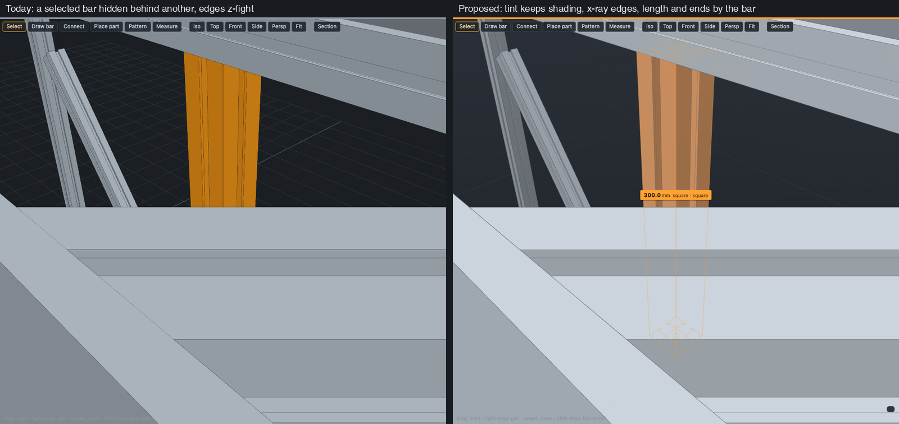

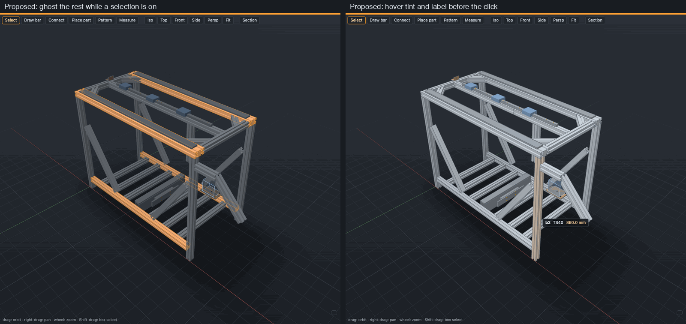

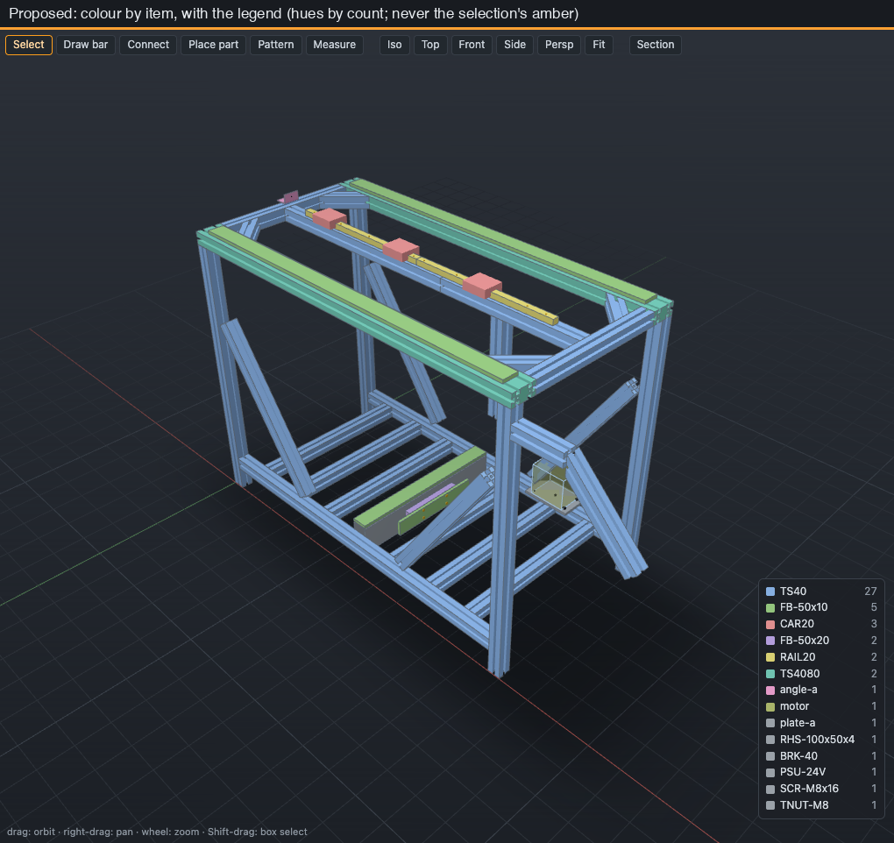

### 5.4 Effects that cost a pass

| Effect | When | Budget |
|---|---|---|
| Screen-space outlines (depth and normal discontinuities) | orthographic views always; perspective as a setting | one full-screen pass over a normal-and-depth target; on demand, so only when the frame changes |
| Ambient occlusion (GTAO, or N8AO at half resolution) | perspective, on a real GPU, only once the camera settles (drop it while orbiting) | off in snapshot mode and on SwiftShader; it is noisy and not byte-stable |
| Contact shadow | once per revision, reused until the model changes | one render from below plus two blur passes per revision |

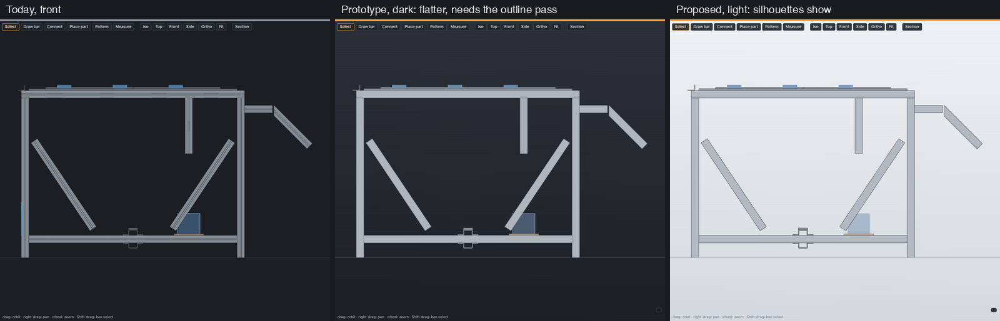

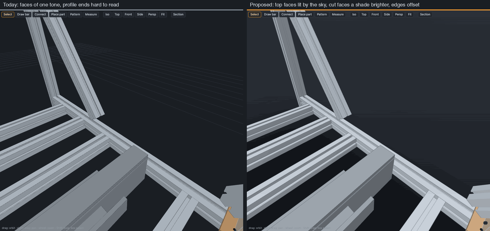

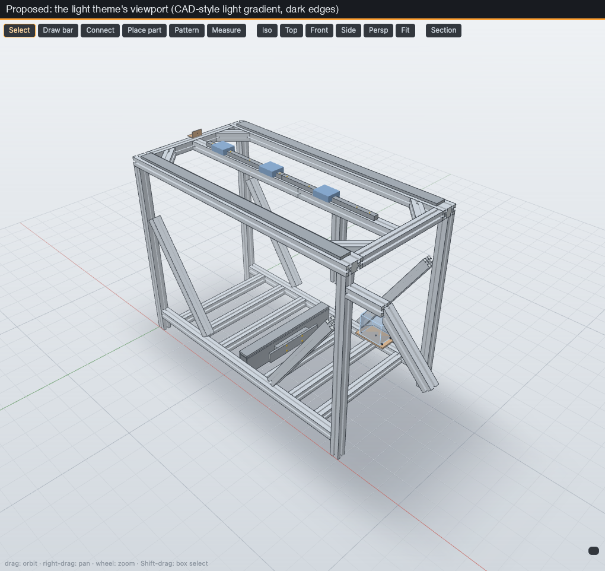

## 6. Tables

### 6.1 Every table

- **One column grid per tab**, set with `table-layout: fixed` and a shared `colgroup`, so a
  column sits at the same x in every group and every supplier.
- **Heads**: sticky, `bg-raised`, 12/16 500 `text-2`, sentence case, the unit after a comma.
- **Rows**: heights per §4.3; cells pad 0 12 px; hairlines in `line` at 55 %; no zebra.
- **Hover** a row: `rgb(255 255 255 / 0.04)` wash, and its entities light in the 3D view.
  **Selected**: `sel` wash at 13 % with a 2 px amber inset on the left; the selected entity's chip
  filled amber.
- **Entities as chips** (12 px 500 on `bg-raised`, 3 px radius): at most four, then a `+N` chip
  that expands the cell. A chip selects on click and hover-highlights in 3D.
- **Item cells**: swatch (10 px square in the item colour) + code in 500 + name in `text-2`; the
  vendor prefix (`test:`) only in the tooltip when the code is unique in the project.
- **Long text** never wraps a row into a paragraph: one line with an ellipsis, the whole text in
  an expanding row below.
- **Stale answers** (Order, Costs, Machining waiting on a new revision) keep the old table at 55 %
  opacity, as today, and add a 2 px `act` progress line under the tab rail while the new answer
  is on its way.
- **The lock stamp** moves off every tab into the revision popover; the drawer's tab rail shows
  `Revision 0, unsaved` at its right end.

### 6.2 Tabs

The tab rail carries a figure or status for each tab, so the drawer can be read closed: `Cut list
47 pieces`, `BOM 24 lines`, `Order` with the octagon and `6 to resolve`, `Costs 6 155 BRL`,
`Checks` with the tick and `pass` (or the error count with the octagon). The active tab is a white
underline and `text-1`, not amber.

**Cut list.** Groups sorted by pieces, most first, so the frame's main profile leads (today they
follow the item id). Group head: swatch, code at 15/20 600, name and options in `text-2`, then
labelled stats on the right (`Pieces 27`, `Total 14 433.61 mm`, `Supply cut to order by test-vendor`)
instead of a middle-dotted string. Columns: Qty (`4 ×`), Cut length (the 15/20 600 figure; centre
length or ordered length on a second 11/12 line in `text-3` when it differs), Ends (a 64 × 14 px
pictogram of the piece with each end drawn as cut: square, mitre slanted in plan, bevel dashed;
angled ends drawn heavier in `text-1`, never in amber, then the words), Machining (one pill per
operation kind with its count: `4 × Ø11  face −y, at 100 and 200 from a`,
`tap M8 × 20 deep  in end a`; pictogram dots for holes), Bars (chips). A group cut from stock gets a **cutting diagram** under
its rows: the stock bar to scale, each piece a segment in the item's colour, kerf as a gap, the
offcut hatched, `used 3 382, offcut 2 618 mm` beside it (the data is already in
`cutlist.groups[].stock[].pieces`).

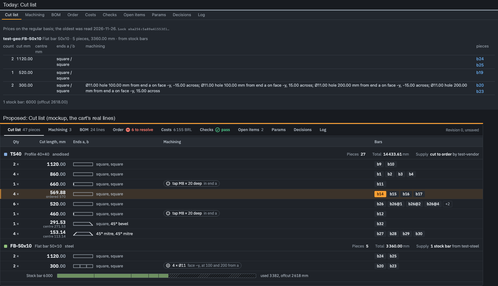

**Order.** A verdict strip first: a status block (`Not ready to order` with the octagon, or `Ready
to order` with the tick) on its wash, a sentence counting what blocks it (`4 of 7 suppliers are
blocked by 6 things to resolve. 3 suppliers are ready.`), the order lines' likely total at
24/28 with its range, and the date. Then one card per supplier, blocked first: a 3 px left rule in
the status colour, name 15/20 600, status glyph and words (`Blocked, 2 to resolve`), total and
range whisker. A blocked card opens on its **to-resolve list**: glyph, the rule in plain words
(`Open item O2`, `No price`, `Estimated price`), the message as a sentence, and the action that
fixes it on the right (`Open O2`, `Add a price`, `Add the quoted price`). Warnings on a READY card
show as one line under its head. READY cards fold to their head; lines open on click. Columns:
swatch, Item, Supplied as (`cut to 860 mm, SKU TS40-c7`), Quantity, Unit price, Likely, Price
source (`quoted 26 Nov`, or the warn triangle and `estimate`), For (chips).

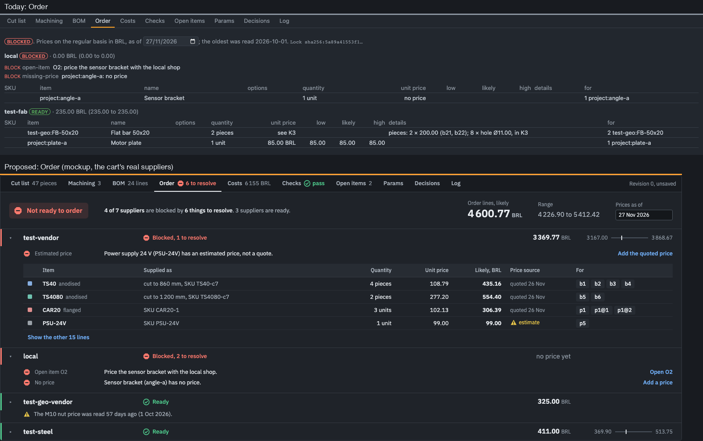

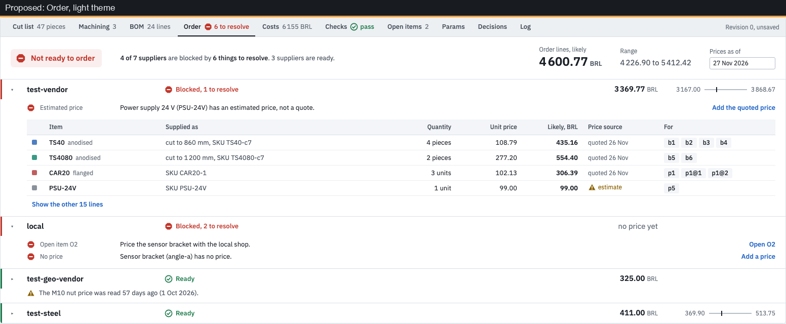

**BOM.** Kind groups with their mass at 15/20; columns swatch, Item, Options, Qty, Length mm,
Mass kg (3 decimals, an `estimate` triangle where the mass is estimated), Used by (chips, `+N`).
The total mass moves into the tab rail and the no-selection summary.

**Costs.** Cost lines in the shared grid; the totals table right-aligned under it at 15/20 with
the total row at 18/24; the provenance share as a two-segment bar (`src` 68.26 %, `est` 31.74 %)
rather than a sentence.

**Checks.** Diagnostics grouped by severity with the four glyphs; a check row gives its margin as
a number and a small bar against its limit. **Machining** follows the cut list's pills and
pictograms; the hole table keeps its columns, right-aligned, in the shared grid.

### 6.3 Empty, idle and loading

- **All checks pass**: the tick at 28 px, `Every check passes`, and what was checked
  (`39 bars, 10 parts and 33 connections derive without an error or a warning at revision 0.`),
  with `Add a check`.
- **Nothing selected**: the properties column shows the project, not an instruction alone: bars,
  parts, mass, the likely cost with labour at 18/24, and the order's status with its glyph.
- **Nothing to cut**: `Nothing to cut yet. Draw a bar, or set a profile from the catalog as the
  palette.` with `Draw a bar  B` (primary) and `Open the catalog`.
- **Pricing**: three skeleton lines in the table's shape and `pricing revision 4`, instead of
  `Pricing the order…`.

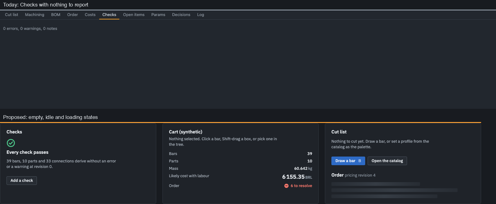

## 7. Ranked changes

Impact is for readability and for how fast an engineer finds what needs fixing; effort S is under
a day, M a few days, L a week or more.

| # | Change | Impact | Effort | Section |
|---|---|---|---|---|
| R1 | Selection that cannot hide: tint keeping shading, x-ray edges, polygon offset on every body (also ends the dashed edges) | High | S | 5.3 |
| R2 | Hover highlight and label in the viewport; table rows and chips hover-highlight in 3D | High | S | 5.3, 6.1 |
| R3 | Lighting: hemisphere plus camera-riding key, low ambient; depth fog; gradient background | High | S | 5.1 |
| R4 | Edges split into outline and detail, detail fading with zoom in perspective; flat-face-end silhouettes; edge colour by body lightness (black profiles visible) | High | M | 5.2 |
| R5 | Order presentation: verdict strip, blocked-first supplier cards, to-resolve list with actions, READY folded, likely + whisker | High | M | 6.2 |
| R6 | Table system: fixed shared column grids, number alignment and grouping, dimmed `.00`, units in heads, chips, no wrapping rows | High | M | 6.1, 4.4 |
| R7 | Colour by item (and supplier, status) with a clickable legend; the same swatches in tree, cut list, BOM and order | High | M | 5.3, 4.1 |
| R8 | Tokens, Plex fonts, type scale, one meaning per colour, statuses as glyph + word + colour | High | M | 4 |
| R9 | Cut list: end pictograms, machining pills, the stock cutting diagram | Medium-high | M | 6.2 |
| R10 | Ground sized to the model, faded, with axis lines, footprint or contact shadow; axes gizmo | Medium | S (grid, axes), M (shadow, gizmo) | 5.1 |
| R11 | Ghost / isolate the rest while a selection is on | Medium | S | 5.3 |
| R12 | Tab rail with counts and statuses; empty, idle and loading states; project summary when nothing is selected | Medium | S | 6.2, 6.3 |
| R13 | Screen-space outline pass for orthographic views; AO on settle on real GPUs | Medium | L | 5.4 |
| R14 | Section caps with hatch | Medium | M | 5.3 |
| R15 | Tool icons in three groups, one row at 1280 px; shape-coded snap markers; cyan tool preview | Medium | S to M | 4.5, 5.3 |
| R16 | Light theme for the whole app (viewport included) | Medium | M | 4.1, 5.1 |

Order of work: R1 to R3 first (a day or two together, the largest gain per hour, and they need no
new dependency), then R8 (the tokens the rest uses), then R6 and R5, then R4 and R7.

## 8. The prototype, and what it found

The throwaway copy changed `scene.ts` and added a small look module: the lights, fog, gradient,
model-sized grid and footprint shadow, cap materials, polygon offset, the two edge buffers and
their zoom ramp, selection x-ray, hover and its label, the length label, ghosting, colour by item
with the legend, and a light theme. Each 3D "proposed" image is that copy rendering the cart on
SwiftShader (**measured**). Found on the way:

- **Rounded profiles have no silhouette lines** in today's edge set (§2.1, 2): the edges along a
  bar come from the slot lips. Adding a line where each flat face ends fixed it in perspective
  views (**measured**).
- **A dark silhouette line on a dark background is invisible**: in the dark orthographic front
  view the outline lines fall on the background side. A mid-tone edge helps a little; the light
  theme shows them plainly; the screen-space outline pass is the real fix (**measured**:
  `03-ortho-front.png`). The prototype faded the slot lips in ortho too, which made its dark
  ortho view flatter than today's; hence the rule in §5.2 that ortho keeps them until R13.
- **`angledGeometry` drops the unit geometry's groups** (`src/mesh/bars.ts` builds a new
  `BufferGeometry` from positions and index only), so a multi-material bar draws nothing until the
  groups are copied (**measured** in the prototype; harmless today with one material).
- **Colour by item**: hue by count made TS4080 (2 bars) teal against TS40's (27) blue; a first
  try that assigned hues in scene order gave TS4080 a sand hue near the selection amber, hence
  the rule that the item palette avoids amber.
- Not verified: frame rates on a real GPU, the outline pass, AO, stencil caps, the contact shadow
  and the gizmo (not prototyped); the hover raycast's cost at 1 000 bars.

## 9. Files

- `img/visual/drawer-mockup.html`: cut list, order and states mockup (`?theme=light` for light).
- `img/visual/tokens-mockup.html`: the token sheet and the tool bar.
- `img/visual/01` to `12`: the renders and mockups shown above.
